# NovaFlow ERP — الدليل الكامل للنظام وموديولاته

> **ملف مُولَّد آلياً** من `docs/verticals.md` + `docs/relationships.md` — لا تُحرِّره يدوياً.
> للإصلاح أو الإضافة عدّل المصدرين ثم نفّذ: `npm run docs:guide`.
>
> **محتوى هذا الملف**: 5 موديولات · 76 مجموعة بيانات · 132 علاقة مُشتقة من الكود · 11 فجوة موثّقة.
> **تاريخ التوليد**: 2026-11-07

---

## الفهرس العام

### الجزء الأول: الموديولات: الاستشارات · المقاولات · D&B · الموارد البشرية · اللب المشترك

  - [١. الحقيقة الأولى: النظام لا ينفصل بالكود، بل بالبيانات](#١-الحقيقة-الأولى-النظام-لا-ينفصل-بالكود-بل-بالبيانات)
  - [٢. خريطة التوزيع (76 مجموعة × 5 موديولات)](#٢-خريطة-التوزيع-76-مجموعة-5-موديولات)
    - [٢.١ مصفوفة العضوية (✓ = تُستخدم داخل الموديول، ● = حصرية له)](#٢١-مصفوفة-العضوية-تستخدم-داخل-الموديول-حصرية-له)
  - [٣. موديول الاستشارات الهندسية consulting](#٣-موديول-الاستشارات-الهندسية-consulting)
    - [٣.١ رحلة العمل كما ينفذها الكود](#٣١-رحلة-العمل-كما-ينفذها-الكود)
    - [٣.٢ الكيانات التي يعيش فيها الموديول](#٣٢-الكيانات-التي-يعيش-فيها-الموديول)
    - [٣.٣ ما الذي لا يفعله موديول الاستشارات](#٣٣-ما-الذي-لا-يفعله-موديول-الاستشارات)
  - [٤. موديول المقاولات والإنشاءات construction](#٤-موديول-المقاولات-والإنشاءات-construction)
    - [٤.١ رحلة العمل كما ينفذها الكود](#٤١-رحلة-العمل-كما-ينفذها-الكود)
    - [٤.٢ الكيانات التي يعيش فيها الموديول](#٤٢-الكيانات-التي-يعيش-فيها-الموديول)
    - [٤.٣ الفرق البنيوي عن الاستشارات (وليس مجرد مسميات)](#٤٣-الفرق-البنيوي-عن-الاستشارات-وليس-مجرد-مسميات)
  - [٥. موديول التصميم والتنفيذ hybrid (D&B) — الجسر](#٥-موديول-التصميم-والتنفيذ-hybrid-db-الجسر)
  - [٦. موديول الموارد البشرية hr — عمود خدمي، لا جزيرة](#٦-موديول-الموارد-البشرية-hr-عمود-خدمي-لا-جزيرة)
  - [٧. اللب المشترك core — ما لا يملكه أي موديول](#٧-اللب-المشترك-core-ما-لا-يملكه-أي-موديول)
  - [٨. التقاطعات: العلاقات التي تعبر بين الموديولات](#٨-التقاطعات-العلاقات-التي-تعبر-بين-الموديولات)
  - [٩. التقسيم المقترح (تنفيذ على 3 مراحل، بلا كسر للتوافق)](#٩-التقسيم-المقترح-تنفيذ-على-3-مراحل-بلا-كسر-للتوافق)
    - [المرحلة 1 — وسم البيانات (قراءة فقط، لا سلوك)](#المرحلة-1-وسم-البيانات-قراءة-فقط-لا-سلوك)
    - [المرحلة 2 — مرجع واحد للفصل](#المرحلة-2-مرجع-واحد-للفصل)
    - [المرحلة 3 — فصل الوصول (اختياري، أقوى الأثر)](#المرحلة-3-فصل-الوصول-اختياري-أقوى-الأثر)
  - [١٠. قرار معماري مفتوح: هل «المشروع» كيان مستقل؟](#١٠-قرار-معماري-مفتوح-هل-المشروع-كيان-مستقل)
  - [١١. ماذا يجب أن تتذكر عندما تعدّل](#١١-ماذا-يجب-أن-تتذكر-عندما-تعدل)

### الجزء الثاني: خريطة العلاقات المرجعية: المجموعات، المفاتيح الأجنبية، خطوط الأنابيب، الفجوات

  - [0. الخلاصة في عشرة أسطر](#0-الخلاصة-في-عشرة-أسطر)
  - [1. الطبقة الصفرية: الهوية والتأجير](#1-الطبقة-الصفرية-الهوية-والتأجير)
    - [1.1 جدول المجموعات الكامل (76 مجموعة)](#11-جدول-المجموعات-الكامل-76-مجموعة)
    - [1.2 التقسيم الرأسي: استشارات / مقاولات / D&B / HR / لب مشترك](#12-التقسيم-الرأسي-استشارات-مقاولات-db-hr-لب-مشترك)
  - [2. المخططات المفاهيمية (ER) لكل نطاق](#2-المخططات-المفاهيمية-er-لكل-نطاق)
    - [2.1 المرجعيات والكتالوج الهندسي — أبجدية النظام](#21-المرجعيات-والكتالوج-الهندسي-أبجدية-النظام)
    - [2.2 المبيعات والوثائق التجارية](#22-المبيعات-والوثائق-التجارية)
    - [2.3 المقايسات والتنفيذ الميداني — قلب النظام الهندسي](#23-المقايسات-والتنفيذ-الميداني-قلب-النظام-الهندسي)
    - [2.4 المشتريات والمخازن والأصول](#24-المشتريات-والمخازن-والأصول)
    - [2.5 الموارد البشرية — سلسلة الامتثال لقانون العمل الكويتي](#25-الموارد-البشرية-سلسلة-الامتثال-لقانون-العمل-الكويتي)
    - [2.6 المحاسبة والفوترة والأبعاد التحليلية](#26-المحاسبة-والفوترة-والأبعاد-التحليلية)
    - [2.7 الصلاحيات: كيف ترتبط الأرقام بالبيانات](#27-الصلاحيات-كيف-ترتبط-الأرقام-بالبيانات)
  - [3. خطوط الأنابيب: من الحدث التشغيلي إلى القيد المالي](#3-خطوط-الأنابيب-من-الحدث-التشغيلي-إلى-القيد-المالي)
    - [3.1 provisioning — تأسيس المنشأة (Provisioning)](#31-provisioning-تأسيس-المنشأة-provisioning)
    - [3.2 sales-to-delivery — من فرصة إلى معاملة](#32-sales-to-delivery-من-فرصة-إلى-معاملة)
    - [3.3 quote-to-contract — عرض السعر ← عقد ← مقايسة](#33-quote-to-contract-عرض-السعر-عقد-مقايسة)
    - [3.4 field-execution — التنفيذ الميداني وتجميع الكميات](#34-field-execution-التنفيذ-الميداني-وتجميع-الكميات)
    - [3.5 auto-billing — الأتمتة المالية: مرحلة → مطالبة](#35-auto-billing-الأتمتة-المالية-مرحلة-مطالبة)
    - [3.6 cost-recovery — ترحيل التكاليف (WIP)](#36-cost-recovery-ترحيل-التكاليف-wip)
    - [3.7 procurement-loop — دورة المشتريات والمخزون](#37-procurement-loop-دورة-المشتريات-والمخزون)
    - [3.8 hr-to-finance — المسار البشري ← المالي](#38-hr-to-finance-المسار-البشري-المالي)
    - [3.9 subcontractor-loop — دورة مقاول الباطن](#39-subcontractor-loop-دورة-مقاول-الباطن)
    - [3.10 variations — الأوامر التغييرية (VO)](#310-variations-الأوامر-التغييرية-vo)
  - [4. جدول المفاتيح الأجنبية الكامل (132 علاقة)](#4-جدول-المفاتيح-الأجنبية-الكامل-132-علاقة)
    - [4.1 علاقات دلالية لا تراها الأنواع (triggers / counters / auto / denorm)](#41-علاقات-دلالية-لا-تراها-الأنواع-triggers-counters-auto-denorm)
    - [4.2 مولّدات الأرقام (counters)](#42-مولدات-الأرقام-counters)
  - [5. اتفاقيات النظام — اقرأها قبل أن تكتب أي استعلام](#5-اتفاقيات-النظام-اقرأها-قبل-أن-تكتب-أي-استعلام)
  - [6. مصفوفة الملكية: مَن يقرأ ومَن يكتب](#6-مصفوفة-الملكية-من-يقرأ-ومن-يكتب)
    - [6.1 خريطة الواجهات: أي شاشة تقرأ أي مجموعة](#61-خريطة-الواجهات-أي-شاشة-تقرأ-أي-مجموعة)
    - [6.2 عدادات الاستخدام (من docs/relations.generated.json)](#62-عدادات-الاستخدام-من-docsrelationsgeneratedjson)
  - [7. الفجوات والمخاطر (مرقّمة ومطابقة للسجل)](#7-الفجوات-والمخاطر-مرقمة-ومطابقة-للسجل)
    - [7.1 أولويات التنفيذ (خطة بالترتيب)](#71-أولويات-التنفيذ-خطة-بالترتيب)
  - [8. الحوكمة: كيف تبقى العلاقات واضحة دائماً](#8-الحوكمة-كيف-تبقى-العلاقات-واضحة-دائما)
  - [9. انطلاقة سريعة للمبرمج الجديد](#9-انطلاقة-سريعة-للمبرمج-الجديد)

### ملحق تشغيلي: دليل النقل: الخروج الآمن من منصة مغلقة (بيانات، مستخدمون، فهارس، استضافة)

  - [0. حدّد أولاً: ما الذي سيموت بالضبط؟ (3 طبقات منفصلة)](#0-حدد-أولا-ما-الذي-سيموت-بالضبط-3-طبقات-منفصلة)
  - [1. الخطوة صفر — اعملها الليلة (قبل أي قرار، ~45 دقيقة)](#1-الخطوة-صفر-اعملها-الليلة-قبل-أي-قرار-45-دقيقة)
  - [2. قرار الوجهة — المقارنة الصادقة](#2-قرار-الوجهة-المقارنة-الصادقة)
    - [سببان حاسمان للبقاء على Firebase الآن](#سببان-حاسمان-للبقاء-على-firebase-الآن)
  - [3. خطة النقل (الخيار A) — 7 مراحل، كل واحدة قابلة للتحقق](#3-خطة-النقل-الخيار-a-7-مراحل-كل-واحدة-قابلة-للتحقق)
    - [المرحلة 1 · مشروع Firebase جديد (15 دقيقة)](#المرحلة-1-مشروع-firebase-جديد-15-دقيقة)
    - [المرحلة 2 · ربط المستودع بالمشروع الجديد](#المرحلة-2-ربط-المستودع-بالمشروع-الجديد)
    - [المرحلة 3 · الفهارس والقواعد أولاً (قبل البيانات)](#المرحلة-3-الفهارس-والقواعد-أولا-قبل-البيانات)
    - [المرحلة 4 · البيانات](#المرحلة-4-البيانات)
    - [المرحلة 5 · المستخدمون](#المرحلة-5-المستخدمون)
    - [المرحلة 6 · الاستضافة والأمام](#المرحلة-6-الاستضافة-والأمام)
    - [المرحلة 7 · بيئة التطوير والوكلاء (نفسها)](#المرحلة-7-بيئة-التطوير-والوكلاء-نفسها)
  - [4. قائمة تحقق «تم النقل فعلاً» (لا تنتقل قبل إكمالها)](#4-قائمة-تحقق-تم-النقل-فعلا-لا-تنتقل-قبل-إكمالها)
  - [5. ثغرة يجب إغلاقها **أثناء** النقل (سطران، وحان وقتها)](#5-ثغرة-يجب-إغلاقها-أثناء-النقل-سطران-وحان-وقتها)
  - [6. إن اخترت B (Postgres/Supabase) — المسار الأقصر](#6-إن-اخترت-b-postgressupabase-المسار-الأقصر)
  - [7. جدول زمني حتى مارس (~17 أسبوعاً)](#7-جدول-زمني-حتى-مارس-17-أسبوعا)
  - [8. إن صارت المنصة read-only أو اختفت قبل أن تكمل](#8-إن-صارت-المنصة-read-only-أو-اختفت-قبل-أن-تكمل)
  - [9. قرارات تحتاجها مني / منك](#9-قرارات-تحتاجها-مني-منك)

---

# القراءة السريعة: 12 سطرًا تختصر النظام كله

1. كل شيء تحت **مستأجر واحد**: `companies/{companyId}/…`، والعزل تفرضه `firestore.rules` عبر `belongsToCompany()`.
2. **الهوية عالمية والصلاحية محلية**: `global_users/{uid}` → `companyId` + `roleId` + `employeeId` + `departmentId`، ومرآة في `companies/{c}/users/{uid}`.
3. **لا توجد مجموعة مشاريع**: «المشروع» = معاملة (`transactions`) مصفّاة نصياً، وكل `projectId` يحمل `transactionId` فعلياً.
4. **المعاملة هي محور كل رابط**: الوثائق، المقايسات، المراحل، التنفيذ، الفوترة، التكاليف، المواعيد، الزيارات — كلها `transactionId` واحد.
5. **الشجرة الفنية تُنشئ والنسخة تُنفَّذ**: `technicalStages` (قالب) ← `transactionStages` (نسخة قابلة للتعديل والحقن).
6. **القاموس الموحد**: `boqReferenceNodes` مصدر كود/وصف/وحدة/سعر/مرحلة لكل بنود الأعمال.
7. **التنفيذ عدّادات**: `executions` تزيد `boqItems.executedQuantity` و`stageInstances.currentCount`؛ والـ VO يضيف `approvedVariationQty` ولا يمسّ الأصل.
8. **المال يُولَّد من الحدث**: إتمام مرحلة ← `milestone → due` ← `ipcs` ← `vouchers` ← `journalEntries`؛ والزيارة ← قيد WIP؛ والمسير ← قيد رواتب.
9. **أبعاد حتمية المعرّف**: `cc_{transactionId}` و`pc_{transactionId}` وحساب WIP بـ `referenceId=transactionId` — تكرار آمن للأتمتة.
10. **كل مرجع مُجمَّد لحظة الكتابة**: `xxxName` مرآة، و`hourlyCostRef → actualCost` نسخة سعر اللحظة.
11. **الموديولات رأسية بالبيانات لا بالكود**: `activityType` + `pricingMode` + `measurementMode` + `isTimed/isNumeric` + profile ساعات العمل.
12. **الفصل الحالي نصي وهشّ**: 5 مواضع مطابقة نصية (وثّقت كـ G11)، وأخطر ما كشفه الفحص: G1 (تحليل انحراف المواد معطّل) وG8 (عقد بلا معاملة لا يُفوتر بصمت).

---

# الجزء الأول: الموديولات: الاستشارات · المقاولات · D&B · الموارد البشرية · اللب المشترك

> **السؤال الذي تجيبه هذه الوثيقة**: كيف ينفصل «التصميم والاستشارات» عن «المقاولات» عن «الموارد البشرية»، وما الذي يشتركون فيه، وما هي العلاقات التي تعبر بين هذه العوالم الثلاثة؟
>
> للرجوع التفصيلي إلى كل حقل وكل رابط: [`docs/relationships.md`](relationships.md) — وللتحقق الآلي: `npm run check:relations`.

---

### ١. الحقيقة الأولى: النظام لا ينفصل بالكود، بل بالبيانات

لا يوجد في قاعدة البيانات أي حقل اسمه `vertical` أو `moduleType`. الفصل يُشتق لحظة القراءة من **خمسة مفاتيح بيانات**:

| # | المفتاح | أين يسكن | القيم | ماذا يقرّر |
| :-- | :--- | :--- | :--- | :--- |
| 1 | `activityTypeId` + كود النوع | `transactions` / القوالب | `CONSULTING` · `CONSTRUCTION` · `DESIGN_BUILD` (من `src/lib/seed-data.ts`) | أي شجرة مراحل وأي قوالب وأي رحلة عمل |
| 2 | `pricingMode` | `quotations` / `contracts` | `percentage` · `fixed` · `itemized` | نسبة مئوية على مبلغ كلي (استشارات) مقابل بنود مبلغة (مقاولات) |
| 3 | `measurementMode` | `boqs` / `boqTemplates` | `lumpsum` · `quantity` · `hybrid` | هل يوجد جدول كميات أصلاً |
| 4 | `isTimed` / `isNumeric` + `allowedDepartmentIds` | `technicalStages` / `transactionStages` | زمن بالأيام مقابل مستهدف كمّي | كيف يُقاس إنجاز المرحلة ومتى تُغلق |
| 5 | `general` / `architectural` / `fieldWork` / `meetingRooms` | `settings/work_hours` | 4 جداول زمنية في مستند واحد | أي «ساعة عمل» تُطبّق على أي موظف |

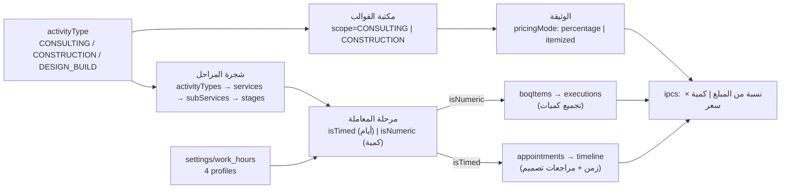

**خلاصة عملية**: الموديولات الثلاثة ليست تطبيقات منفصلة، بل **ثلاث ركوب مختلفة على نفس المحركات** — المحرك نفسه (`transactions` + `stageInstances` + `contracts.milestones` + `journalEntries`) يتصرّف كـ«أتعاب استشارية» أو «مقايسة تنفيذ» حسب المفاتيح الخمسة.

---

### ٢. خريطة التوزيع (76 مجموعة × 5 موديولات)

| الموديول | id | مجموعات تخصه | منها حصري له |
| :--- | :--- | ---: | ---: |
| الاستشارات الهندسية والتصميم | `consulting` | 26 | 0 |
| المقاولات والإنشاءات | `construction` | 48 | 8 |
| تصميم وإنشاء (Design & Build) | `hybrid` | 27 | 0 |
| الموارد البشرية والامتثال | `hr` | 14 | 7 |
| اللب المشترك (Shared Core) | `core` | 43 | 16 |

#### ٢.١ مصفوفة العضوية (✓ = تُستخدم داخل الموديول، ● = حصرية له)

| المجموعة | استشارات | مقاولات | D&B | HR | اللب المشترك | الغرض المختصر |
| :--- | :---: | :---: | :---: | :---: | :---: | :--- |
| `company` |  |  |  |  | ● | جذر المستأجر: كل مجموعة داخل companies/{companyId} مملوكة له · `companies/{companyId}` |
| `company_requests` |  |  |  |  | ● | طابور طلبات التأسيس خارج نطاق المستأجر؛ يفعّله المطور فينشئ companies + roles + departments + jobs + employees + global_users · `company_requests/{requestId}` |
| `counters` |  |  |  |  | ● | مولّد الأرقام التسلسلية الآمن (JV-/RV-/PV-/PO-/BOQ-/IPC-/C-...) · `companies/{companyId}/counters/{counterKey}` |
| `globalUser` |  |  |  |  | ● | الهوية العالمية الوحيدة لكل مستخدم: uid → companyId + roleId + employeeId + departmentId + roleCode · `global_users/{uid}` |
| `invitations` |  |  |  |  | ● | دعوة للانضمام داخل المنشأة؛ تُقبل عبر /join/{companyId}/{inviteId} وتكتب global_users + companies/{c}/users · `companies/{companyId}/invitations` |
| `users` |  |  |  |  | ● | مرآة العضوية المحلية داخل المنشأة؛ تُكتب مع global_users في batch واحد — غير معلنة في multi-tenant.ts · `companies/{companyId}/users/{uid}` |
| `areas` |  |  |  |  | ● | مناطق داخل المحافظة: governorateId + مسار Firestore فرعي · `companies/{companyId}/governorates/{govId}/areas` |
| `costTypeCategories` |  |  |  |  | ● | معرّفة في paths فقط — لا استخدام لها حالياً · `companies/{companyId}/costTypeCategories` |
| `customReferenceItems` |  |  |  |  | ● | عناصر القوائم المخصصة؛ تُحلّ نفس نوع القوائم القياسية في ReferenceListService · `companies/{companyId}/customReferenceLists/{code}/items/{itemId}` |
| `customReferenceLists` |  |  |  |  | ● | تعريفات القوائم المرجعية المخصصة (نظام مفتوح للتوسّع) · `companies/{companyId}/customReferenceLists/{code}` |
| `departments` |  |  |  | ✓ | ✓ | أقسام المنشأة؛ مصدر scope='dept' في محرك الصلاحيات · `companies/{companyId}/departments` |
| `governorates` |  |  |  |  | ● | محافظات الكويت المرجعية (جذر شجرة الموقع) · `companies/{companyId}/governorates` |
| `itemCategories` |  | ✓ |  |  | ✓ | معرّفة في paths فقط — تُستخدم كمرجع allowedItemCategoryIds في بنود BOQ · `companies/{companyId}/itemCategories` |
| `jobs` |  |  |  | ✓ | ✓ | المسميات الوظيفية داخل القسم، تحمل roleId + hourlyCost (مرجع التكلفة) · `companies/{companyId}/departments/{deptId}/jobs` |
| `meetingRooms` | ✓ |  |  |  | ✓ | قاعات/صالة المكتب — تُستخدم كـ hallId في المواعيد وكمصدر جدول مواعيد العمل meetingRooms · `companies/{companyId}/meetingRooms` |
| `milestoneTimingTypes` |  |  |  |  | ● | معرّفة في paths فقط — التوقيت فعلياً enum MilestoneTiming في types/templates.ts · `companies/{companyId}/milestoneTimingTypes` |
| `paymentConditionTypes` | ✓ |  |  |  | ✓ | معرّفة في paths فقط — لا يوجد لها استخدام بعد (انظر gaps) · `companies/{companyId}/paymentConditionTypes` |
| `paymentMethods` |  |  |  |  | ● | قائمة طرق الدفع المرجعية؛ يُشار إليها بالكود لا بالمعرّف · `companies/{companyId}/paymentMethods` |
| `roles` |  |  |  |  | ● | مصفوفة الصلاحيات matrix[{resourceId,action,scope}] — تحكم الوصول داخل المنشأة؛ roleCode يُطابق القواعد الأمنية · `companies/{companyId}/roles` |
| `serviceTypes` |  |  |  |  | ● | تصنيف الخدمات العام (moduleScope) — مستقل عن شجرة activityTypes · `companies/{companyId}/serviceTypes` |
| `settings` | ✓ | ✓ |  | ✓ | ✓ | مستند إعدادات ساعات العمل/رمضان/العطل · `companies/{companyId}/settings/work_hours` |
| `unitTypes` |  | ✓ |  |  | ✓ | وحدات القياس (m²، يوم، عدد) referenced by BOQ nodes · `companies/{companyId}/unitTypes` |
| `activityTypes` | ✓ | ✓ | ✓ |  | ✓ | جذر الشجرة الوظيفية: نوع النشاط (عزل، مقاولات، تصميم...) · `companies/{companyId}/activityTypes` |
| `services` | ✓ | ✓ | ✓ |  | ✓ | خدمة داخل نوع النشاط — مجموعة فرعية Firestore تحت activityTypes/{actId}/services · `companies/{companyId}/activityTypes/{actId}/services` |
| `subServices` | ✓ | ✓ | ✓ |  | ✓ | خدمة فرعية: المستوى الذي تُربط به القوالب والمراحل · `companies/{companyId}/activityTypes/{actId}/services/{srvId}/subServices` |
| `technicalStages` | ✓ | ✓ | ✓ |  | ✓ | قالب المرحلة الفنية: isNumeric/numericTarget، isTimed/timeTargetDays، nextStageIds (DAG)، billableTrigger + milestoneKey للفوترة · `companies/{companyId}/activityTypes/{actId}/services/{srvId}/subServices/{subId}/stages` |
| `clientHistory` | ✓ | ✓ |  |  | ✓ | سجل تدقيق لكل عميل (تغيير حالة/ملاحظة/إسناد مهندس/إنشاء معاملة) كمجموعة فرعية تحت العميل · `companies/{companyId}/clients/{clientId}/history` |
| `clients` | ✓ | ✓ | ✓ |  | ✓ | ملف العميل الموحد برقم سيادي C-0001/YYYY عبر counters؛ يحمل المهندس المسؤول + الموقع + القسم · `companies/{companyId}/clients` |
| `leads` |  |  |  |  | ● | فرص المبيعات قبل التحويل إلى عميل (لا يوجد كيان TypeScript بعد) · `companies/{companyId}/leads` |
| `executions` |  | ✓ | ✓ |  |  | سطر تنفيذ مسطّح (وليس subgroup): الكميات + العمالة + المعدات + التكلفة المجمّدة، ويُرجّح به بند المقايسة · `companies/{companyId}/executions` |
| `transactionComments` | ✓ | ✓ |  |  | ✓ | نقاش المعاملة (تعليقات وردود parentCommentId، تثبيت، أرشفة) مرتبط أحياناً بموعد أو مرحلة · `companies/{companyId}/transactions/{tId}/comments` |
| `transactionStages` | ✓ | ✓ | ✓ |  | ✓ | نسخة مراحل المعاملة من القالب الفني؛ تتقدم بالمواعيد والزيارات وتُغلق المراحل لإطلاق الفوترة · `companies/{companyId}/transactions/{tId}/stageInstances` |
| `transactionTimeline` | ✓ | ✓ | ✓ |  | ✓ | شريط الأحداث الموحد لكل معاملة — تكتبه 6 خدمات مختلفة (أتمتة مالية، إنجاز، VO، مراجعات تصميم) · `companies/{companyId}/transactions/{tId}/timeline` |
| `transactions` | ✓ | ✓ | ✓ |  | ✓ | النواة التشغيلية: معاملة العميل (عملياً هي 'المشروع') · `companies/{companyId}/transactions` |
| `contracts` | ✓ | ✓ | ✓ |  | ✓ | العقد الرسمي: milestones مرتبطة بالمراحل الفنية + retentionRate + دفعة مقدمة؛ بوّابة الفوترة والذمم · `companies/{companyId}/contracts` |
| `quotations` | ✓ | ✓ | ✓ |  | ✓ | عرض سعر مُنشأ من قالب؛ يتحول إلى عقد بنفس البنية (items → milestones) · `companies/{companyId}/quotations` |
| `subconContracts` |  | ● |  |  |  | عقد مقاول باطن: نفس منطق الـ milestones لكن بحسابات مستحقات ومحتجزات خاصة بالباطن · `companies/{companyId}/subconContracts` |
| `boqReferenceNodes` | ✓ | ✓ | ✓ |  |  | القاموس الهندسي الموحد (شجرة بنود العمل): المصدر الوحيد لأكواد وأوصاف وأسرار البنود في كل النظام · `companies/{companyId}/boqReferenceNodes` |
| `boqTemplateItems` |  | ✓ | ✓ |  |  | بنود القالب مع shجرة ancestorIds وروابط boqReferenceNodeId/technicalStageId/unitTypeId · `companies/{companyId}/boqTemplates/{templateId}/items` |
| `boqTemplates` | ✓ | ✓ | ✓ |  |  | قالب جدول كميات قابل لإعادة الاستخدام؛ يُستنسخ إلى boqs/{id}/items عند التفعيل · `companies/{companyId}/boqTemplates` |
| `contractTemplates` | ✓ | ✓ |  |  | ✓ | قالب عقد: بنود قانونية + defaultMilestones + retentionRate + boqTemplateId · `companies/{companyId}/contractTemplates` |
| `quotationTemplates` | ✓ | ✓ |  |  | ✓ | قالب عرض سعر مربوط بنشاط/خدمة/خدمة فرعية + boqTemplateId اختياري · `companies/{companyId}/quotationTemplates` |
| `subconContractTemplates` |  | ● |  |  |  | قالب عقد باطن محدد بالتخصص (trade) · `companies/{companyId}/subconContractTemplates` |
| `boqItems` |  | ✓ | ✓ |  |  | بند مقايسة: 6 عدادات كمية (contract/planned/approvedVariation/executed/verified/billed) + رابط مرحلة + رابط باطن · `companies/{companyId}/boqs/{boqId}/items` |
| `boqVariationItems` |  | ✓ | ✓ |  |  | بنود الأمر التغييروي؛ عند الاعتماد تُضاف إلى approvedVariationQty للبند الأصلي · `companies/{companyId}/boqs/{boqId}/variations/{voId}/items` |
| `boqVariations` |  | ✓ | ✓ |  |  | الأمر التغييروي (VO) على المقايسة: draft → approved/rejected، لا يعدّل الأصل بل يضيف · `companies/{companyId}/boqs/{boqId}/variations` |
| `boqs` |  | ✓ | ✓ |  |  | مقايسة المعاملة الفعلية (boqNumber آلي BOQ-YYYY-0001) — حلقة الوصل بين العقد والتنفيذ والفوترة · `companies/{companyId}/boqs` |
| `appointments` | ✓ | ✓ | ✓ |  |  | موعد (عميل/موقع/قاعة/حظر) مربوط بعميل + معاملة + مرحلة + قاعة + مهندس(ين) — يحرّك إتمام المراحل · `companies/{companyId}/appointments` |
| `fieldVisits` |  | ✓ | ✓ |  |  | زيارة ميدانية بشبكة رباعية (موظفون/عمالة/معدات/مواد) + صور + GPS؛ اعتمادها يولّد قيد WIP · `companies/{companyId}/fieldVisits` |
| `workGroups` |  | ✓ | ✓ | ✓ |  | طاقم عمل ميداني: مشرف + أعضاء (employees) + قسم — وحدة الإسناد في الزيارات · `companies/{companyId}/workGroups` |
| `applications` |  |  |  | ● |  | طلبات التوظيف (recruitment pipeline) — لا يوجد لها TypeScript type بعد · `companies/{companyId}/applications` |
| `attendance` |  |  |  | ● |  | سجل بصمة يومي (checkIn/out ×2) محسوب مقابل إعدادات ساعات العمل والراحة والإجازات · `companies/{companyId}/attendance` |
| `employeeAuditLogs` |  |  |  | ● |  | تتبع حقل-بحقل لتغييرات ملف الموظف · `companies/{companyId}/employees/{employeeId}/auditLogs` |
| `employees` |  |  |  | ✓ | ✓ | السجل الموحد للقوى العاملة (داخلي/خارجي): قسم + وظيفة + دور + راتب + رصيد إجازات · `companies/{companyId}/employees` |
| `leaveRequests` |  |  |  | ● |  | طلب إجازة بمراحل (pending→approved→commenced→returned) + سلّم sickness tiers القانوني · `companies/{companyId}/leaveRequests` |
| `payroll` |  |  |  | ● |  | مسير راتب شهري؛ سجلات الموظفين في مجموعة فرعية records تحت نفس المستند · `companies/{companyId}/payroll` |
| `payrollRecords` |  |  |  | ● |  | سجلات راتب الموظف داخل المسير — يولّدها payroll-service بنسخة مجمّدة من بيانات الموظف · `companies/{companyId}/payroll/{batchId}/records/{recordId}` |
| `permissionRequests` |  |  |  | ● |  | طلب إذن تأخير/انصراف مبكر — يُحتسب في تسوية الرواتب · `companies/{companyId}/permissionRequests` |
| `assetAssignments` |  | ✓ |  | ✓ |  | العهدة الفعلية (صرف/استرجاع) للموظف — تعدّل رصيد الصنف في المخزون · `companies/{companyId}/assetAssignments` |
| `equipment` |  | ✓ | ✓ |  |  | سجل الآليات: ملكية/تمويل/تأمين/فحص + أساس الاستهلاك hourlyDepreciationRate المُغذّي لتكلفة الاستخدام · `companies/{companyId}/equipment` |
| `equipmentAssignments` |  | ● |  |  |  | مجموعة معرّفة في paths وغير مستخدمة؛ التوزيع الفعلي يسجَّل في assetAssignments (انظر gaps) · `companies/{companyId}/equipmentAssignments` |
| `inventoryItems` |  | ● |  |  |  | أصناف المخزون برصيد quantity يُزاد/يُنقص آلياً من PO والعهدة · `companies/{companyId}/inventoryItems` |
| `inventoryTransactions` |  | ● |  |  |  | مجموعة حركة مخزون معرّفة في paths ولا تُكتب منها أي موضع — الحركات حالياً ضمن assetAssignments فقط (انظر gaps) · `companies/{companyId}/inventoryTransactions` |
| `warehouses` |  | ● |  |  |  | المستودعات — حاويات منطقية للأصناف · `companies/{companyId}/warehouses` |
| `poItems` |  | ✓ | ✓ |  |  | بنود أمر الشراء: تربط الصنف ببند مقايسة ومرحلة فنية (جوهر مقارنة المشتري بالمنفذ) · `companies/{companyId}/purchaseOrders/{poId}/items` |
| `purchaseOrders` |  | ✓ | ✓ |  |  | أمر شراء PO-YYYY-0001 بحالة تدفق (draft→approved→ordered→received) — أساس الاستلام في المخزن · `companies/{companyId}/purchaseOrders` |
| `subcontractors` |  | ✓ | ✓ |  |  | مقاولو الباطن بالتخصص والتقييم — يظهرون في البنود والمراحل والتنفيذ والـ SIPs · `companies/{companyId}/subcontractors` |
| `suppliers` |  | ● |  |  |  | سجل الموردين المعتمدين (يظهر أيضاً كموردي معدات في equipment.supplierId) · `companies/{companyId}/suppliers` |
| `accounts` | ✓ | ✓ |  |  | ✓ | دليل الحسابات الشجري لكل منشأة؛ حسابات العملاء/WIP تُنشأ آلياً تحت 1202 و1205 · `companies/{companyId}/accounts` |
| `costCenters` | ✓ | ✓ |  |  | ✓ | بُعد تحليلي للتكلفة؛ للمعاملات مراكز حتمية cc_{transactionId} · `companies/{companyId}/costCenters` |
| `costRateCards` |  | ✓ | ✓ | ✓ |  | جدول تعرفة العمالة الساري؛ يغذّي تكلفة الساعة في التنفيذ والزيارات · `companies/{companyId}/costRateCards` |
| `ipcs` | ✓ | ✓ | ✓ |  |  | مستخلص المالك: gross − retention(5%) = netPayable؛ مولّد آلياً من إتمام المراحل · `companies/{companyId}/ipcs` |
| `journalEntries` | ✓ | ✓ |  |  | ✓ | قيد مزدوج متوازن وجوباً؛ مصدر sourceType+sourceId يوثّق أي عملية تشغيلية ولدته · `companies/{companyId}/journalEntries` |
| `profitCenters` | ✓ | ✓ |  |  | ✓ | بُعد تحليلي للربحية؛ pc_{transactionId} لكل معاملة/مشروع · `companies/{companyId}/profitCenters` |
| `subIpcs` |  | ● |  |  |  | مستخلص الباطن بنفس المنطق مع نسبة محتجزات عقد الباطن · `companies/{companyId}/subIpcs` |
| `vouchers` | ✓ | ✓ |  |  | ✓ | سند قبض/صرف مرتبط تلقائياً بقيد محاسبي في نفس الـ batch · `companies/{companyId}/vouchers` |

---

### ٣. موديول الاستشارات الهندسية `consulting`

#### ٣.١ رحلة العمل كما ينفذها الكود

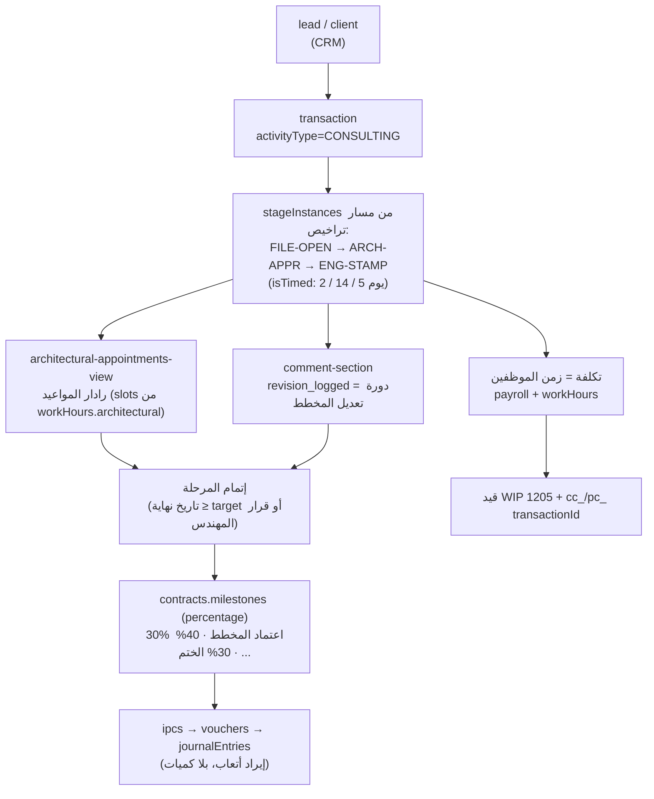

#### ٣.٢ الكيانات التي يعيش فيها الموديول

| المجموعة | الدور داخل موديول الاستشارات |
| :--- | :--- |
| `transactions` | الحاضنة: معاملة «أتعاب تصميم/إشراف/ترخيص». هي نفسها جدول المشاريع لكن بمسار زمني. |
| `transactionStages` | المراحل الزمنية (FILE-OPEN · ARCH-APPR · ENG-STAMP) — الإغلاق بالأقدمية والقرار، لا بالكمية. |
| `technicalStages` | قالب المسار: `isTimed=true` + `timeTargetDays` + `allowedDepartmentIds` (القسم المعماري). |
| `appointments` | رادار المواعيد المعماري: توليد slots من `workHours.architectural` + منع تعارض نفس المهندس. |
| `meetingRooms` | قاعات الاجتماعات مع العميل (`hallId`) — تُستثنى من الرادار بنوع `hall_meeting`. |
| `transactionTimeline` | سجل `revision_logged` = دورة مراجعة المخطط (V1→V2→V2) — عملة التسليم المكتبية. |
| `transactionComments` | نقاش فني مثبّت على المرحلة، ومفلتر بـ `technicalStageId`. |
| `quotations / contracts` | `pricingMode='percentage'` — الدفعات نسب من الأتعاب الإجمالية، وشرطها اعتماد مرحلة فنية. |
| `quotationTemplates / contractTemplates` | قوالب `?scope=CONSULTING` (نصوص قانونية + جدول أتعاب، لا بنود كميات). |
| `boqTemplates / boqReferenceNodes` | اختياري: مقايسة `lumpsum` لخدمات المكتب (بنود مقطوعية لا مقاس). |
| `clients / clientHistory` | حالة العميل + سجل إسناد المهندس المسؤول (`assignedEngineerId`). |
| `ipcs` | مطالبات أتعاب: بدون retention عملياً، وبلا lineItems كمّية. |
| `journalEntries / accounts` | إيراد الاستشارات تحت 4101 + ذمم العميل 1202 (يُنشأ آلياً عند اعتماد العقد). |
| `employees` | المهندس المعماري: وقته هو المورد الإنتاجي؛ `jobTitle` يحمل «معماري» فيُصنَّف للرادار. |
| `settings (work_hours)` | profile `architectural` + `meetingRooms` (slot 30 دقيقة / راحة 5) — يختلف عن العام. |
| `attendance / leaveRequests` | تؤثر على توفر المهندس في الرادار (منع حجز موعد لمهندس في إجازة). |

#### ٣.٣ ما الذي لا يفعله موديول الاستشارات
- **لا** `executions` ولا `boqItems.executedQuantity` — لا يوجد «منفَّذ كمّي»، فالقياس زمني.
- **لا** `purchaseOrders` / `inventoryItems` / `subcontractors` — المكتب لا يشتري مواد ولا يوظّف باطناً (إلا في D&B).
- **لا** `fieldVisits` ولا `workGroups` ولا `equipment` — لا شبكة موارد ميدانية.
- النتيجة: التكلفة تُحسب من الرواتب، والربحية = أتعاب − زمن (تقريبية حالياً، انظر §7).

---

### ٤. موديول المقاولات والإنشاءات `construction`

#### ٤.١ رحلة العمل كما ينفذها الكود

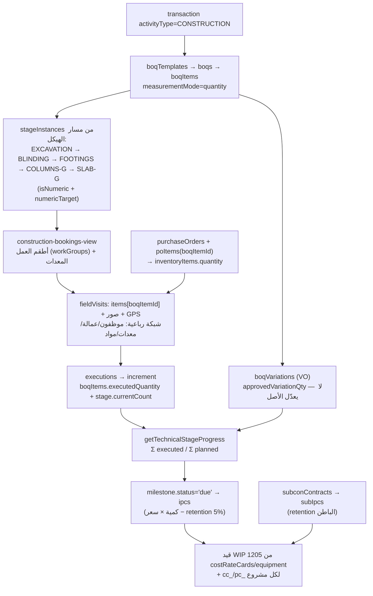

#### ٤.٢ الكيانات التي يعيش فيها الموديول

| المجموعة | الدور في المقاولات | مفتاح الربط الحاسم |
| :--- | :--- | :--- |
| `boqs / boqItems` | جدول الكميات الحي: 6 عدّادات لكل بند (contract / planned / executed / verified / approvedVariation / billed). | `boqItems.transactionId` → المعاملة |
| `boqVariations / boqVariationItems` | الأوامر التغييرويّة: تضيف `approvedVariationQty` وتحقن مراحل جديدة (`originType=temporary_vo`). | `sourceBoqItemId` |
| `executions` | سطر تنفيذ واحد = كمية + عمالة + معدات بتكلفة مجمّدة لحظة التنفيذ. | `boqItemId` + `stageInstanceId` |
| `fieldVisits` | الإثبات الميداني: صور + GPS + شبكة رباعية، واعتمادها المالي يولّد قيد WIP. | `transactionId` + `items[].boqItemId` |
| `transactionStages` | مراحل كمّية: `currentCount` يُرجَّح بـ increment وتُغلق عند بلوغ `numericTarget`. | `technicalStageId` |
| `workGroups` | طاقم العمل: مشرف + أعضاء + قسم — وحدة الإسناد في الزيارة. | `memberIds[]` → employees |
| `costRateCards` | جدول تعرفة العمالة (jobTitle → hourlyCost): المصدر الوحيد لسعر الساعة. | `laborRates[].jobTitle` |
| `equipment / assetAssignments` | سجل الآليات والعهدة: `hourlyDepreciationRate` أو `hourlyRentalRate` يصبح تكلفة استخدام. | `equipmentUsed[].equipmentId` |
| `purchaseOrders / poItems` | أمر الشراء مربوط ببند المقايسة والمرحلة = أساس تحليل انحراف المواد. | `poItems[].boqItemId` |
| `suppliers / subcontractors / subconContracts / subIpcs` | سلسلة الباطن: عقد ← تنفيذ ← مستخلص بمحتجزات خاصة. | `subcontractorId` |
| `warehouses / inventoryItems / inventoryTransactions` | المخزون ورصيده (المجموعة الأخيرة معلَّنة بلا استخدام — G3). | `itemId` |
| `ipcs` | مستخلص المالك: كمية معتمدة × سعر البند − retention (5%) − استرداد دفعة مقدمة. | `contractId` + `lineItems[].boqItemId` |
| `journalEntries / costCenters` | تكلفة مباشرة: WIP مدين / مستحقات دائن، وتحليل على `cc_{transactionId}`. | `referenceId = transactionId` |
| `attendance / payroll` | أجور الموقع اليومية تدخل المسير، والمسير يولّد قيد 2204. | `payrollRecords.employeeId` |

#### ٤.٣ الفرق البنيوي عن الاستشارات (وليس مجرد مسميات)
| البند | الاستشارات | المقاولات |
| :--- | :--- | :--- |
| وحدة القياس | يوم/قطعي (`LS`) | m² · m³ · طن · م.طولي (`unitTypes` من seed) |
| عدّاد الإنجاز | تاريخ + قرار (`isTimed`) | `currentCount ≥ numericTarget` |
| الإيراد | نسبة من أتعاب | كمية × سعر بند |
| التكلفة | رواتب مكتبية | عمالة + معدات + مواد |
| الرقابة | دورات مراجعة المخططات | انحراف مُشترى/منفّذ + محتجزات |
| الوثيقة | `pricingMode=percentage` | `pricingMode=itemized` + `measurementMode=quantity` |
| المخاطر | تأخر اعتمادات بلدية | تجاوز كميات، أوامر تغييروي، هدر مواد |

---

### ٥. موديول التصميم والتنفيذ `hybrid` (D&B) — الجسر

أخطر الموديولات لأنه يجمع المحركين على **معاملة واحدة**: `DB-VILLA-01` يمرّ بمراحل زمنية (`DB-CONCEPT`, `DB-DESIGN`, `DB-PERMIT`) ثم بمراحل كمّية/ميدانية (`DB-STRUCTURE`).

علاقاته الخاصة التي يجب فهمها:
- **مرحلة واحدة بنفس المحرك لكن بنمطين**: `isTimed` للتصميم، `isNumeric` للتنفيذ — لذا لا يمكن افتراض «المرحلة = كمية» في أي كود مشترك.
- **قالب واحد للعقد** مع `milestones[]` مختلطة: دفعة عند اعتماد المخطط (نسبة) + دفعات عند صبّ السقف (كميات).
- **الربط الذي يمنع الضياع**: `boqs.transactionId` و`contracts.transactionId` و`executions.transactionId` كلها نفس المعاملة — لذا تكلفة المكتب وتكلفة الموقع تلتقيان في نفس `cc_{transactionId}` / `pc_{transactionId}`، وتظهر الربحية موحّدة في `analytics-service`.
- **أول ما ينكسر هنا**: `ProjectService` (فلترة `'مقاولات'`) **لا يرى** معاملات D&B لأن اسم نشاطها «تصميم وإنشاء» — انظر G2 وG11: معاملة D&B محجوبة عن شاشة المشاريع والتحليلات.

---

### ٦. موديول الموارد البشرية `hr` — عمود خدمي، لا جزيرة

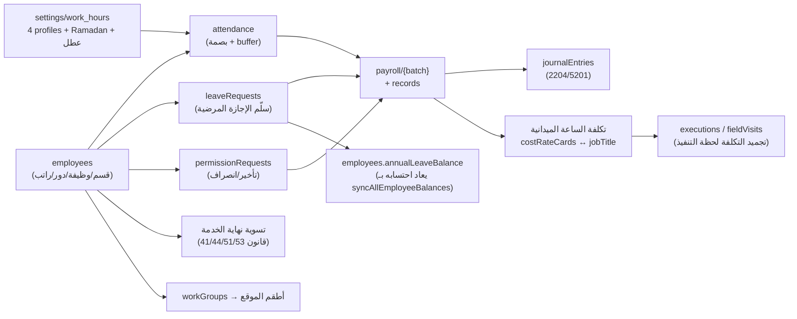

| العلاقة | نوعها | لماذا هي مهمة بين الموديولات |
| :--- | :--- | :--- |
| `Employee.jobTitle` ⇄ `CostRateCard.laborRates[].jobTitle` | مطابقة نصية (لا معرّف!) | تحوّل الموظف إلى **سعر ساعة** يدخل تكلفة المشروع — وأي تغيير مسمى يكسر التكلفة بصمت |
| `Employee.departmentId` → `scope='dept'` | صلاحية | يحدّد مَن يرى بيانات مَن داخل كل موديول |
| `attendance` + `leaveRequests` → `PayrollRecord.deductions` | تجميع ∑ | الرقابة القانونية على الخصم (ساعة سماحية، سلّم المرضية) |
| `payroll.accountingJournalId` → `journalEntries` | مُطلِق ⚡ | الرواتب تُغلَق في الدفاتر آلياً |
| `global_users.employeeId` → `employees` | هوية | يجعل «المستخدم» هو «الموظف»: أساس `scope='own'` والمرجعيات `engineerId` |
| `workGroups.memberIds[]` → `employees` | مجموعة | تحديد من يُسمح له بتسجيل تنفيذ ميداني |
| `settings/work_hours.holidays/ramadan` | قالب | يغيّر حساب `workingDays` في الإجازات وفيslots المواعيد معاً |

**نقطة تصميم مهمة**: HR لا يعرف المشاريع، لكن المشاريع تعرف HR. لهذا لا يوجد أي حقل `transactionId` في `payroll` — التكلفة تُنسَّب لاحقاً في `executions` (مَن عمل ومتى)، لا في المسير.

---

### ٧. اللب المشترك `core` — ما لا يملكه أي موديول

| الطبقة | المجموعات | القاعدة السيادية |
| :--- | :--- | :--- |
| الهوية والتأجير | `company` · `globalUser` · `users` · `invitations` · `company_requests` · `counters` | كل مستند يحمل `companyId`؛ مرآة `users` تُكتب مع `global_users` في batch واحد |
| الصلاحيات | `roles` (matrix: resourceId/action/scope) | `resourceId` من `SYSTEM_RESOURCES` فقط — 12 مورداً، **لا مورد واحد لكل موديول رأسي** (انظر §8) |
| الجغرافيا والقوائم | `governorates` · `areas` · `unitTypes` · `paymentMethods` · `customReferenceLists` · `serviceTypes` | `ReferenceListService` يحلّ النوع ديناميكياً: `paths` أو `customReferenceLists/{code}/items` |
| الكتالوج الهندسي | `activityTypes` → `services` → `subServices` → `stages` | الشجرة واحدة لكل الموديولات؛ الفرق في **الخصائص** لا في الفروع |
| العملاء | `clients` · `clientHistory` · `leads` | `clients.status=contracted` يُكتب من `document-service` لا من شاشة العميل |
| المعاملة | `transactions` · `transactionStages` · `transactionTimeline` · `transactionComments` | المجرى الموحد لكل الأحداث: أي موديول يترك أثراً هنا |
| الوثائق | `quotations` · `contracts` · 4 أنواع قوالب | `templateId` بوليمورفي؛ التحويل من عرض إلى عقد ينسخ البنود إلى milestones |
| المال | `accounts` · `journalEntries` · `vouchers` · `ipcs` · `costCenters` · `profitCenters` | حارس التوازن في `AccountingService` فقط؛ القيد يُنسب لمصادره بـ `sourceType`+`sourceId` |

---

### ٨. التقاطعات: العلاقات التي تعبر بين الموديولات

| # | من ← إلى | الآلية | الملفات الحاسمة | المخاطرة عند التعطّل |
| :-- | :--- | :--- | :--- | :--- |
| 1 | تنفيذ ميداني ← محاسبة | `fieldVisits` معتمدة ⇒ حساب WIP تحت 1205 + قيد | `field-visit-service.ts:100-135` | تكلفة المشروع تُقرأ ناقصة |
| 2 | مراحل ← فوترة | `milestoneKey` / `linkedStageInstanceId` ⇒ `status='due'` ⇒ `ipcs` | `billing-service.ts` · `billing-trigger-service.ts` (ميت) | مستخلصات لا تصدر بصمت (G8) |
| 3 | مقايسة ← مشتريات | `poItems.boqItemId` ⇒ مقارنة مُشترى/منفّذ | `boq-inventory-link-service.ts` | معطّل فعلياً الآن (G1) |
| 4 | مقايسة ← أوامر تغييروي | VO ⇒ `approvedVariationQty` + حقن مراحل | `variation-service.ts:194-240` | إيراد مضاف بلا مقابل تنفيذي |
| 5 | عقد ← ذمم العملاء | `createAutomaticSubAccount('1202', clientId)` | `document-service.ts:57-70` | كشف عملاء بلا رصيد |
| 6 | HR ← تكلفة المشروع | `jobTitle` ⇄ `laborRates` ⇒ `hourlyCostRef` | `payroll-service.ts` · `boq-execution-service.ts` | تكلفة خاطئة لكل المشاريع القديمة |
| 7 | HR ← محاسبة | `payroll` ⇒ `journalEntries` (2204/5201) | `payroll-service.ts:20` | المسير لا يظهر في القوائم |
| 8 | عقد باطن ← باطن/تنفيذ | `StageInstance.subcontractorId` + `boqItems.subcontractorId` ⇒ `subIpcs` | `billing-service.generateSubcontractorIPC` | مستحقات باطن بلا مصدر كمّي |
| 9 | مواعيد ← مراحل | `Appointment.stageId` + `startedByApptId`/`completedByApptId` | `appointment-service.ts` · `comment-section.tsx` | مراحل تُغلق بلا أثر زمني |
| 10 | صلاحيات ← كل شيء | `roles.matrix[].resourceId` + `scope` ⇒ فلترة الواجهة | `permissions/catalog.ts` · `engine.ts` | تسرّب بيانات بين الأقسام |

---

### ٩. التقسيم المقترح (تنفيذ على 3 مراحل، بلا كسر للتوافق)

#### المرحلة 1 — وسم البيانات (قراءة فقط، لا سلوك)
1. أضف `vertical: 'consulting' | 'construction' | 'hybrid'` إلى **`activityTypes`** (جذر الشجرة) — حقل واحد هناك يرثه كل شيء عبر `transactions.activityTypeId`.
2. أضف `vertical` إلى `departments` و`jobs` (لتصنيف الطاقم بدل مطابقة النصوص).
3. املأهما من `settings/checklists/technical-paths` و`settings/checklists/departments` (نفس الشاشات، حقل اختيار واحد).

#### المرحلة 2 — مرجع واحد للفصل
`src/lib/verticals.ts` يقترح أن يكون المرجع الوحيد:

```ts
export type Vertical = 'consulting' | 'construction' | 'hybrid';
// يقرأ activityType.vertical أولاً، ويسقط للتوافق على المطابقة النصية القديمة
export function resolveTransactionVertical(t: { activityTypeId?: string; activityTypeName?: string }, types: ActivityType[]): Vertical;
export function resolveStaffVertical(e: { departmentId?: string; jobTitle?: string }, departments: Department[], jobs: Job[]): Vertical;
export const isConstructionPortfolio = (v: Vertical) => v === 'construction' || v === 'hybrid';
```

ثم تُستبدل المطابقات الخمس به (هذه هي المواضع الفعلية اليوم):

| الموضع | الكود الحالي | البديل |
| :--- | :--- | :--- |
| `src/services/project-service.ts:39` | `activityTypeName?.includes('مقاولات') \|\| ... 'Construction'` | `resolveTransactionVertical(...)` |
| `src/app/dashboard/projects/page.tsx:49` | نفس المطابقة نصياً | نفس الدالة |
| `src/services/analytics-service.ts:279` | `activityTypeName?.includes('مقاولات')` | نفس الدالة |
| `src/components/appointments/architectural-appointments-view.tsx:231` | `departmentName?.includes('معماري') \|\| 'Arch'` | `resolveStaffVertical(...) === 'consulting'` |
| `src/components/construction/construction-bookings-view.tsx:157` | `jobTitle?.includes('موقع'\|'تنفيذ')` | `resolveStaffVertical(...) === 'construction'` |

#### المرحلة 3 — فصل الوصول (اختياري، أقوى الأثر)
- أضف موردين جديدين إلى `SYSTEM_RESOURCES`: `consulting` و`construction`، واجعل `projects` مورداً أباً يُرث منهما.
- اجعل `menuItems` في `src/components/layout/dashboard-sidebar.tsx` تُبنى من المورد: حالياً مجموعة «construction» تستخدم `resource: 'projects'` — أي أن من يملك صلاحية المشاريع يملك الميداني تلقائياً. بعد الفصل يمكن لمكتب الاستشارات إخفاء رادار الموقع والمعدات.
- **تحذير**: لا يُغيَّر أي سلوك قبل إضافة `firestore.rules` طبقة تحقق بالـ vertical وإلا صار الفصل تجميلياً فقط.

---

### ١٠. قرار معماري مفتوح: هل «المشروع» كيان مستقل؟

| الخيار | المزايا | التكاليف |
| :--- | :--- | :--- |
| **A. إبقاء المشروع = معاملة** (الوضع الحالي) | صفر هجرة؛ كل الربط الحالي على `transactionId` يعمل فوراً | تسمية مضلّلة: `projectId` يعني `transactionId` (8 مواضع)، ولا يمكن لمعاملة أن تنتمي لأكثر من نشاط/مجموعة |
| **B. مشروع كيان حقيقي يجمع عدة معاملات** | يعالج D&B فعلياً (تصميم + تنفيذ لمشروع واحد)، وميزانية إجمالية، وربحيتها موحّدة | هجرة `projectId` في 7 مجموعات، وتغيير فلاتر `cc_`/`pc_` وحسابات WIP التي تعتمد `cc_{transactionId}` |

**التوصية**: (A) + إضافة `activityType.vertical` اليوم، والتفكير في (B) فقط عند ظهور «مجمع سكني = 20 معاملة تحت مشروع واحد». السبب: العلاقات المالية (WIP/cc_/pc_) كلها مبنية على `transactionId`، وتحويلها لمسار project يعني إعادة كتابة `accounting-service` و`field-visit-service` و`cost-center` identifiers.

---

### ١١. ماذا يجب أن تتذكر عندما تعدّل

1. **قبل أن تضيف «موديولاً جديداً» اسأل: أي المفتاحين الخمسة يفعّله؟** معظم ما تظنه موديولاً جديداً هو مسار `activityType` جديد + قالب بـ `pricingMode` مختلف.
2. **المراحل هي نقطة الانفصال**: `isTimed` ⇒ زمن، `isNumeric` ⇒ كمية. أي كود يفترض أحدهما يكسر الموديول الآخر.
3. **`transactionStages` ملك المعاملة، `technicalStages` ملك المصنع**: لا تعدّل القالب لإصلاح مشروع — حقن المراحل (VO) هو المسار المشروع.
4. **الموارد تُجمَّد لا تُشار إليها**: لا تقرأ `costRateCards` لاحقاً لحساب تكلفة قديمة — خذ القيمة من `executions.laborDetails[].actualCost`.
5. **الفصل الحالي نصي وهش (G11)**: أي إعادة تسمية لقسم أو نشاط تعني بيانات مخفية عن رادارات وشاشات وتقارير، بلا خطأ ظاهر.

---

# الجزء الثاني: خريطة العلاقات المرجعية: المجموعات، المفاتيح الأجنبية، خطوط الأنابيب، الفجوات

> **هذا الملف هو المرجع الوحيد لفهم «ما الذي يرتبط بماذا» في النظام كله.**
> المسارات تُشتق آلياً من `src/firebase/multi-tenant.ts`، والمفاتيح الأجنبية تُشتق من `src/types/*.ts`،
> والمعنى الدلالي (ملكية، حالة، خطوط أنابيب، فجوات) مخزّن في `docs/relations.json`.
>
> | الأداة | الوظيفة |
> | :--- | :--- |
> | `docs/relations.json` | السجل المرجعي: الكيانات، اختصارات الحقول (aliases)، وسوم الموديولات الرأسية، خطوط الأنابيب، الفجوات |
| `docs/verticals.md` | شرح النظام مقسّماً إلى موديولات: استشارات هندسية · مقاولات · D&B · موارد بشرية · اللب المشترك |
> | `docs/relations.generated.json` | لقطة مولّدة: كل مسار، كل علاقة، عدادات الاستخدام — **لا تُحرَّر يدوياً** |
> | `npm run check:relations` | رقيب يمنع انحراف الكود عن التوثيق (٧ فحوصات، خروج بكود 1 عند أي خطأ) |

---

### 0. الخلاصة في عشرة أسطر

1. **مستأجر واحد = جذر واحد**: كل بيانات المنشأة داخل `companies/{companyId}/…`، وعزلها تفرضه `firestore.rules` عبر `belongsToCompany()`.
2. **الهوية عالمية والصلاحية محلية**: `global_users/{uid}` يقرّر الشركة والدور والموظف والقسم، ولكل مستخدم مرآة داخل `companies/{c}/users/{uid}`.
3. **`transactions` هي النواة، لا `projects`**: لا توجد مجموعة مشاريع أصلاً؛ «المشروع» معاملة مصفّاة نصياً، وكل حقول `projectId` تحمل `transactionId` فعلياً (**G2**).
4. **المعاملة هي محور كل ربط**: العقود، المقايسات، المراحل، التنفيذ، الفوترة، التكاليف، المواعيد والزيارات — كلها ترجع إلى `transactionId`.
5. **شجرة فنية واحدة للمفاهيم**: `activityTypes → services → subServices → stages` تُنشئ القوالب، وتُنسخ لحظة إنشاء المعاملة إلى `stageInstances` قابلة للتعديل.
6. **قاموس هندسي موحد**: `boqReferenceNodes` مصدر بنود العمل (كود، وصف، وحدة، سعر مرجعي، مرحلة) لكل القوالب والمقايسات.
7. **التنفيذ = عدّادات لا تعديل سجلات**: كل `executions` تزيد `boqItems.executedQuantity` و`stageInstances.currentCount` بـ `increment`، والأوامر التغييرية تضيف `approvedVariationQty` ولا تلمس الأصل.
8. **المال يُولَّد من الحدث**: إتمام مرحلة ⇐ `milestone.status='due'` ⇐ `ipcs` ⇐ `vouchers` ⇐ `journalEntries`؛ التكلفة الميدانية ⇐ قيد WIP؛ المسير ⇐ قيد رواتب.
9. **الأبعاد التحليلية حتمية المعرّف**: `cc_{transactionId}` و`pc_{transactionId}` وحساب WIP بمفتاح `referenceId=transactionId` — تكرار آمن (Idempotency) بدون استعلامات بحث.
10. **كل مرجع مُجمَّد لحظة الكتابة**: `xxxName` مرآة منسوخة، و`hourlyCostRef → actualCost` نسخة مجمّدة من جدول التعرفة — لا إعادة قراءة من المصدر لاحقاً.

---

### 1. الطبقة الصفرية: الهوية والتأجير

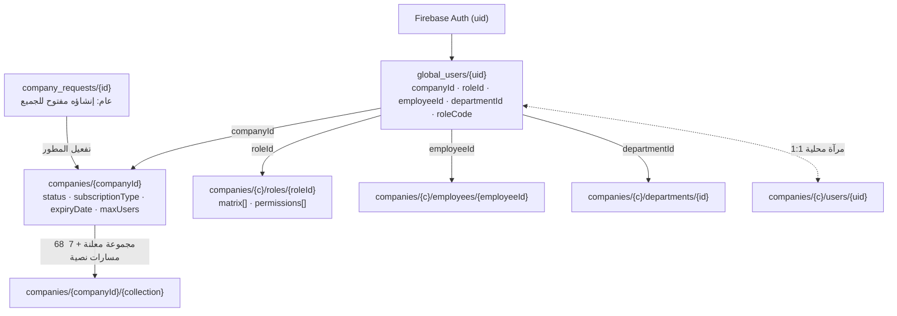

سلسلة التحقق عند أي طلب (كما هي في `firestore.rules` + `src/context/auth-context.tsx`):

`auth.uid` → `global_users/{uid}` → `companyId` → `companies/{companyId}` → (`isGlobalAdmin()` أو تطابق `companyId`) → إذن القراءة/الكتابة على كل المجموعات الفرعية عبر `match /{allSubCollections=**}`.

| # | المصدر | الهدف | آلية الربط | ملاحظة |
| :-- | :--- | :--- | :--- | :--- |
| 1 | `Firebase Auth (uid)` | `global_users/{uid}` | docId == auth.uid | `onAuthStateChanged` + `onSnapshot` مع حارس بصمة (hash) لمنع الحلقة |
| 2 | `global_users/{uid}.companyId` | `companies/{companyId}` | companyId | `company-context.tsx` يقرأ الترخيص ويحسب `daysRemaining` |
| 3 | `global_users/{uid}.roleId` | `companies/{companyId}/roles/{roleId}` | roleId | `roleData` تغذّي `usePermissions` و`hasResourceAccess` |
| 4 | `global_users/{uid}.employeeId` | `companies/{companyId}/employees/{employeeId}` | employeeId | `employeeId` هو ما يجعل `scope='own'` و`hourlyCost` متاحين |
| 5 | `global_users/{uid}.departmentId` | `companies/{companyId}/departments/{departmentId}` | departmentId | `departmentId` هو أساس `scope='dept'` |
| 6 | `companies/{companyId}/users/{uid}` | `global_users/{uid}` | mirror (tenant-local copy) | تُكتب في نفس `writeBatch` مع `global_users` — توحيد قسري |

نقطتان سياديتان:
- **المفتاح المطلق**: البريد `admin@novaflow.com` يمرّر كل القواعد (`isSovereignDev()`) وكل الصلاحيات (`hasResourceAccess`) — موثّق في `docs/testing-bypass-log.md`.
- **`roleCode` يُخزَّن بالأحرف الكبيرة دائماً**: أي مسار كتابة يخالف ذلك يكسر `currentUserData().get('roleCode','USER').upper() == 'ADMIN'` (تم توحيد ذلك في `UserService` والهجرة `runIdentityMigration`).

#### 1.1 جدول المجموعات الكامل (76 مجموعة)

«الأب» = التضمين الفعلي في Firestore (وليس مجرد مرجع منطقي)، و«الملّاك» = الخدمة التي تكتب المجموعة.

| الموديول | المفتاح | المسار | الكيان (TS) | الأب | الحالة | الملاّك | الغرض |
| :--- | :--- | :--- | :--- | :--- | :--- | :--- | :--- |
| الهوية والتأجير | `company` | `companies/{companyId}` | **بدون نوع** | — | نشطة | `developer/page.tsx` | جذر المستأجر: كل مجموعة داخل companies/{companyId} مملوكة له. حقول الترخيص: status/subscriptionType/expiryDate/maxUsers. غير مشار إليها عبر paths.company() في الكود (تُقرأ بمسار نصي). |
| الهوية والتأجير | `company_requests` | `company_requests/{requestId}` | **بدون نوع** | — | عام ⚠️ | `developer/page.tsx` | طابور طلبات التأسيس خارج نطاق المستأجر؛ يفعّله المطور فينشئ companies + roles + departments + jobs + employees + global_users. |
| الهوية والتأجير | `counters` | `companies/{companyId}/counters/{counterKey}` | **بدون نوع** | `company` | مسار نصي ⚠️ | `counters.ts` | مولّد الأرقام التسلسلية الآمن (JV-/RV-/PV-/PO-/BOQ-/IPC-/C-...). غير معلن في multi-tenant.ts. |
| الهوية والتأجير | `globalUser` | `global_users/{uid}` | **بدون نوع** | — | نشطة | `user-service.ts` | الهوية العالمية الوحيدة لكل مستخدم: uid → companyId + roleId + employeeId + departmentId + roleCode. |
| الهوية والتأجير | `invitations` | `companies/{companyId}/invitations` | `Invitation` | `company` | نشطة | `user-service.ts` | دعوة للانضمام داخل المنشأة؛ تُقبل عبر /join/{companyId}/{inviteId} وتكتب global_users + companies/{c}/users. |
| الهوية والتأجير | `users` | `companies/{companyId}/users/{uid}` | **بدون نوع** | `company` | مسار نصي ⚠️ | `user-service.ts` | مرآة العضوية المحلية داخل المنشأة؛ تُكتب مع global_users في batch واحد — غير معلنة في multi-tenant.ts. |
| القوائم المرجعية | `areas` | `companies/{companyId}/governorates/{govId}/areas` | `Area` | `company` | نشطة | `location-service.ts` | مناطق داخل المحافظة: governorateId + مسار Firestore فرعي. |
| القوائم المرجعية | `costTypeCategories` | `companies/{companyId}/costTypeCategories` | **بدون نوع** | `company` | معلَّنة بلا استخدام | `reference-list-service.ts` | معرّفة في paths فقط — لا استخدام لها حالياً. |
| القوائم المرجعية | `customReferenceItems` | `companies/{companyId}/customReferenceLists/{code}/items/{itemId}` | `BaseReferenceList` | `customReferenceLists` | مسار نصي ⚠️ | `reference-list-service.ts` | عناصر القوائم المخصصة؛ تُحلّ نفس نوع القوائم القياسية في ReferenceListService. |
| القوائم المرجعية | `customReferenceLists` | `companies/{companyId}/customReferenceLists/{code}` | **بدون نوع** | `company` | مسار نصي ⚠️ | `reference-list-service.ts` | تعريفات القوائم المرجعية المخصصة (نظام مفتوح للتوسّع). |
| القوائم المرجعية | `departments` | `companies/{companyId}/departments` | `Department` | `company` | نشطة | `department-service.ts` | أقسام المنشأة؛ مصدر scope='dept' في محرك الصلاحيات. |
| القوائم المرجعية | `governorates` | `companies/{companyId}/governorates` | `Governorate` | `company` | نشطة | `location-service.ts` | محافظات الكويت المرجعية (جذر شجرة الموقع). |
| القوائم المرجعية | `itemCategories` | `companies/{companyId}/itemCategories` | **بدون نوع** | `company` | معلَّنة بلا استخدام | `reference-list-service.ts` | معرّفة في paths فقط — تُستخدم كمرجع allowedItemCategoryIds في بنود BOQ. |
| القوائم المرجعية | `jobs` | `companies/{companyId}/departments/{deptId}/jobs` | `Job` | `company` | نشطة | `department-service.ts` | المسميات الوظيفية داخل القسم، تحمل roleId + hourlyCost (مرجع التكلفة). |
| القوائم المرجعية | `meetingRooms` | `companies/{companyId}/meetingRooms` | `MeetingRoom` | `company` | نشطة | — | قاعات/صالة المكتب — تُستخدم كـ hallId في المواعيد وكمصدر جدول مواعيد العمل meetingRooms. |
| القوائم المرجعية | `milestoneTimingTypes` | `companies/{companyId}/milestoneTimingTypes` | **بدون نوع** | `company` | معلَّنة بلا استخدام | `reference-list-service.ts` | معرّفة في paths فقط — التوقيت فعلياً enum MilestoneTiming في types/templates.ts. |
| القوائم المرجعية | `paymentConditionTypes` | `companies/{companyId}/paymentConditionTypes` | **بدون نوع** | `company` | معلَّنة بلا استخدام | `reference-list-service.ts` | معرّفة في paths فقط — لا يوجد لها استخدام بعد (انظر gaps). |
| القوائم المرجعية | `paymentMethods` | `companies/{companyId}/paymentMethods` | **بدون نوع** | `company` | نشطة | `reference-list-service.ts` | قائمة طرق الدفع المرجعية؛ يُشار إليها بالكود لا بالمعرّف. |
| القوائم المرجعية | `roles` | `companies/{companyId}/roles` | `Role` | `company` | نشطة | `role-service.ts` | مصفوفة الصلاحيات matrix[{resourceId,action,scope}] — تحكم الوصول داخل المنشأة؛ roleCode يُطابق القواعد الأمنية. |
| القوائم المرجعية | `serviceTypes` | `companies/{companyId}/serviceTypes` | `ServiceType` | `company` | نشطة | `service-type-service.ts` | تصنيف الخدمات العام (moduleScope) — مستقل عن شجرة activityTypes. |
| القوائم المرجعية | `settings` | `companies/{companyId}/settings/work_hours` | `WorkHoursSettings` | `company` | مسار نصي ⚠️ | `work-hours-service.ts` | مستند إعدادات ساعات العمل/رمضان/العطل. اسم المجموعة (settings) عام لكنه يضم وثيقة واحدة حالياً. |
| القوائم المرجعية | `unitTypes` | `companies/{companyId}/unitTypes` | `UnitType` | `company` | نشطة | `reference-list-service.ts` | وحدات القياس (m²، يوم، عدد) referenced by BOQ nodes. |
| كتالوج الخدمات | `activityTypes` | `companies/{companyId}/activityTypes` | `ActivityType` | `company` | نشطة | `technical-path-service.ts` | جذر الشجرة الوظيفية: نوع النشاط (عزل، مقاولات، تصميم...). كل شيء فني يتفرع منه. |
| كتالوج الخدمات | `services` | `companies/{companyId}/activityTypes/{actId}/services` | `Service` | `activityTypes` | نشطة | `technical-path-service.ts` | خدمة داخل نوع النشاط — مجموعة فرعية Firestore تحت activityTypes/{actId}/services. |
| كتالوج الخدمات | `subServices` | `companies/{companyId}/activityTypes/{actId}/services/{srvId}/subServices` | `SubService` | `services` | نشطة | `technical-path-service.ts` | خدمة فرعية: المستوى الذي تُربط به القوالب والمراحل. |
| كتالوج الخدمات | `technicalStages` | `companies/{companyId}/activityTypes/{actId}/services/{srvId}/subServices/{subId}/stages` | `TechnicalStage` | `subServices` | نشطة | `technical-path-service.ts` | قالب المرحلة الفنية: isNumeric/numericTarget، isTimed/timeTargetDays، nextStageIds (DAG)، billableTrigger + milestoneKey للفوترة. |
| CRM | `clientHistory` | `companies/{companyId}/clients/{clientId}/history` | `ClientHistory` | `clients` | نشطة | `client-service.ts` | سجل تدقيق لكل عميل (تغيير حالة/ملاحظة/إسناد مهندس/إنشاء معاملة) كمجموعة فرعية تحت العميل. |
| CRM | `clients` | `companies/{companyId}/clients` | `Client` | `company` | نشطة | `client-service.ts` | ملف العميل الموحد برقم سيادي C-0001/YYYY عبر counters؛ يحمل المهندس المسؤول + الموقع + القسم. |
| CRM | `leads` | `companies/{companyId}/leads` | **بدون نوع** | `company` | نشطة | `recruitment-service.ts` | فرص المبيعات قبل التحويل إلى عميل (لا يوجد كيان TypeScript بعد). |
| المعاملات والمشاريع | `executions` | `companies/{companyId}/executions` | `BOQItemExecutionEntry` | `company` | نشطة | `boq-execution-service.ts` | سطر تنفيذ مسطّح (وليس subgroup): الكميات + العمالة + المعدات + التكلفة المجمّدة، ويُرجّح به بند المقايسة. |
| المعاملات والمشاريع | `transactionComments` | `companies/{companyId}/transactions/{tId}/comments` | `TransactionComment` | `transactions` | نشطة | `comment-service.ts` | نقاش المعاملة (تعليقات وردود parentCommentId، تثبيت، أرشفة) مرتبط أحياناً بموعد أو مرحلة. |
| المعاملات والمشاريع | `transactionStages` | `companies/{companyId}/transactions/{tId}/stageInstances` | `StageInstance` | `transactions` | نشطة | `transaction-service.ts` | نسخة مراحل المعاملة من القالب الفني؛ تتقدم بالمواعيد والزيارات وتُغلق المراحل لإطلاق الفوترة. |
| المعاملات والمشاريع | `transactionTimeline` | `companies/{companyId}/transactions/{tId}/timeline` | `TransactionTimelineEvent` | `transactions` | نشطة | `boq-execution-service.ts` | شريط الأحداث الموحد لكل معاملة — تكتبه 6 خدمات مختلفة (أتمتة مالية، إنجاز، VO، مراجعات تصميم). |
| المعاملات والمشاريع | `transactions` | `companies/{companyId}/transactions` | `Transaction` | `company` | نشطة | `transaction-service.ts` | النواة التشغيلية: معاملة العميل (عملياً هي 'المشروع'). كل وثيقة ومقايسة ومرحلة وتكلفة ترجع إليها. |
| الوثائق التجارية | `contracts` | `companies/{companyId}/contracts` | `Contract` | `company` | نشطة | `document-service.ts` | العقد الرسمي: milestones مرتبطة بالمراحل الفنية + retentionRate + دفعة مقدمة؛ بوّابة الفوترة والذمم. |
| الوثائق التجارية | `quotations` | `companies/{companyId}/quotations` | `Quotation` | `company` | نشطة | `document-service.ts` | عرض سعر مُنشأ من قالب؛ يتحول إلى عقد بنفس البنية (items → milestones). |
| الوثائق التجارية | `subconContracts` | `companies/{companyId}/subconContracts` | **بدون نوع** | `company` | نشطة | `document-service.ts` | عقد مقاول باطن: نفس منطق الـ milestones لكن بحسابات مستحقات ومحتجزات خاصة بالباطن. |
| مكتبة القوالب | `boqReferenceNodes` | `companies/{companyId}/boqReferenceNodes` | `BOQReferenceNode` | `company` | نشطة | `boq-reference-service.ts` | القاموس الهندسي الموحد (شجرة بنود العمل): المصدر الوحيد لأكواد وأوصاف وأسرار البنود في كل النظام. |
| مكتبة القوالب | `boqTemplateItems` | `companies/{companyId}/boqTemplates/{templateId}/items` | `BOQTemplateItem` | `boqTemplates` | نشطة | `template-service.ts` | بنود القالب مع shجرة ancestorIds وروابط boqReferenceNodeId/technicalStageId/unitTypeId. |
| مكتبة القوالب | `boqTemplates` | `companies/{companyId}/boqTemplates` | `BOQTemplate` | `company` | نشطة | `template-service.ts` | قالب جدول كميات قابل لإعادة الاستخدام؛ يُستنسخ إلى boqs/{id}/items عند التفعيل. |
| مكتبة القوالب | `contractTemplates` | `companies/{companyId}/contractTemplates` | `ContractTemplate` | `company` | نشطة | `template-service.ts` | قالب عقد: بنود قانونية + defaultMilestones + retentionRate + boqTemplateId. |
| مكتبة القوالب | `quotationTemplates` | `companies/{companyId}/quotationTemplates` | `QuotationTemplate` | `company` | نشطة | `template-service.ts` | قالب عرض سعر مربوط بنشاط/خدمة/خدمة فرعية + boqTemplateId اختياري. |
| مكتبة القوالب | `subconContractTemplates` | `companies/{companyId}/subconContractTemplates` | `SubConContractTemplate` | `company` | نشطة | `template-service.ts` | قالب عقد باطن محدد بالتخصص (trade). |
| المقايسات الحية | `boqItems` | `companies/{companyId}/boqs/{boqId}/items` | `BOQItem` | `boqs` | نشطة | `document-service.ts` | بند مقايسة: 6 عدادات كمية (contract/planned/approvedVariation/executed/verified/billed) + رابط مرحلة + رابط باطن. |
| المقايسات الحية | `boqVariationItems` | `companies/{companyId}/boqs/{boqId}/variations/{voId}/items` | **بدون نوع** | `boqVariations` | نشطة | `variation-service.ts` | بنود الأمر التغييروي؛ عند الاعتماد تُضاف إلى approvedVariationQty للبند الأصلي. |
| المقايسات الحية | `boqVariations` | `companies/{companyId}/boqs/{boqId}/variations` | **بدون نوع** | `boqs` | نشطة | `variation-service.ts` | الأمر التغييروي (VO) على المقايسة: draft → approved/rejected، لا يعدّل الأصل بل يضيف. |
| المقايسات الحية | `boqs` | `companies/{companyId}/boqs` | `BOQ` | `company` | نشطة | `document-service.ts` | مقايسة المعاملة الفعلية (boqNumber آلي BOQ-YYYY-0001) — حلقة الوصل بين العقد والتنفيذ والفوترة. |
| الميدان والمواعيد | `appointments` | `companies/{companyId}/appointments` | `Appointment` | `company` | نشطة | `appointment-service.ts` | موعد (عميل/موقع/قاعة/حظر) مربوط بعميل + معاملة + مرحلة + قاعة + مهندس(ين) — يحرّك إتمام المراحل. |
| الميدان والمواعيد | `fieldVisits` | `companies/{companyId}/fieldVisits` | `FieldVisit` | `company` | نشطة | `field-visit-service.ts` | زيارة ميدانية بشبكة رباعية (موظفون/عمالة/معدات/مواد) + صور + GPS؛ اعتمادها يولّد قيد WIP. |
| الميدان والمواعيد | `workGroups` | `companies/{companyId}/workGroups` | `WorkGroup` | `company` | نشطة | `hr-service.ts` | طاقم عمل ميداني: مشرف + أعضاء (employees) + قسم — وحدة الإسناد في الزيارات. |
| Mوارد البشرية | `applications` | `companies/{companyId}/applications` | **بدون نوع** | `company` | نشطة | `recruitment-service.ts` | طلبات التوظيف (recruitment pipeline) — لا يوجد لها TypeScript type بعد. |
| Mوارد البشرية | `attendance` | `companies/{companyId}/attendance` | `AttendanceRecord` | `company` | نشطة | `attendance-import-service.ts` | سجل بصمة يومي (checkIn/out ×2) محسوب مقابل إعدادات ساعات العمل والراحة والإجازات. |
| Mوارد البشرية | `employeeAuditLogs` | `companies/{companyId}/employees/{employeeId}/auditLogs` | `EmployeeAuditLog` | `employees` | مسار نصي ⚠️ | `hr-service.ts` | تتبع حقل-بحقل لتغييرات ملف الموظف. |
| Mوارد البشرية | `employees` | `companies/{companyId}/employees` | `Employee` | `company` | نشطة | `hr-service.ts` | السجل الموحد للقوى العاملة (داخلي/خارجي): قسم + وظيفة + دور + راتب + رصيد إجازات. |
| Mوارد البشرية | `leaveRequests` | `companies/{companyId}/leaveRequests` | `LeaveRequest` | `company` | نشطة | `leave-service.ts` | طلب إجازة بمراحل (pending→approved→commenced→returned) + سلّم sickness tiers القانوني. |
| Mوارد البشرية | `payroll` | `companies/{companyId}/payroll` | `PayrollBatch` | `company` | نشطة | `payroll-service.ts` | مسير راتب شهري؛ سجلات الموظفين في مجموعة فرعية records تحت نفس المستند. |
| Mوارد البشرية | `payrollRecords` | `companies/{companyId}/payroll/{batchId}/records/{recordId}` | `PayrollRecord` | `payroll` | مسار نصي ⚠️ | `payroll-service.ts` | سجلات راتب الموظف داخل المسير — يولّدها payroll-service بنسخة مجمّدة من بيانات الموظف. |
| Mوارد البشرية | `permissionRequests` | `companies/{companyId}/permissionRequests` | `PermissionRequest` | `company` | نشطة | `permission-service.ts` | طلب إذن تأخير/انصراف مبكر — يُحتسب في تسوية الرواتب. |
| الأصول | `assetAssignments` | `companies/{companyId}/assetAssignments` | **بدون نوع** | `company` | نشطة | `inventory-service.ts` | العهدة الفعلية (صرف/استرجاع) للموظف — تعدّل رصيد الصنف في المخزون. |
| الأصول | `equipment` | `companies/{companyId}/equipment` | `Equipment` | `company` | نشطة | `equipment-service.ts` | سجل الآليات: ملكية/تمويل/تأمين/فحص + أساس الاستهلاك hourlyDepreciationRate المُغذّي لتكلفة الاستخدام. |
| الأصول | `equipmentAssignments` | `companies/{companyId}/equipmentAssignments` | **بدون نوع** | `company` | معلَّنة بلا استخدام | — | مجموعة معرّفة في paths وغير مستخدمة؛ التوزيع الفعلي يسجَّل في assetAssignments (انظر gaps). |
| الأصول | `inventoryItems` | `companies/{companyId}/inventoryItems` | **بدون نوع** | `company` | نشطة | `inventory-service.ts` | أصناف المخزون برصيد quantity يُزاد/يُنقص آلياً من PO والعهدة. |
| الأصول | `inventoryTransactions` | `companies/{companyId}/inventoryTransactions` | **بدون نوع** | `company` | معلَّنة بلا استخدام | — | مجموعة حركة مخزون معرّفة في paths ولا تُكتب منها أي موضع — الحركات حالياً ضمن assetAssignments فقط (انظر gaps). |
| الأصول | `warehouses` | `companies/{companyId}/warehouses` | **بدون نوع** | `company` | نشطة | `inventory-service.ts` | المستودعات — حاويات منطقية للأصناف. |
| المشتريات | `poItems` | `companies/{companyId}/purchaseOrders/{poId}/items` | `POItem` | `purchaseOrders` | نشطة | `procurement-service.ts` | بنود أمر الشراء: تربط الصنف ببند مقايسة ومرحلة فنية (جوهر مقارنة المشتري بالمنفذ). |
| المشتريات | `purchaseOrders` | `companies/{companyId}/purchaseOrders` | `PurchaseOrder` | `company` | نشطة | `procurement-service.ts` | أمر شراء PO-YYYY-0001 بحالة تدفق (draft→approved→ordered→received) — أساس الاستلام في المخزن. |
| المشتريات | `subcontractors` | `companies/{companyId}/subcontractors` | `Subcontractor` | `company` | نشطة | `procurement-service.ts` | مقاولو الباطن بالتخصص والتقييم — يظهرون في البنود والمراحل والتنفيذ والـ SIPs. |
| المشتريات | `suppliers` | `companies/{companyId}/suppliers` | **بدون نوع** | `company` | نشطة | `procurement-service.ts` | سجل الموردين المعتمدين (يظهر أيضاً كموردي معدات في equipment.supplierId). |
| الفوترة والمحاسبة | `accounts` | `companies/{companyId}/accounts` | `Account` | `company` | نشطة | `accounting-service.ts` | دليل الحسابات الشجري لكل منشأة؛ حسابات العملاء/WIP تُنشأ آلياً تحت 1202 و1205. |
| الفوترة والمحاسبة | `costCenters` | `companies/{companyId}/costCenters` | `CostCenter` | `company` | نشطة | `accounting-service.ts` | بُعد تحليلي للتكلفة؛ للمعاملات مراكز حتمية cc_{transactionId}. |
| الفوترة والمحاسبة | `costRateCards` | `companies/{companyId}/costRateCards` | `CostRateCard` | `company` | نشطة | `cost-rate-service.ts` | جدول تعرفة العمالة الساري؛ يغذّي تكلفة الساعة في التنفيذ والزيارات. |
| الفوترة والمحاسبة | `ipcs` | `companies/{companyId}/ipcs` | `InterimPaymentCertificate` | `company` | نشطة | `billing-service.ts` | مستخلص المالك: gross − retention(5%) = netPayable؛ مولّد آلياً من إتمام المراحل. |
| الفوترة والمحاسبة | `journalEntries` | `companies/{companyId}/journalEntries` | `JournalEntry` | `company` | نشطة | `accounting-service.ts` | قيد مزدوج متوازن وجوباً؛ مصدر sourceType+sourceId يوثّق أي عملية تشغيلية ولدته. |
| الفوترة والمحاسبة | `profitCenters` | `companies/{companyId}/profitCenters` | `ProfitCenter` | `company` | نشطة | `accounting-service.ts` | بُعد تحليلي للربحية؛ pc_{transactionId} لكل معاملة/مشروع. |
| الفوترة والمحاسبة | `subIpcs` | `companies/{companyId}/subIpcs` | `SubIPC` | `company` | نشطة | `billing-service.ts` | مستخلص الباطن بنفس المنطق مع نسبة محتجزات عقد الباطن. |
| الفوترة والمحاسبة | `vouchers` | `companies/{companyId}/vouchers` | `Voucher` | `company` | نشطة | `accounting-service.ts` | سند قبض/صرف مرتبط تلقائياً بقيد محاسبي في نفس الـ batch. |

> **مسار نصي ⚠️** = المجموعة تُكتب بمسار نصي خارج `paths` (لا يحميه المترجم)، و**معلَّنة بلا استخدام** = لها تابع في `paths` ولا يُستدعى في أي ملف.

#### 1.2 التقسيم الرأسي: استشارات / مقاولات / D&B / HR / لب مشترك

> التفصيل الكامل لكل موديول (رحلات العمل، الكيانات، الالتباسات، وخطة فصل نظيفة) في **[`docs/verticals.md`](verticals.md)**. الجدول أدناه هو الملخّص المشتق من وسوم `verticals` في السجل.

| الموديول | id | مجموعاته | حصري له | أمثلة حصرية |
| :--- | :--- | ---: | ---: | :--- |
| الاستشارات الهندسية والتصميم | `consulting` | 26 | 0 | — |
| المقاولات والإنشاءات | `construction` | 48 | 8 | `equipmentAssignments`, `inventoryItems`, `inventoryTransactions`, `subIpcs`, `subconContractTemplates`, `subconContracts`, `suppliers`, `warehouses` |
| تصميم وإنشاء (Design & Build) | `hybrid` | 27 | 0 | — |
| الموارد البشرية والامتثال | `hr` | 14 | 7 | `applications`, `attendance`, `employeeAuditLogs`, `leaveRequests`, `payroll`, `payrollRecords`, `permissionRequests` |
| اللب المشترك (Shared Core) | `core` | 43 | 16 | `areas`, `company`, `company_requests`, `costTypeCategories`, `counters`, `customReferenceItems`, `customReferenceLists`, `globalUser`, `governorates` |

**كيف ينفصل الموديول فعلياً؟** لا يوجد حقل `vertical` في القاعدة: الفصل يشتق من 5 مفاتيح — كود `activityType` على المعاملة، `pricingMode` و`measurementMode` على الوثيقة، `isTimed`/`isNumeric` على المرحلة، الـ profile في `settings/work_hours`، وقسم/مسمى الموظف. التنفيد الحالي مطابقات نصية في 5 مواضع (**G11**).

---

### 2. المخططات المفاهيمية (ER) لكل نطاق

> `||--o{` تعني «أب واحد ↔ أبناء كثر». النص بين القوسين هو مفتاح الربط الفعلي داخل المستند.

#### 2.1 المرجعيات والكتالوج الهندسي — أبجدية النظام

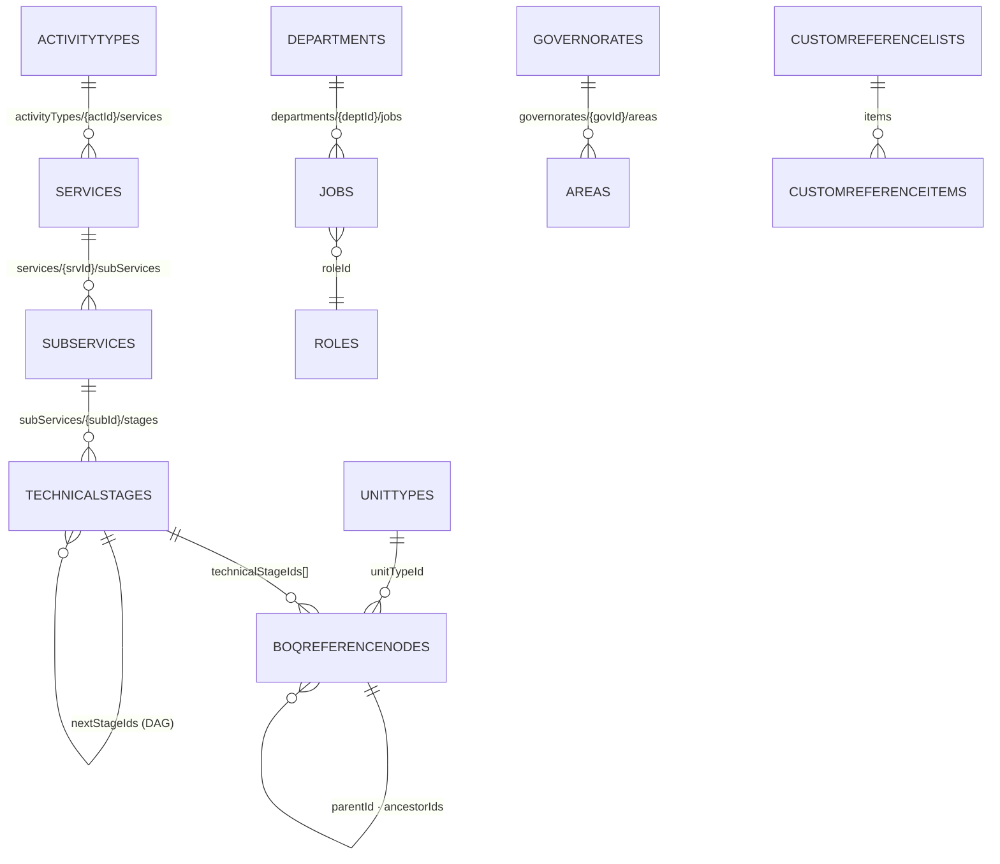

- **لماذا التضمين وليس المرجع؟** `services` و`subServices` و`stages` مجموعات فرعية حقيقية داخل `activityTypes` — حذف نوع النشاط يحذف الشجرة كلها بالمسار نفسه (لا Cascade في Firestore).
- **`boqReferenceNodes`** مسطّحة لكنها شجرة بالحقول: `parentId` + `ancestorIds[]` + `depth` + `order` + `nodeRole('group' | 'work_item')` + `isExecutable` — لتسهيل الفلترة عبر النشاط دون التنقّل في المسارات.
- القوائم المرجعية **نصف مفتوحة**: `ReferenceListService` يحلّ النوع ديناميكياً — إن كان له مفتاح في `paths` استُخدم مساره، وإلا تحوّل إلى `customReferenceLists/{code}/items`. لذلك `unitTypes` و`paymentMethods` و`itemCategories` وغيرها نفس العقد وبنفس البنية `BaseReferenceList`.

#### 2.2 المبيعات والوثائق التجارية

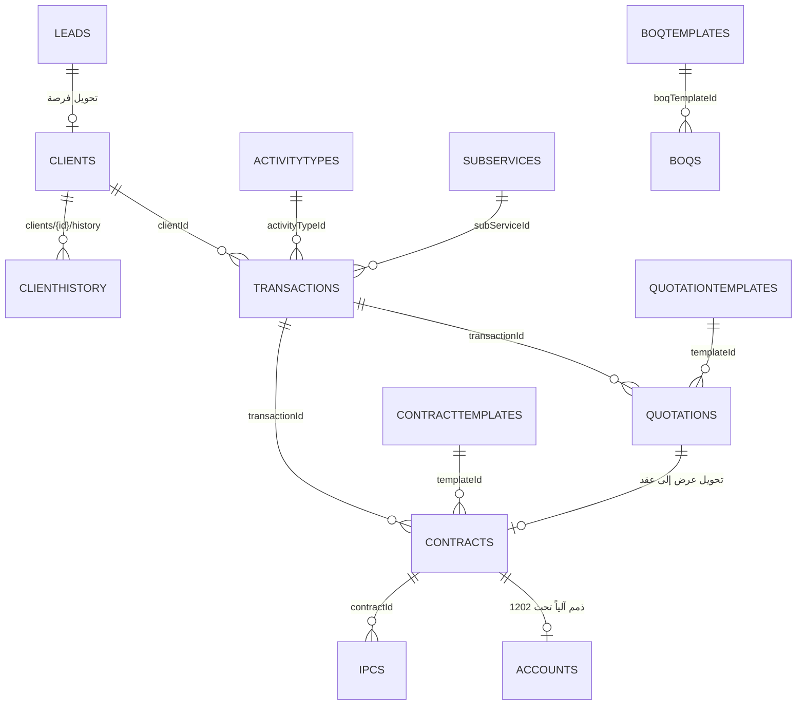

**العقد = بوابة المال**. في `contracts.milestones[]` يلتقي الفني بالمالي:

| حقل في العقد | يقابله | المعنى |
| :--- | :--- | :--- |
| `milestones[].technicalStageId` | `technicalStages` | الدفعة مشروطة بإنجاز مرحلة فنية |
| `milestones[].linkedStageInstanceId` | `transactionStages` | ربط مباشر بنسخة المرحلة في هذه المعاملة |
| `milestones[].linkedMilestoneKey` ⇄ `stageInstances.milestoneKey` | مفتاح نصي | مطابقة احتياطية عند غياب الـ id (منطق `BillingTriggerService`) |
| `milestones[].contractualEvent` | `SIGNING` / `CONTRACTING` / `MANUAL` | إطلاق مطالبة فورية عند التوقيع/الدفع |
| `retentionRate` | `ipcs.retentionRate` | المصدر الافتراضي للمحتجزات (5%) |
| `transactionId` | `transactions` | **شرط الفوترة** — غيابه يعني عقداً لا يُفوتر أبداً بصمت (**G8**) |

#### 2.3 المقايسات والتنفيذ الميداني — قلب النظام الهندسي

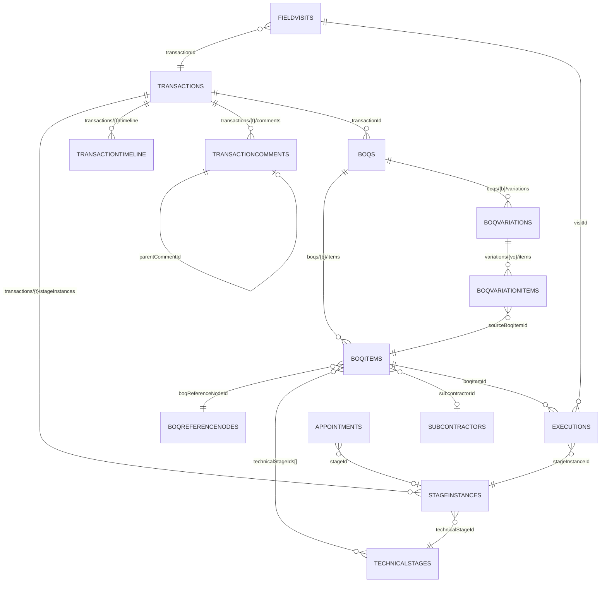

**عدّادات بند المقايسة الستة** — أهم علاقة حسابية في النظام، وكلها تُجمَّع من التفصيل:

| العدّاد في `boqItems` | مَن يزيده | متى |
| :--- | :--- | :--- |
| `contractQty` | `boqTemplateItems.plannedQuantity` | عند استنساخ القالب إلى المقايسة |
| `plannedQuantity` | `DocumentService.instantiateBoqFromTemplate` | تهيئة المقايسة |
| `executedQuantity` | `BOQExecutionService.recordBOQItemExecution` | كل سطر تنفيذ (`increment`) |
| `verifiedQuantity` | تدقيق التنفيذ (`status: verified` + `verifiedBy`) | مراجعة المهندس |
| `approvedVariationQty` | `VariationService` عند اعتماد الأمر التغييروي | بعد موافقة الإدارة |
| `billedQuantity` | `ipcs` (المستخلصات) | عند فوترة البند |

منها تُقرأ **نسبة الإنجاز** = `Σ executed / Σ planned` للبنود المرتبطة بالمرحلة (`getTechnicalStageProgress`)، وهي بوابة إتمام المرحلة التي تُطلق الفوترة.

#### 2.4 المشتريات والمخازن والأصول

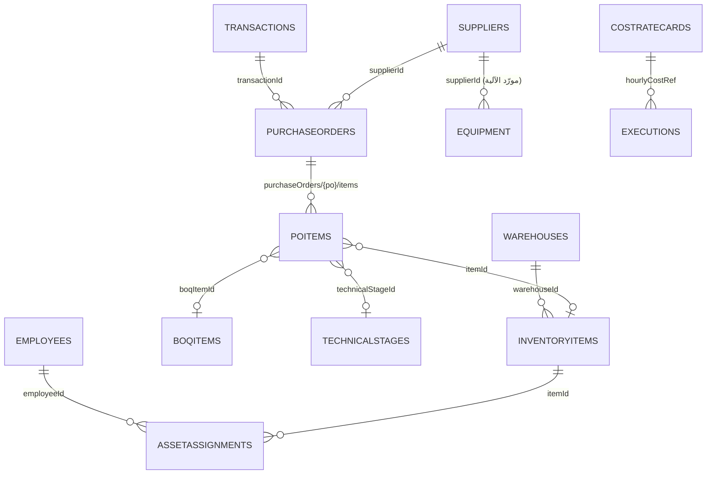

- **ثلاثية المقارنة** (جوهر الرقابة): `POItem.quantity` (مُشترى) ⇄ `BOQItem.executedQuantity` (منفّذ) ⇄ `plannedQuantity` (مخطّط) — الفرق هو الهدر أو النقص.
- `assetAssignments` هي العهدة الفعلية: تفحص الرصيد ثم تخصم `inventoryItems.quantity` في نفس الـ batch، والاسترجاع يعيده.
- **`equipmentAssignments` و`inventoryTransactions` معرّفتان في `paths` ولا تُستخدمان إطلاقاً** (**G3**) — توزيع المعدات يسلك `assetAssignments`.

#### 2.5 الموارد البشرية — سلسلة الامتثال لقانون العمل الكويتي

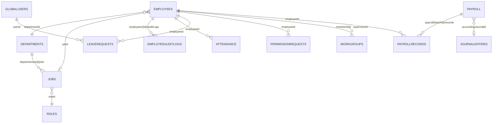

علاقات لا تظهر في المخطط لكنها الأهم سلوكياً:
- `leaveRequests(status ∈ approved|on-leave|returned|commenced)` ⇒ تخصم من `employees.annualLeaveBalance`، و`SeedService.syncAllEmployeeBalances()` يعيد احتسابه من الصفر (تراكمي حسب `hireDate` − المستهلك) عبر `WorkingDaysService` المستند إلى `settings/work_hours`.
- `attendance` + `permissionRequests` ⇒ `absentDays` / `lateMinutes` / `unjustifiedAbsenceDays` في `PayrollRecord`: **البصمة تدخل الرواتب، والرواتب تدخل القيود**.
- `employeeAuditLogs` سجل تدقيق حقل-بحقل (oldValue/newValue) لا تقرأه إلا شاشة ملف الموظف.
- `Employee.paymentBasis` (شهري/يومي) و`paymentMethod` يحدّدان شكل الخصم في المسير، و`employeeType` (داخلي/خارجي) يحرّر الحقول الإلزامية عند التسجيل.

#### 2.6 المحاسبة والفوترة والأبعاد التحليلية

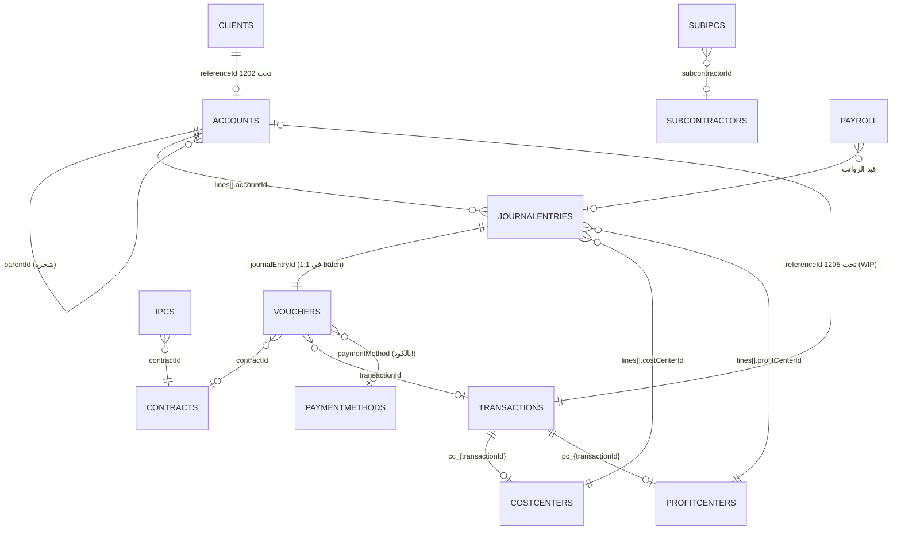

**دليل الحسابات ليس مرجعاً ساكناً، بل يُكتب من العمليات:**

| الحساب | الكود | آلية الإنشاء التلقائي | متى |
| :--- | :--- | :--- | :--- |
| ذمم العملاء | `1202` | `ensureControlAccount` + `createAutomaticSubAccount(referenceId=clientId)` | اعتماد/دفع عقد |
| أعمال تحت التنفيذ (WIP) | `1205` | `createAutomaticSubAccount(referenceId=transactionId)` | اعتماد زيارة ميدانية |
| مستحقات رواتب وأجور | `2204` | `ensureControlAccount` | ترحيل الزيارة / اعتماد المسير |
| مخصص نهاية الخدمة / الإجازات | `2205` / `2206` | `seedConstructionCOA` عند التأسيس | التأسيس |

كما أن `accounts.analyticalConfig` (not_allowed / optional / required / auto) هو ما يفرضه `AnalyticalValidationService` على سطور القيد — أي أن **الحساب يقرّر أي أبعاد تحليلية مسموحة**، وليس العكس.

#### 2.7 الصلاحيات: كيف ترتبط الأرقام بالبيانات

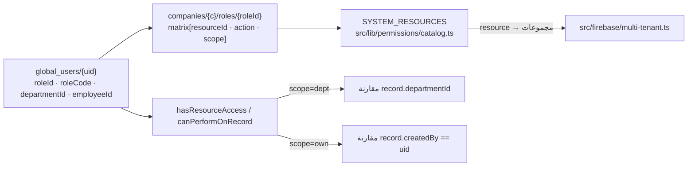

`scope` يربط الصلاحية **بالحقول** لا بالمجموعات: `dept` يفترض وجود `departmentId` على المستند (موجود على `clients` فقط!)، و`own` يفترض `createdBy` (موجود على الوثائق والمحاسبة، غائب عن `employees` و`transactions`). أي مجموعة بلا هذه الحقول لا يمكن تقييدها فعلياً — ثغرة حوكمة يجب مراعاتها عند التوسّع.

---

### 3. خطوط الأنابيب: من الحدث التشغيلي إلى القيد المالي

هذه العلاقات السببية/الزمنية لا تظهر في الحقول، وهي سبب وجود النظام أصلاً. كل معرّف (`id`) أدناه مُتحقَّق منه أنه موثّق.

#### 3.1 `provisioning` — تأسيس المنشأة (Provisioning)
```
   1. company_requests/{id} (public create)
   2. developer/page.tsx → companies/{newId}
   3. companies/{c}/roles + departments + departments/{d}/jobs
   4. companies/{c}/employees/{ownerId} + global_users/{uid}
   5. company_requests/{id}.status = activated (+ ownerUid, companyId)
   6. SeedService.seedConstructionCOA → accounts + costCenters + profitCenters
   7. SeedService.runSeed → departments/jobs
```
> ⚙️ لا يوجد أي Cloud Function: التأسيس كامل من عميل المتصفح بصلاحيات المطور (isSovereignDev).

#### 3.2 `sales-to-delivery` — من فرصة إلى معاملة
```
   1. leads/{id} (CRM)
   2. clients/{id} (fileNumber من counters)
   3. clients/{id}/history (تسجيل الحدث)
   4. transactions/{id} (clientId + activityType/service/subService + مهندس مسؤول)
   5. transactions/{id}/stageInstances (نسخ من technicalStages)
```

#### 3.3 `quote-to-contract` — عرض السعر ← عقد ← مقايسة
```
   1. quotationTemplates (boqReferenceNodeId + technicalStageId في البنود)
   2. quotations (items منسوخة، pricingMode)
   3. DocumentService.convertQuotationToContract → contracts (items → milestones) + quotations.status=approved
   4. contractTemplates/boqTemplates → DocumentService.instantiateBoqFromTemplate → boqs + boqs/{b}/items
   5. contracts.status ∈ [approved|active|signed|paid] → clients.status=contracted + حساب ذمم آلي 1202/referenceId=clientId
   6. paid → BillingService.triggerMilestoneBilling(SIGNING,at)
```

#### 3.4 `field-execution` — التنفيذ الميداني وتجميع الكميات
```
   1. appointments (clientId/transactionId/stageId) أو fieldVisits (items[boqItemId])
   2. BOQExecutionService.recordBOQItemExecution → executions/{id}
   3. boqs/{b}/items/{i}.executedQuantity = increment(qty)
   4. transactions/{t}/stageInstances/{s}.currentCount = increment(qty)
   5. transactions/{t}/timeline (type=numeric_update)
```
> ⚙️ التكلفة تُجمَّد لحظة التنفيذ (hourlyCostRef → actualCost) من costRateCards/equipment — لا تعاد قراءتها لاحقاً.

#### 3.5 `auto-billing` — الأتمتة المالية: مرحلة → مطالبة
```
   1. إتمام المرحلة (من المعاملة أو من موعد حسب nextStageIds/isRequired)
   2. contracts.milestones[].status = due (مطابقة بـ milestoneKey أو linkedStageInstanceId)
   3. BillingService.triggerMilestoneBilling → ipcs/{id} (gross − retention 5% = netPayable)
   4. counters: ipc_owner_{transactionId} → IPC-0001
   5. transactions/{t}/timeline (type=billing_triggered)
   6. قيد القبض يدوياً لاحقاً: vouchers + journalEntries في batch واحد
```

#### 3.6 `cost-recovery` — ترحيل التكاليف (WIP)
```
   1. fieldVisits معتمدة → FieldVisitService.approveFieldVisitForBilling
   2. accounts: createAutomaticSubAccount('1205', transactionId) = حساب WIP للمشروع
   3. accounts: ensureControlAccount('2204' مستحقات الرواتب)
   4. costCenters cc_{transactionId} + profitCenters pc_{transactionId}
   5. journalEntries (قيد متوازن مدين WIP/دائن مستحقات) via AccountingService.createJournalEntry
```

#### 3.7 `procurement-loop` — دورة المشتريات والمخزون
```
   1. suppliers + inventoryItems + warehouses
   2. purchaseOrders (PO-YYYY-0001 من counters) + purchaseOrders/{po}/items (boqItemId + technicalStageId)
   3. receivedQuantity في البند مقابل quantity
   4. inventoryItems.quantity يُحدَّث آلياً عند الاستلام/الصرف
   5. assetAssignments (عهدة الموظف) + boqs/{b}/items (تحليل الانحراف)
```

#### 3.8 `hr-to-finance` — المسار البشري ← المالي
```
   1. attendance (بصمة/Excel import) + leaveRequests + permissionRequests
   2. PayrollService.generatePayroll (خصومات الغياب/التأخير حسب نظام ساعات العمل)
   3. payroll/{batchId} + payroll/{batchId}/records
   4. الاعتماد → journalEntries (2204/5201) + payroll.accountingJournalId
   5. gratuity/end-of-service: employees + leaveBalances → تسوية (حسابية فقط، لا مستند دائم)
```

#### 3.9 `subcontractor-loop` — دورة مقاول الباطن
```
   1. subcontractors + subconContractTemplates → subconContracts (retentionRate)
   2. boqs/{b}/items[].subcontractorId + transactions/{t}/stageInstances[].subcontractorId/Price
   3. executions[].subcontractorId (من بند المقايسة)
   4. BillingService.generateSubcontractorIPC → subIpcs (counters ipc_sub_{subcontractorId})
   5. سند صرف (vouchers type=payment) → قيد مستحقات الباطن
```

#### 3.10 `variations` — الأوامر التغييرية (VO)
```
   1. boqs/{b}/variations/{vo} (draft) + variations/{vo}/items
   2. حقن مرحلة جديدة: transactions/{t}/stageInstances (originType=temporary_vo) + إعادة ترتيب order
   3. اعتماد VO → boqItems.approvedVariationQty += qty + timeline + تحديث كميات البنود المتأثرة
   4. رفض VO → variations.status=cancelled (لا يمس الأصل)
```

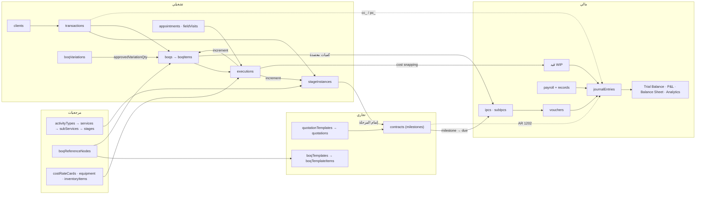

**القاعدة الذهبية**: أي مسار مالي جديد يدخل من بابين فقط — `AccountingService.createJournalEntry` أو `AccountingService.createVoucher` (سند + قيد في batch واحد). لا يجوز لأي خدمة أن تكتب في `journalEntries` مباشرة، فحارس التوازن `|debit − credit| ≤ 0.001` موجود هناك وحده.

---

### 4. جدول المفاتيح الأجنبية الكامل (132 علاقة)

مشتق آلياً من `src/types/*.ts`. أي حقل `xxxId` جديد بلا هدف في `docs/relations.json → aliases` **يفشل الفحص** — بهذه الآلية تبقى الخريطة مطابقة للكود.

| المصدر | الحقل | الهدف | عبر الواجهة | نوع الهدف |
| :--- | :--- | :--- | :--- | :--- |
| `accounts` | `parentId` | `accounts` | `Account` | شجرة (SELF) |
| `appointments` | `additionalEngineerIds` | `employees` | `Appointment` | مرجع |
| `appointments` | `clientId` | `clients` | `Appointment` | مرجع |
| `appointments` | `departmentId` | `departments` | `Appointment` | مرجع |
| `appointments` | `engineerId` | `employees` | `Appointment` | مرجع |
| `appointments` | `hallId` | `meetingRooms` | `Appointment` | مرجع |
| `appointments` | `stageId` | `transactionStages` | `Appointment` | مرجع |
| `appointments` | `transactionId` | `transactions` | `Appointment` | مرجع |
| `areas` | `governorateId` | `governorates` | `Area` | مرجع |
| `attendance` | `employeeId` | `employees` | `AttendanceRecord` | مرجع |
| `boqItems` | `ancestorIds` | `boqItems` | `BOQItem` | شجرة (SELF) |
| `boqItems` | `boqId` | `boqs` | `BOQItem` | مرجع |
| `boqItems` | `clientId` | `clients` | `BOQItem` | مرجع |
| `boqItems` | `subcontractorId` | `subcontractors` | `BOQItem` | مرجع |
| `boqItems` | `technicalStageId` | `technicalStages` | `BOQItem` | مرجع |
| `boqItems` | `technicalStageIds` | `technicalStages` | `BOQItem` | مرجع |
| `boqItems` | `transactionId` | `transactions` | `BOQItem` | مرجع |
| `boqReferenceNodes` | `activityTypeId` | `activityTypes` | `BOQReferenceNode` | مرجع |
| `boqReferenceNodes` | `allowedActivityTypeIds` | `activityTypes` | `BOQReferenceNode` | مرجع |
| `boqReferenceNodes` | `allowedItemCategoryIds` | `itemCategories` | `BOQReferenceNode` | مرجع |
| `boqReferenceNodes` | `allowedServiceIds` | `services` | `BOQReferenceNode` | مرجع |
| `boqReferenceNodes` | `ancestorIds` | `boqReferenceNodes` | `BOQReferenceNode` | شجرة (SELF) |
| `boqReferenceNodes` | `parentId` | `boqReferenceNodes` | `BOQReferenceNode` | شجرة (SELF) |
| `boqReferenceNodes` | `serviceId` | `services` | `BOQReferenceNode` | مرجع |
| `boqReferenceNodes` | `subServiceId` | `subServices` | `BOQReferenceNode` | مرجع |
| `boqReferenceNodes` | `technicalStageId` | `technicalStages` | `BOQReferenceNode` | مرجع |
| `boqReferenceNodes` | `technicalStageIds` | `technicalStages` | `BOQReferenceNode` | مرجع |
| `boqReferenceNodes` | `unitTypeId` | `unitTypes` | `BOQReferenceNode` | مرجع |
| `boqTemplateItems` | `allowedItemCategoryIds` | `itemCategories` | `BOQTemplateItem` | مرجع |
| `boqTemplateItems` | `ancestorIds` | `boqTemplateItems` | `BOQTemplateItem` | شجرة (SELF) |
| `boqTemplateItems` | `boqReferenceNodeId` | `boqReferenceNodes` | `BOQTemplateItem` | مرجع |
| `boqTemplateItems` | `parentId` | `boqTemplateItems` | `BOQTemplateItem` | شجرة (SELF) |
| `boqTemplateItems` | `technicalStageId` | `technicalStages` | `BOQTemplateItem` | مرجع |
| `boqTemplateItems` | `technicalStageIds` | `technicalStages` | `BOQTemplateItem` | مرجع |
| `boqTemplateItems` | `unitTypeId` | `unitTypes` | `BOQTemplateItem` | مرجع |
| `boqTemplates` | `activityTypeIds` | `activityTypes` | `BOQTemplate` | مرجع |
| `boqTemplates` | `serviceIds` | `services` | `BOQTemplate` | مرجع |
| `clientHistory` | `clientId` | `clients` | `ClientHistory` | مرجع |
| `clientHistory` | `userId` | `globalUser` | `ClientHistory` | مرجع |
| `clients` | `areaId` | `areas` | `Client` | مرجع |
| `clients` | `assignedEngineerId` | `employees` | `Client` | مرجع |
| `clients` | `departmentId` | `departments` | `Client` | مرجع |
| `clients` | `governorateId` | `governorates` | `Client` | مرجع |
| `contractTemplates` | `boqTemplateId` | `boqTemplates` | `ContractTemplate` | مرجع |
| `contracts` | `boqTemplateId` | `boqTemplates` | `Contract` | مرجع |
| `costCenters` | `projectId` | `transactions` | `CostCenter` | مرجع |
| `employeeAuditLogs` | `employeeId` | `employees` | `EmployeeAuditLog` | مرجع |
| `employees` | `departmentId` | `departments` | `Employee` | مرجع |
| `employees` | `jobId` | `jobs` | `Employee` | مرجع |
| `employees` | `roleId` | `roles` | `Employee` | مرجع |
| `equipment` | `supplierId` | `suppliers` | `Equipment` | مرجع |
| `executions` | `appointmentId` | `appointments` | `BOQItemExecutionEntry` | مرجع |
| `executions` | `boqId` | `boqs` | `BOQItemExecutionEntry` | مرجع |
| `executions` | `boqItemId` | `boqItems` | `BOQItemExecutionEntry` | مرجع |
| `executions` | `subcontractorId` | `subcontractors` | `BOQItemExecutionEntry` | مرجع |
| `executions` | `transactionId` | `transactions` | `BOQItemExecutionEntry` | مرجع |
| `executions` | `visitId` | `fieldVisits` | `BOQItemExecutionEntry` | مرجع |
| `fieldVisits` | `activeStageId` | `transactionStages` | `FieldVisit` | مرجع |
| `fieldVisits` | `clientId` | `clients` | `FieldVisit` | مرجع |
| `fieldVisits` | `engineerId` | `employees` | `FieldVisit` | مرجع |
| `fieldVisits` | `transactionId` | `transactions` | `FieldVisit` | مرجع |
| `ipcs` | `boqItemId` | `boqItems` | `InterimPaymentCertificate` | مرجع |
| `ipcs` | `contractId` | `contracts` | `InterimPaymentCertificate` | مرجع |
| `jobs` | `departmentId` | `departments` | `Job` | مرجع |
| `jobs` | `roleId` | `roles` | `Job` | مرجع |
| `leaveRequests` | `employeeId` | `employees` | `LeaveRequest` | مرجع |
| `leaveRequests` | `userId` | `globalUser` | `LeaveRequest` | مرجع |
| `payroll` | `accountingJournalId` | `journalEntries` | `PayrollBatch` | مرجع |
| `payrollRecords` | `batchId` | `payroll` | `PayrollRecord` | مرجع |
| `payrollRecords` | `employeeId` | `employees` | `PayrollRecord` | مرجع |
| `permissionRequests` | `employeeId` | `employees` | `PermissionRequest` | مرجع |
| `permissionRequests` | `userId` | `globalUser` | `PermissionRequest` | مرجع |
| `poItems` | `boqId` | `boqs` | `POItem` | مرجع |
| `poItems` | `boqItemId` | `boqItems` | `POItem` | مرجع |
| `poItems` | `itemId` | `inventoryItems` | `POItem` | مرجع |
| `poItems` | `poId` | `purchaseOrders` | `POItem` | مرجع |
| `poItems` | `technicalStageId` | `technicalStages` | `POItem` | مرجع |
| `profitCenters` | `projectId` | `transactions` | `ProfitCenter` | مرجع |
| `purchaseOrders` | `projectId` | `transactions` | `PurchaseOrder` | مرجع |
| `purchaseOrders` | `supplierId` | `suppliers` | `PurchaseOrder` | مرجع |
| `purchaseOrders` | `transactionId` | `transactions` | `PurchaseOrder` | مرجع |
| `quotationTemplates` | `boqTemplateId` | `boqTemplates` | `QuotationTemplate` | مرجع |
| `quotations` | `boqTemplateId` | `boqTemplates` | `Quotation` | مرجع |
| `services` | `activityTypeId` | `activityTypes` | `Service` | مرجع |
| `subIpcs` | `boqItemId` | `boqItems` | `SubIPC` | مرجع |
| `subIpcs` | `subcontractorId` | `subcontractors` | `SubIPC` | مرجع |
| `subIpcs` | `transactionId` | `transactions` | `SubIPC` | مرجع |
| `subServices` | `activityTypeId` | `activityTypes` | `SubService` | مرجع |
| `subServices` | `serviceId` | `services` | `SubService` | مرجع |
| `technicalStages` | `activityTypeId` | `activityTypes` | `TechnicalStage` | مرجع |
| `technicalStages` | `allowedDepartmentIds` | `departments` | `TechnicalStage` | مرجع |
| `technicalStages` | `nextStageIds` | `technicalStages` | `TechnicalStage` | شجرة (SELF) |
| `technicalStages` | `serviceId` | `services` | `TechnicalStage` | مرجع |
| `technicalStages` | `subServiceId` | `subServices` | `TechnicalStage` | مرجع |
| `transactionComments` | `appointmentId` | `appointments` | `TransactionComment` | مرجع |
| `transactionComments` | `parentCommentId` | `transactionComments` | `TransactionComment` | شجرة (SELF) |
| `transactionComments` | `stageInstanceId` | `transactionStages` | `TransactionComment` | مرجع |
| `transactionComments` | `transactionId` | `transactions` | `TransactionComment` | مرجع |
| `transactionStages` | `activityTypeId` | `activityTypes` | `StageInstance` | مرجع |
| `transactionStages` | `allowedDepartmentIds` | `departments` | `StageInstance` | مرجع |
| `transactionStages` | `completedByApptId` | `appointments` | `StageInstance` | مرجع |
| `transactionStages` | `nextStageIds` | `transactionStages` | `StageInstance` | شجرة (SELF) |
| `transactionStages` | `nextStageIds` | `transactionStages` | `StageInstance` | شجرة (SELF) |
| `transactionStages` | `projectId` | `transactions` | `StageInstance` | مرجع |
| `transactionStages` | `serviceId` | `services` | `StageInstance` | مرجع |
| `transactionStages` | `startedByApptId` | `appointments` | `StageInstance` | مرجع |
| `transactionStages` | `subServiceId` | `subServices` | `StageInstance` | مرجع |
| `transactionStages` | `subcontractorId` | `subcontractors` | `StageInstance` | مرجع |
| `transactionStages` | `technicalStageId` | `technicalStages` | `StageInstance` | مرجع |
| `transactionStages` | `templateStageId` | `technicalStages` | `StageInstance` | مرجع |
| `transactionStages` | `transactionId` | `transactions` | `StageInstance` | مرجع |
| `transactionTimeline` | `appointmentId` | `appointments` | `TransactionTimelineEvent` | مرجع |
| `transactionTimeline` | `stageId` | `transactionStages` | `TransactionTimelineEvent` | مرجع |
| `transactionTimeline` | `technicalStageId` | `technicalStages` | `TransactionTimelineEvent` | مرجع |
| `transactionTimeline` | `transactionId` | `transactions` | `TransactionTimelineEvent` | مرجع |
| `transactionTimeline` | `userId` | `globalUser` | `TransactionTimelineEvent` | مرجع |
| `transactions` | `activityTypeId` | `activityTypes` | `Transaction` | مرجع |
| `transactions` | `assignedEngineerId` | `employees` | `Transaction` | مرجع |
| `transactions` | `clientId` | `clients` | `Transaction` | مرجع |
| `transactions` | `serviceId` | `services` | `Transaction` | مرجع |
| `transactions` | `subServiceId` | `subServices` | `Transaction` | مرجع |
| `vouchers` | `accountId` | `accounts` | `Voucher` | مرجع |
| `vouchers` | `cashAccountId` | `accounts` | `Voucher` | مرجع |
| `vouchers` | `contractId` | `contracts` | `Voucher` | مرجع |
| `vouchers` | `costCenterId` | `costCenters` | `Voucher` | مرجع |
| `vouchers` | `journalEntryId` | `journalEntries` | `Voucher` | مرجع |
| `vouchers` | `profitCenterId` | `profitCenters` | `Voucher` | مرجع |
| `vouchers` | `projectId` | `transactions` | `Voucher` | مرجع |
| `vouchers` | `transactionId` | `transactions` | `Voucher` | مرجع |
| `workGroups` | `departmentId` | `departments` | `WorkGroup` | مرجع |
| `workGroups` | `memberIds` | `employees` | `WorkGroup` | مرجع |
| `workGroups` | `supervisorId` | `employees` | `WorkGroup` | مرجع |

#### 4.1 علاقات دلالية لا تراها الأنواع (triggers / counters / auto / denorm)

هذه `docs/relations.json → edges` — الطبقة التي تجعل النظام «متصلاً» لا مجرد جداول متجاورة:

| المصدر | الحقل / الحدث | الهدف | النوع | الاتجاه | الشرح |
| :--- | :--- | :--- | :--- | :--- | :--- |
| `clients` | `status` | `contracts` | مُطلِق ⚡ | 1:n | اعتماد/دفع عقد يقلب حالة العميل إلى contracted تلقائياً (DocumentService.updateContract). |
| `clients` | `clientId` | `accounts` | إنشاء آلي 🤖 | 1:1 | كل عقد معتمد ينشئ حساب ذمم فرعي للعميل تحت Control Account 1202 عبر referenceId=clientId. |
| `transactions` | `transactionId` | `costCenters` | إنشاء آلي 🤖 | 1:1 | مركز تكلفة حتمي المعرف: cc_{transactionId}. |
| `transactions` | `transactionId` | `profitCenters` | إنشاء آلي 🤖 | 1:1 | مركز ربحية حتمي المعرف: pc_{transactionId}. |
| `transactions` | `transactionId` | `accounts` | إنشاء آلي 🤖 | 1:1 | حساب WIP فرعي تحت 1205 بمعرّف referenceId=transactionId. |
| `technicalStages` | `nextStageIds` | `technicalStages` | مرجع | n:n | قالب المسار: رسم تدفق المراحل داخل القالب (DAG). |
| `transactionStages` | `nextStageIds` | `transactionStages` | مرجع | n:n | نسخة المطبّقة من الـ DAG داخل المعاملة، قابلة للتعديل بالأوامر التغييرية. |
| `transactionStages` | `id` | `contracts` | مُطلِق ⚡ | 1:n | إغلاق المرحلة يقلب حالة milestone إلى due عبر milestoneKey/linkedStageInstanceId ثم يطلق IPC. |
| `contracts` | `milestones[].technicalStageId` | `technicalStages` | مرجع | n:1 | ربط الدفعة المالية بمرحلة فنية: الفوترة مشروطة بالإنجاز. |
| `boqItems` | `executedQuantity` | `executions` | تجميع ∑ | 1:n | كل execution تزيد executedQuantity في البند بـ increment (تجميع تصاعدي). |
| `boqVariationItems` | `sourceBoqItemId` | `boqItems` | تجميع ∑ | n:1 | اعتماد الـ VO يضيف approvedVariationQty إلى البند الأصلي (لا يعدّل الكمية الأصلية). |
| `executions` | `laborDetails[].hourlyCostRef` | `costRateCards` | مرآة منسوخة 🪞 | n:1 | تجميد سعر الساعة لحظة التنفيذ (Cost Snapping) بدل القراءة اللاحقة من الجدول. |
| `executions` | `equipmentUsed[].hourlyRateRef` | `equipment` | مرآة منسوخة 🪞 | n:1 | تجميد إيجار/إهلاك المعدة لحظة الاستخدام. |
| `fieldVisits` | `items[].boqItemId` | `boqItems` | مرجع | n:1 | الزيارة الميدانية تسجّل إنجاز على بنود المقايسة (مع صور GPS). |
| `fieldVisits` | `id` | `journalEntries` | مُطلِق ⚡ | 1:1 | اعتماد الزيارة مالياً يولّد قيد WIP: مدين حساب 1205 الفرعي، دائن 2204. |
| `ipcs` | `milestonesTriggered` | `contracts` | مرآة منسوخة 🪞 | n:1 | منع الفوترة المكررة: الـ IPC يحتفظ بأسماء الـ milestones المستهلكة. |
| `vouchers` | `journalEntryId` | `journalEntries` | مرجع | 1:1 | السند والقيد يُنشآن في batch واحد ويشاركان نفس رقم JV الآلي. |
| `vouchers` | `transactionId/contractId` | `transactions` | مرجع | n:1 | سند القبض يُنسب للمعاملة والعقد لتغذية تقرير التدفق النقدي لكل مشروع. |
| `payroll` | `accountingJournalId` | `journalEntries` | مُطلِق ⚡ | 1:1 | اعتماد مسير الرواتب يولّد قيد 2204/5201. |
| `attendance` | `employeeId` | `payroll` | تجميع ∑ | n:1 | الغياب والتأخير يتحولان إلى خصومات في PayrollRecord. |
| `leaveRequests` | `employeeId` | `employees` | تجميع ∑ | n:1 | الإجازة المعتمدة تخصم من annualLeaveBalance (ويعيد SeedService.syncAllEmployeeBalances احتسابها من الصفر). |
| `purchaseOrders` | `items[].boqItemId` | `boqItems` | مرجع | n:1 | ربط تكلفة المشتريات ببند المقايسة = أساس تحليل انحراف المواد. |
| `assetAssignments` | `itemId` | `inventoryItems` | تجميع ∑ | n:1 | صرف العهدة يخصم quantity من الصنف؛ الاسترجاع يعيده. |
| `equipment` | `id` | `assetAssignments` | مرجع | 1:n | المسار الفعلي لعهد المعدات يمر بـ assetAssignments بينما equipmentAssignments معرّفة وغير مستخدمة. |
| `roles` | `matrix[].resourceId` | `permissions-catalog` | مرجع بالكود 🔑 | n:1 | الصلاحيات مرتبطة بمعرّف مورد نصي من SYSTEM_RESOURCES لا بمجموعة بيانات. |
| `jobs` | `roleId` | `roles` | مرجع | n:1 | المسمى الوظيفي يحمل الدور الافتراضي؛ وEmployee.roleId يكرر نفس الربط. |
| `global_users` | `uid` | `companies/{c}/users` | مرآة منسوخة 🪞 | 1:1 | نسخة محلية للصلاحيات داخل كل منشأة لتفادي استعلامات عبر الجذر. |

#### 4.2 مولّدات الأرقام (counters)

كل رقم تجاري يُولَّد من `companies/{c}/counters/{key}`، فلا تكرار تحت الضغط ولا حاجة لفهرس بحث:

| المفتاح | البادئة | الصيغة | المستخدِم |
| :--- | :--- | :--- | :--- |
| `client` | `C-` | ‎C-0001/YYYY | `ClientService.addClient` (`runTransaction` ذري) |
| `employee` | — | يبدأ من 1001 | `HRService` |
| `journal_entry` | `JV-` | ‎JV-00001 | `AccountingService` (قيد يدوي + سند) |
| `voucher_receipt` / `voucher_payment` | `RV-` / `PV-` | ‎RV-00001 | `AccountingService.createVoucher` |
| `acc_{parentCode}` | = كود الأب | ‎12020001 | حسابات فرعية آلية (ذمم / WIP) |
| `ipc_owner_{transactionId}` | `IPC-` | ‎IPC-0001 | `BillingService.triggerMilestoneBilling` |
| `ipc_sub_{subcontractorId}` | `S-IPC-` | ‎S-IPC-0001 | `BillingService.generateSubcontractorIPC` |
| `boq` | `BOQ-YYYY-` | ‎BOQ-2026-0001 | `DocumentService` |
| `po` | `PO-YYYY-` | ‎PO-2026-0001 | `ProcurementService` |

ملاحظة دقيقة: `client` يستخدم `runTransaction` مع `getDoc/setDoc` على العدّاد (قفل فعلي)، بينما `nextSequential` يستخدم `writeBatch` مع `merge` — المساران صالحان لكن الثاني لا يمنع ضياع الأرقام عند إلغاء العملية بعد زيادة العدّاد.

---

### 5. اتفاقيات النظام — اقرأها قبل أن تكتب أي استعلام

| # | الاتفاقية | القاعدة | تسري على |
| :--- | :--- | :--- | :--- |
| 1 | `tenant-field` | كل مستند يحمل حقل companyId مطابقة لمفتاح المنشأة (وإلا ترفضه القواعد أو تفشل فلاتر القسم). | all |
| 2 | `denorm-name` | لكل مفتاح أجنبي xxxId حقل مرآة xxxName مخزّن داخل المستند لعرضه بدون JOIN. | clientId/clientName, transactionId/transactionNumber, subcontractorId/subcontractorName, ... |
| 3 | `code-ref` | بعض المراجع تتم بالكود لا بالمعرّف (paymentMethod, allowedPaymentMethods, roleCode) — لا يمكن حلها بـ doc() مباشر. | vouchers, accounts, global_users |
| 4 | `deterministic-id` | مصادر الأرقام عبر counters + مفاتيح مستندات حتمية (cc_{transactionId} / pc_{transactionId}) لتكرار آمن (Idempotency) للأتمتة. | costCenters, profitCenters, journalEntries, vouchers, ipcs |
| 5 | `tree-parent` | الأشجار تتم عبر parentId + ancestorIds[] + order + depth (لا توجد مجموعات فرعية Firestore). | accounts, boqReferenceNodes, boqTemplateItems |
| 6 | `audit-stream` | أي حدث عابر للموديولات يُكتب في transactions/{t}/timeline كسجل تدقيق للمعاملة. | billing, boq-execution, variation, transaction, document |

**كيفية قراءة الاتفاقية الأولى عملياً**: القواعد الأمنية تسمح بالقراءة فقط إذا كان `getUserCompany() == companyId` أو الأدمن عام. أي مستند بلا `companyId` (مثلاً مستندات قديمة أُنشئت قبل التوحيد) **لا يمكن لأحد قراءته** — لذلك كل `create*` في الخدمات يكتب `companyId: this.companyId` صراحة.

**الاتفاقية الرابعة (المراجع بالكود)** هي أضعف حلقة: `vouchers.paymentMethod` و`accounts.allowedPaymentMethods` و`global_users.roleCode` مراجع نصية لا يمكن التحقق منها آلياً ولا تنعكس عند إعادة التسمية (**G7**).

**الاتفاقية السادسة (الأشجار)**: تُقرأ بخطوتين — استعلام واحد على المجموعة ثم تركيب الشجرة في الذاكرة (`src/lib/boq-tree-utils.ts`)، و`AccountingService.getNextAccountCode` يرتّب الأكواد في الذاكرة **تفادياً لإنشاء فهارس سحابية**.

---

### 6. مصفوفة الملكية: مَن يقرأ ومَن يكتب

| الخدمة | المجموعات التي تلمسها | الأثر | اعتمادات داخلية |
| :--- | :--- | :--- | :--- |
| `accounting-service.ts` | `accounts`, `costCenters`, `journalEntries`, `profitCenters`, `vouchers` | قراءة + كتابة | `analytical-validation-service` |
| `analytics-service.ts` | `boqItems`, `boqs`, `employees`, `equipment`, `executions`, `ipcs`, `journalEntries`, `transactions` | قراءة فقط | — |
| `appointment-service.ts` | `appointments`, `clients` | قراءة + كتابة | — |
| `attendance-import-service.ts` | `attendance` | قراءة + كتابة | — |
| `billing-service.ts` | `contracts`, `ipcs`, `subIpcs`, `subconContracts`, `transactionTimeline`, `transactions` | قراءة + كتابة | — |
| `billing-trigger-service.ts` | `contracts`, `transactionStages` | قراءة + كتابة | — |
| `boq-execution-service.ts` | `boqItems`, `boqs`, `executions`, `transactionStages`, `transactionTimeline` | قراءة + كتابة | — |
| `boq-inventory-link-service.ts` | `boqItems` | قراءة فقط | — |
| `boq-reference-service.ts` | `boqReferenceNodes` | قراءة + كتابة | — |
| `client-service.ts` | `clientHistory`, `clients` | قراءة + كتابة | — |
| `comment-service.ts` | `transactionComments`, `transactions` | قراءة + كتابة | `client-service` |
| `cost-rate-service.ts` | `costRateCards` | قراءة + كتابة | — |
| `department-service.ts` | `departments`, `jobs` | قراءة + كتابة | — |
| `document-service.ts` | `boqItems`, `boqTemplateItems`, `boqTemplates`, `boqs`, `clients`, `contractTemplates`, `contracts`, `quotationTemplates`, `quotations`, `subconContractTemplates`, `subconContracts`, `transactionTimeline` | قراءة + كتابة | `accounting-service`, `billing-service` |
| `equipment-service.ts` | `equipment` | قراءة + كتابة | `accounting-service` |
| `field-visit-service.ts` | `boqItems`, `fieldVisits` | قراءة + كتابة | `accounting-service` |
| `hr-service.ts` | `employees` | قراءة + كتابة | `accounting-service`, `work-hours-service`, `working-days-service` |
| `inventory-service.ts` | `assetAssignments`, `inventoryItems`, `warehouses` | قراءة + كتابة | — |
| `leave-service.ts` | `employees`, `leaveRequests` | قراءة + كتابة | — |
| `location-service.ts` | `areas`, `governorates` | قراءة + كتابة | — |
| `payment-milestone-service.ts` | `contracts`, `vouchers` | قراءة فقط | — |
| `payroll-service.ts` | `attendance`, `employees`, `leaveRequests`, `payroll` | قراءة + كتابة | `accounting-service`, `work-hours-service`, `working-days-service` |
| `permission-service.ts` | `leaveRequests`, `permissionRequests` | قراءة + كتابة | — |
| `procurement-service.ts` | `poItems`, `purchaseOrders` | قراءة + كتابة | — |
| `project-service.ts` | `transactions` | قراءة فقط | — |
| `recruitment-service.ts` | `applications` | قراءة + كتابة | — |
| `reference-service.ts` | `activityTypes`, `services`, `subServices`, `technicalStages` | قراءة + كتابة | — |
| `role-service.ts` | `roles` | قراءة + كتابة | — |
| `seed-service.ts` | `accounts`, `appointments`, `boqs`, `clients`, `costCenters`, `departments`, `employees`, `jobs`, `leaveRequests`, `profitCenters`, `transactions` | قراءة + كتابة | `work-hours-service`, `working-days-service` |
| `service-type-service.ts` | `serviceTypes` | قراءة + كتابة | — |
| `technical-path-service.ts` | `activityTypes`, `services`, `subServices`, `technicalStages` | قراءة + كتابة | — |
| `template-service.ts` | `boqReferenceNodes`, `boqTemplateItems`, `boqTemplates`, `contractTemplates`, `quotationTemplates`, `subconContractTemplates` | قراءة + كتابة | — |
| `transaction-service.ts` | `clients`, `technicalStages`, `transactionStages`, `transactionTimeline`, `transactions` | قراءة + كتابة | `accounting-service` |
| `user-service.ts` | `invitations` | قراءة + كتابة | — |
| `variation-service.ts` | `boqItems`, `boqVariationItems`, `boqVariations`, `boqs`, `transactionStages`, `transactionTimeline`, `transactions` | قراءة + كتابة | — |

**التكاملات العابرة للموديولات** (أهم من الجدول):
- `document-service` → `accounting-service` + `billing-service`: اعتماد العقد يُنشئ حساب ذمم ويُطلق مطالبة `SIGNING`.
- `field-visit-service` → `accounting-service`: اعتماد الزيارة يُنشئ حساب WIP + `cc_`/`pc_` + قيد.
- `payroll-service` → `accounting-service`: اعتماد المسير يُنشئ قيد الرواتب ويربطه بـ `payroll.accountingJournalId`.
- `boq-execution-service` → `executions` + `boqItems` + `transactionStages` + `transactionTimeline`: أربع كتابات في batch واحد.
- `variation-service` → `transactionStages` (حقن مراحل وإعادة ترتيب `order`) + `boqItems` + `transactionTimeline`.
- `accounting-service` → `analytical-validation-service`: فرض `accounts.analyticalConfig` على سطور القيد.

#### 6.1 خريطة الواجهات: أي شاشة تقرأ أي مجموعة

| الشاشة | الملف | المجموعات |
| :--- | :--- | :--- |
| accounting/claims | `src/app/dashboard/accounting/claims/page.tsx` | `ipcs` |
| accounting/coa | `src/app/dashboard/accounting/coa/page.tsx` | `accounts` |
| accounting/journals | `src/app/dashboard/accounting/journals/page.tsx` | `accounts`, `costCenters`, `journalEntries`, `profitCenters`, `transactions` |
| accounting/reports | `src/app/dashboard/accounting/reports/page.tsx` | `costCenters`, `profitCenters`, `transactions` |
| accounting/vouchers/payment | `src/app/dashboard/accounting/vouchers/payment/page.tsx` | `accounts`, `costCenters`, `paymentMethods`, `profitCenters`, `transactions`, `vouchers` |
| accounting/vouchers/receipt/[id] | `src/app/dashboard/accounting/vouchers/receipt/[id]/page.tsx` | `vouchers` |
| accounting/vouchers/receipt | `src/app/dashboard/accounting/vouchers/receipt/page.tsx` | `accounts`, `clients`, `contracts`, `costCenters`, `paymentMethods`, `profitCenters`, `transactions`, `vouchers` |
| appointments/[id] | `src/app/dashboard/appointments/[id]/page.tsx` | `appointments`, `boqItems`, `boqs`, `employees`, `equipment`, `subconContracts`, `transactionComments`, `transactionStages`, `transactions`, `workGroups` |
| checklists/departments | `src/app/dashboard/checklists/departments/page.tsx` | `departments`, `jobs` |
| checklists/geo | `src/app/dashboard/checklists/geo/page.tsx` | `areas`, `governorates` |
| checklists/service-types | `src/app/dashboard/checklists/service-types/page.tsx` | `serviceTypes` |
| checklists/technical-paths | `src/app/dashboard/checklists/technical-paths/page.tsx` | `activityTypes`, `services`, `subServices` |
| checklists/technical-paths/technical-stages-manager | `src/app/dashboard/checklists/technical-paths/technical-stages-manager.tsx` | `technicalStages` |
| clients/[id]/contracts/[cId] | `src/app/dashboard/clients/[id]/contracts/[cId]/page.tsx` | `contracts`, `technicalStages` |
| clients/[id]/edit | `src/app/dashboard/clients/[id]/edit/page.tsx` | `clients` |
| clients/[id] | `src/app/dashboard/clients/[id]/page.tsx` | `clientHistory`, `clients`, `transactions` |
| clients/[id]/quotations/[qId] | `src/app/dashboard/clients/[id]/quotations/[qId]/page.tsx` | `quotations`, `technicalStages` |
| clients/[id]/transactions/[tId]/boq | `src/app/dashboard/clients/[id]/transactions/[tId]/boq/page.tsx` | `boqItems`, `boqTemplates`, `boqs`, `ipcs`, `subcontractors`, `transactions` |
| clients/[id]/transactions/[tId] | `src/app/dashboard/clients/[id]/transactions/[tId]/page.tsx` | `boqItems`, `boqTemplates`, `boqs`, `contracts`, `executions`, `transactionComments`, `transactionStages`, `transactionTimeline`, `transactions` |
| clients/[id]/transactions/new | `src/app/dashboard/clients/[id]/transactions/new/page.tsx` | `activityTypes`, `clients`, `departments`, `employees`, `services`, `subServices` |
| clients | `src/app/dashboard/clients/page.tsx` | `clients` |
| construction/field-visits/[id] | `src/app/dashboard/construction/field-visits/[id]/page.tsx` | `fieldVisits` |
| construction/field-visits/new | `src/app/dashboard/construction/field-visits/new/page.tsx` | `boqItems`, `boqs`, `clients`, `employees`, `equipment`, `subconContracts`, `transactionStages`, `transactions`, `workGroups` |
| construction/field-visits | `src/app/dashboard/construction/field-visits/page.tsx` | `fieldVisits` |
| construction/groups | `src/app/dashboard/construction/groups/page.tsx` | `workGroups` |
| crm | `src/app/dashboard/crm/page.tsx` | `leads` |
| equipment/[id]/edit | `src/app/dashboard/equipment/[id]/edit/page.tsx` | `equipment` |
| equipment | `src/app/dashboard/equipment/page.tsx` | `equipment` |
| hr/attendance/import | `src/app/dashboard/hr/attendance/import/page.tsx` | `employees` |
| hr/employees/[id] | `src/app/dashboard/hr/employees/[id]/page.tsx` | `employees` |
| hr/employees | `src/app/dashboard/hr/employees/page.tsx` | `employees` |
| hr/gratuity-calculator | `src/app/dashboard/hr/gratuity-calculator/page.tsx` | `employees` |
| hr/gratuity | `src/app/dashboard/hr/gratuity/page.tsx` | `employees` |
| hr/leaves-manager | `src/app/dashboard/hr/leaves-manager.tsx` | `leaveRequests` |
| hr/leaves/[id] | `src/app/dashboard/hr/leaves/[id]/page.tsx` | `leaveRequests` |
| hr/leaves/new | `src/app/dashboard/hr/leaves/new/page.tsx` | `employees` |
| hr/leaves | `src/app/dashboard/hr/leaves/page.tsx` | `leaveRequests` |
| hr | `src/app/dashboard/hr/page.tsx` | `employees` |
| hr/payroll/[id] | `src/app/dashboard/hr/payroll/[id]/page.tsx` | `payroll` |
| hr/payroll | `src/app/dashboard/hr/payroll/page.tsx` | `payroll` |
| hr/permissions/[id] | `src/app/dashboard/hr/permissions/[id]/page.tsx` | `permissionRequests` |
| hr/permissions | `src/app/dashboard/hr/permissions/page.tsx` | `permissionRequests` |
| hr/recruitment | `src/app/dashboard/hr/recruitment/page.tsx` | `applications` |
| hr/reports/attendance/individual/[id] | `src/app/dashboard/hr/reports/attendance/individual/[id]/page.tsx` | `attendance`, `employees` |
| hr/reports/attendance | `src/app/dashboard/hr/reports/attendance/page.tsx` | `attendance` |
| hr/reports/dossier/[id] | `src/app/dashboard/hr/reports/dossier/[id]/page.tsx` | `assetAssignments`, `attendance`, `employees` |
| hr/reports/dossier | `src/app/dashboard/hr/reports/dossier/page.tsx` | `employees` |
| hr/reports/leaves | `src/app/dashboard/hr/reports/leaves/page.tsx` | `employees` |
| hr/reports/leaves/statement/[id] | `src/app/dashboard/hr/reports/leaves/statement/[id]/page.tsx` | `employees`, `leaveRequests` |
| hr/reports | `src/app/dashboard/hr/reports/page.tsx` | `employees` |
| hr/reports/payroll/individual/[id] | `src/app/dashboard/hr/reports/payroll/individual/[id]/page.tsx` | `employees`, `payroll` |
| hr/reports/payroll | `src/app/dashboard/hr/reports/payroll/page.tsx` | `payroll` |
| inventory | `src/app/dashboard/inventory/page.tsx` | `employees`, `inventoryItems` |
| procurement/contracts | `src/app/dashboard/procurement/contracts/page.tsx` | `contracts` |
| procurement/orders/new | `src/app/dashboard/procurement/orders/new/page.tsx` | `boqItems`, `boqs`, `inventoryItems`, `suppliers` |
| procurement/orders | `src/app/dashboard/procurement/orders/page.tsx` | `purchaseOrders` |
| procurement | `src/app/dashboard/procurement/page.tsx` | `purchaseOrders`, `suppliers` |
| procurement/sub-claims | `src/app/dashboard/procurement/sub-claims/page.tsx` | `subIpcs` |
| procurement/subcontractors/[id] | `src/app/dashboard/procurement/subcontractors/[id]/page.tsx` | `subIpcs`, `subconContracts`, `subcontractors` |
| procurement/subcontractors/contracts/[id] | `src/app/dashboard/procurement/subcontractors/contracts/[id]/page.tsx` | `subconContracts`, `transactionStages` |
| procurement/subcontractors/contracts/new | `src/app/dashboard/procurement/subcontractors/contracts/new/page.tsx` | `clients`, `contracts`, `subconContractTemplates`, `subconContracts`, `subcontractors`, `transactionStages`, `transactions` |
| procurement/subcontractors/contracts | `src/app/dashboard/procurement/subcontractors/contracts/page.tsx` | `subconContracts` |
| procurement/subcontractors | `src/app/dashboard/procurement/subcontractors/page.tsx` | `subcontractors` |
| procurement/suppliers | `src/app/dashboard/procurement/suppliers/page.tsx` | `suppliers` |
| projects/[projectId] | `src/app/dashboard/projects/[projectId]/page.tsx` | `transactions` |
| projects/boqs | `src/app/dashboard/projects/boqs/page.tsx` | `boqs` |
| projects | `src/app/dashboard/projects/page.tsx` | `transactions` |
| projects/reports/client-visits | `src/app/dashboard/projects/reports/client-visits/page.tsx` | `appointments`, `clients`, `transactionComments`, `transactionTimeline` |
| settings/checklists/boq-nodes | `src/app/dashboard/settings/checklists/boq-nodes/page.tsx` | `activityTypes`, `boqReferenceNodes`, `services`, `subServices`, `technicalStages`, `unitTypes` |
| settings/checklists/departments | `src/app/dashboard/settings/checklists/departments/page.tsx` | `departments`, `jobs`, `roles` |
| settings/checklists/geo | `src/app/dashboard/settings/checklists/geo/page.tsx` | `areas`, `governorates` |
| settings/checklists/halls | `src/app/dashboard/settings/checklists/halls/page.tsx` | `meetingRooms` |
| settings/checklists/technical-paths | `src/app/dashboard/settings/checklists/technical-paths/page.tsx` | `activityTypes`, `services`, `subServices` |
| settings/checklists/technical-paths/technical-stages-manager | `src/app/dashboard/settings/checklists/technical-paths/technical-stages-manager.tsx` | `departments`, `technicalStages` |
| settings/cost-centers | `src/app/dashboard/settings/cost-centers/page.tsx` | `costCenters`, `transactions` |
| settings/profit-centers | `src/app/dashboard/settings/profit-centers/page.tsx` | `profitCenters`, `transactions` |
| settings/roles | `src/app/dashboard/settings/roles/page.tsx` | `roles` |
| settings/templates/boq/boq-template-form | `src/app/dashboard/settings/templates/boq/boq-template-form.tsx` | `activityTypes`, `boqReferenceNodes`, `services`, `subServices` |
| settings/templates/boq | `src/app/dashboard/settings/templates/boq/page.tsx` | `boqTemplates` |
| settings/templates/contracts/contract-template-form | `src/app/dashboard/settings/templates/contracts/contract-template-form.tsx` | `activityTypes`, `boqTemplates`, `services`, `subServices`, `technicalStages` |
| settings/templates/contracts | `src/app/dashboard/settings/templates/contracts/page.tsx` | `activityTypes`, `contractTemplates`, `services` |
| settings/templates/quotations | `src/app/dashboard/settings/templates/quotations/page.tsx` | `quotationTemplates` |
| settings/templates/quotations/quotation-template-form | `src/app/dashboard/settings/templates/quotations/quotation-template-form.tsx` | `activityTypes`, `boqTemplates`, `services`, `subServices`, `technicalStages` |
| settings/templates/subcon-contracts | `src/app/dashboard/settings/templates/subcon-contracts/page.tsx` | `subconContractTemplates` |
| settings/templates/subcon-contracts/subcon-contract-form | `src/app/dashboard/settings/templates/subcon-contracts/subcon-contract-form.tsx` | `activityTypes`, `services`, `subServices`, `technicalStages` |
| settings/users | `src/app/dashboard/settings/users/page.tsx` | `employees`, `roles` |

#### 6.2 عدادات الاستخدام (من `docs/relations.generated.json`)

| المجموعة | عدد الملفات التي تستدعي `paths.<key>()` |
| :--- | ---: |
| `employees` | 28 |
| `transactions` | 23 |
| `clients` | 16 |
| `activityTypes` | 12 |
| `transactionStages` | 12 |
| `boqItems` | 11 |
| `boqs` | 11 |
| `contracts` | 11 |
| `services` | 11 |
| `technicalStages` | 11 |
| `leaveRequests` | 10 |
| `subServices` | 10 |
| `departments` | 9 |
| `subconContracts` | 9 |
| `transactionTimeline` | 8 |
| `appointments` | 7 |
| `attendance` | 7 |
| `boqTemplates` | 7 |
| `costCenters` | 7 |
| `profitCenters` | 7 |
| `accounts` | 6 |
| `equipment` | 6 |
| `boqReferenceNodes` | 5 |
| `contractTemplates` | 5 |
| `governorates` | 5 |
| `ipcs` | 5 |
| `jobs` | 5 |
| `payroll` | 5 |
| `permissionRequests` | 5 |
| `quotationTemplates` | 5 |
| `roles` | 5 |
| `subconContractTemplates` | 5 |
| `vouchers` | 5 |
| `areas` | 4 |
| `quotations` | 4 |
| `subIpcs` | 4 |
| `subcontractors` | 4 |
| `suppliers` | 4 |
| `transactionComments` | 4 |
| `executions` | 3 |
| `fieldVisits` | 3 |
| `inventoryItems` | 3 |
| `journalEntries` | 3 |
| `purchaseOrders` | 3 |
| `workGroups` | 3 |
| `applications` | 2 |
| `assetAssignments` | 2 |
| `boqTemplateItems` | 2 |
| `clientHistory` | 2 |
| `meetingRooms` | 2 |
| `paymentMethods` | 2 |
| `serviceTypes` | 2 |
| `boqVariationItems` | 1 |
| `boqVariations` | 1 |
| `costRateCards` | 1 |
| `invitations` | 1 |
| `leads` | 1 |
| `poItems` | 1 |
| `unitTypes` | 1 |
| `warehouses` | 1 |
| `company` | 0 |
| `costTypeCategories` | 0 |
| `equipmentAssignments` | 0 |
| `globalUser` | 0 |
| `inventoryTransactions` | 0 |
| `itemCategories` | 0 |
| `milestoneTimingTypes` | 0 |
| `paymentConditionTypes` | 0 |

---

### 7. الفجوات والمخاطر (مرقّمة ومطابقة للسجل)

لكل فجوة `id` في `docs/relations.json → gaps`، والفحص يطلب ذكرها نصياً هنا كي لا تُنسى:

| id | الخطورة | العنوان | التفصيل | الحل المقترح |
| :--- | :--- | :--- | :--- | :--- |
| **G1** | 🔴 عالية | مجموعة مسطّحة وهمية: purchase_orders_items | src/services/boq-inventory-link-service.ts يستعلم collection(db,'purchase_orders_items') الجذرية، بينما البيانات الفعلية في companies/{c}/purchaseOrders/{poId}/items. الاستعلام يرجع فارغاً دائماً، كما أنه يكسر عزل المستأجر (لا يمكن قراءته بقواعد الأمان الحالية). | استبدال الاستعلام بـ getDocs على كل أوامر شراء المعاملة ثم تجميع البنود، أو إضافة مجموعة مسطّحة مفهرسة فعلاً. |
| **G2** | 🟠 متوسطة | لا توجد مجموعة projects: المشروع = المعاملة | ProjectService يقرأ transactions ويصفّي نصياً بـ activityTypeName.includes('مقاولات'). كل الحقول المسماة projectId (في accounts/journalEntries/vouchers/costCenters/profitCenters/documents) تحمل في الواقع transactionId (مثال: field-visit-service.ts:117 projectId: visit.transactionId). | إمّا توحيد الاسم إلى transactionId في الأنواع، أو إضافة projectId حقيقي + مجموعة projects. الوثائق والـ aliases تعالج projectId → transactions حالياً. |
| **G3** | 🟠 متوسطة | مجموعات معلَّنة بلا أي استخدام | paymentConditionTypes, milestoneTimingTypes, itemCategories, costTypeCategories, inventoryTransactions, equipmentAssignments معرّفة في multi-tenant.ts ولا يُشار إليها في أي ملف. | إمّا ربطها بالواجهات (القوائم المرجعية المخصصة تغطيها جزئياً عبر customReferenceLists) أو حذف التعريف. |
| **G4** | 🟠 متوسطة | مجموعات تُكتب بمسارات نصية خارج paths | users, counters, settings/work_hours, customReferenceLists (+ /items), employees/{id}/auditLogs, payroll/{id}/records, company_requests, global_users — كلها خارج multi-tenant.ts، فأي إعادة تسمية لمسار لا يكتشفها المترجم. | نقلها إلى paths في multi-tenant.ts كمصدر وحيد للمسارات. |
| **G5** | 🟠 متوسطة | تكرار منطق وخدمات ميتة (0 مستورد) | accounting-integration-service (يكرّر توليد قيد WIP الموجود في field-visit-service ويستخدم حقولاً غير موجودة في الأنواع مثل actualCost قبل تهيئتها)، billing-trigger-service (منطق milestone due الموجود في billing-service)، boq-master-service، boq-inventory-link-service، cost-rate-service، end-of-service-calculator، payment-milestone-service، project-service، reference-service. | إمّا ربطها بالواجهات أو نقلها إلى src/services/experimental/ حتى لا تُقرأ كمسار بيانات بديل. |
| **G6** | 🟡 منخفضة | تعارض اسم StageInstance | src/types/transaction.ts و src/types/project.ts يعرّفان واجهتين باسم StageInstance بحقول مختلفة (projectId/templateStageId مقابل transactionId/technicalStageId). الأولى غير مستخدمة. | حذف نسخة project.ts أو إعادة تسميتها ProjectStageInstance. |
| **G7** | 🟡 منخفضة | مرجعيات بالكود لا بالمعرّف | vouchers.paymentMethod و accounts.allowedPaymentMethods و global_users.roleCode تشير إلى عناصر القوائم عبر code/label بدل doc id، فلا يمكن التحقق من سلامتها آلياً ولا تنعكس إعادة التسمية. | توحيد المراجع على form: {code, id} أو إضافة فهرس code → id عند الكتابة. |
| **G8** | 🟡 منخفضة | عقد العميل مرتبط بالمعاملة لا بالعكس | contracts.transactionId اختياري رغم أن الفوترة (BillingService) تفترض وجوده: where('transactionId','==',transactionId). عقد بلا transactionId لا يُفوتر أبداً بدون خطأ ظاهر. | فرض transactionId في العقود المنبثقة من عرض سعر + تحقق في SeedService/Developer checks. |
| **G9** | ⚪ معلوماتية | عدّادات التجميع بدون source of truth مضبوطة | boqItems (executedQuantity/verifiedQuantity/billedQuantity) و stageInstances.currentCount تتقدّم بـ increment من مسارات متعددة، دون إعادة احتساب (recount) دورية؛ أي حذف يدوي لـ executions لا ينقص العدادات. | إضافة أداة recount (مثل SeedService.syncAllEmployeeBalances) تعيد بناء العدادات من التفاصيل. |
| **G10** | 🟡 منخفضة | docs/backend.json لا يصف سوى 3 مجموعات من 68 | ملف المخطط الآلي (backend.json) يعرّف Account/JournalEntry/Voucher فقط، بينما الكود يدير 68 مجموعة — أي أداة تقرأ backend.json كمرجع مخطط ستظن أن بقية النظام غير موجود. | إما توليد backend.json من docs/relations.generated.json، أو حذفه والإشارة إلى docs/relationships.md كمصدر وحيد. |

#### 7.1 أولويات التنفيذ (خطة بالترتيب)

1. **G1** — `boq-inventory-link-service`: الاستعلام على `purchase_orders_items` (مجموعة غير موجودة) يجعل تحليل انحراف المواد معطّلاً بصمت؛ الاستعلام على `boqItems` بـ `where('id','==',id)` زائد عن `getDoc`. الإصلاح: `getDoc` للبند + تجميع `poItems` لأوامر شراء المعاملة.
2. **G8** — اجعل `contracts.transactionId` إلزامياً عند التحويل من عرض سعر، وأضف زر «ربط بمعاملة» في شاشة العقد، ورسالة خطأ في `triggerMilestoneBilling` بدل `return null`.
3. **G4** — انقل `users` و`counters` و`settings/work_hours` و`customReferenceLists(/items)` و`auditLogs` و`payroll/{id}/records` إلى `paths`: تصبح الخريطة كلها محميّة بالمترجم.
4. **G2** — قرار معماري واحد: إمّا إعادة تسمية `projectId → transactionId` في الأنواع الثمانية، أو إنشاء `projects` حقيقية بروابط صريحة. (الحالة الحالية «هشّة»: الفلترة نصية `activityTypeName.includes('مقاولات' | 'Construction')`.)
5. **G9** — أداة `recount` تعيد بناء `executedQuantity`/`currentCount`/`billedQuantity` من التفاصيل (بنفس روح `syncAllEmployeeBalances`).
6. **G3/G5** — إمّا ربط المجموعات الست غير المستخدمة (G3) والخدمات التسع الميتة (G5) بالواجهات، أو نقلها إلى `src/services/experimental/` حتى لا تُقرأ كمسار بيانات بديل.
7. **G10** — `docs/backend.json` (مخطط آلي قديم يغطي 3 مجموعات من 68): ليُولَّد من `docs/relations.generated.json` أو لِيُحذف ويُشار إلى هذه الوثيقة.
8. **الفهارس** — لا يوجد `firestore.indexes.json` في المستودع رغم عشرات استعلامات `where + orderBy`؛ يمكن توليده آلياً من `docs/relations.generated.json`.
9. **أمن القراءة** — قواعد `collection-group` (`stages`, `executions`, `jobs`, `attendance`, `variations`, `contracts`, `quotations`, `fieldVisits`) تعتمد `resource.data.companyId`، أي أن أي مستند بلا `companyId` **غير قابل للقراءة** عبر هذه المسارات.

---

### 8. الحوكمة: كيف تبقى العلاقات واضحة دائماً

| ما تغيّر في الكود | ما يجب تحديثه | يمسكه الفحص؟ |
| :--- | :--- | :--- |
| مجموعة جديدة في `multi-tenant.ts` | صف في `docs/relations.json → collections` + صف في جدول §1.1 | ✅ خطأ |
| حقل `xxxId` جديد في `src/types` | `aliases` (+ صف في §4 عند الحاجة) | ✅ خطأ |
| حذف/إعادة تسمية مجموعة | مفتاح السجل + الجدول | ✅ خطأ |
| مسار نصي جديد `companies/${id}/xxx` | ضعه في `paths` أو سجّله `rawPath` | ✅ خطأ |
| تغيّر حالة الاستخدام (active ⇄ unused) | حقل `status` في السجل | ✅ خطأ |
| تسلسل هرمي خاطئ (parent لا يطابق المسار) | حقل `parent` | ✅ خطأ |
| فجوة جديدة | `gaps[]` + صف في §7 | ⚠️ تحذير |
| خط أنابيب جديد | `pipelines[]` + قسم §3.x | ⚠️ تحذير |

```bash
npm run check:relations              # فحص فقط
npm run check:relations -- --write   # فحص + تحديث اللقطة المولّدة
npm run check:relations -- --json    # تقرير JSON للاستخدام الآلي
```

**قاعدة الكتابة**: السجل يحوي المعنى الذي لا يُشتق، والكود يبقى مصدر المسارات والأنواع، واللقطة تُولَّد. لا تكرّر معلومة يمكن اشتقاقها — وإلا تعفّنت الوثيقة.

---

### 9. انطلاقة سريعة للمبرمج الجديد

| أريد أن أفهم… | ابدأ من |
| :--- | :--- |
| كل مسارات البيانات | `src/firebase/multi-tenant.ts` (68 تابعاً = 68 مجموعة) |
| كيان وحقوله | `src/types/*.ts` + عمود «الكيان» في جدول §1.1 |
| لماذا تغيّرت حالة العميل/رصيد الذمم؟ | `src/services/document-service.ts` → `updateContract` |
| كيف تُولَّد المطالبة؟ | `src/services/billing-service.ts` → `triggerMilestoneBilling` |
| كيف تدخل التكلفة المحاسبة؟ | `src/services/field-visit-service.ts` → `approveFieldVisitForBilling` |
| كيف تُحسب نسبة إنجاز مرحلة؟ | `src/services/boq-execution-service.ts` → `getTechnicalStageProgress` |
| كيف تُقرأ شجرة الحسابات؟ | `src/services/accounting-service.ts` → `getNextAccountCode` / `seedConstructionCOA` |
| الصلاحيات | `src/lib/permissions/catalog.ts` + `engine.ts` + `src/app/dashboard/settings/roles/role-matrix-form.tsx` |
| الأمان على مستوى القاعدة | `firestore.rules` (3 دوال مساعدة + 8 قواعد collection-group) |
| حالة كل علاقة آلياً | `npm run check:relations -- --write` ثم `docs/relations.generated.json` |

---

# ملحق تشغيلي: دليل النقل: الخروج الآمن من منصة مغلقة (بيانات، مستخدمون، فهارس، استضافة)

> **الخطر الحقيقي ليس على كودك** (مستودع GitHub آمن، ورفعتُ عليه كل ما يخصّ النموذج) —
> **الخطر على ثلاثة أشياء ليست في Git: بيانات Firestore، مستخدمو المصادقة، وملفات `.env`/المفاتيح.**
> هذه الوثيقة هي خطة العمل مرتّبة حسب الأثر، مع أوامر جاهزة.

---

### 0. حدّد أولاً: ما الذي سيموت بالضبط؟ (3 طبقات منفصلة)

| الطبقة | محتواها | مصيرها عند إغلاق المنصة | كيف تتأكد في 10 دقائق |
| :--- | :--- | :--- | :--- |
| **١. بيئة التطوير** | مساحة العمل، `node_modules`، **`.env`**، `.idx/dev.nix`، المنافذ، معاينات | **تموت معها قطعياً** | افتح مساحة العمل وشغّل `cat .env*` — إن اختفت المساحة اختفت المفاتيح |
| **٢. مشروع Firebase** `studio-2485061478-24bde` | Firestore (بياناتك الفعلية)، Auth (كلمات سر المستخدمين)، Storage، App Hosting | **يعتمد على الملكية** | `console.firebase.google.com/project-lists` + `gcloud projects list` — هل المشروع باسمك؟ هل تستطيع ربط Billing account؟ |
| **٣. المستودع** | الكود، `firestore.rules`، `docs/`، `scripts/` | **آمن** (GitHub) | `git log` ✓ |

**القرار يتفرع من الطبقة ٢:**
- **الحالة (أ) — المشروع مملوك لك**: الخسارة محدودة. تنشئ بيئة تطوير جديدة، وتُبقي نفس المشروع (أو تنقل البيانات مشروعاً إلى مشروع). يوم إلى ثلاثة.
- **الحالة (ب) — المشروع مُدار من برنامج المنصة** (لا يظهر في قائمتك، أو لا تتحكم بالـ billing): **نقل كامل إلزامي**، والعدّاد يعمل. بياناتك في مشروع قد يُحذف مع المنصة.

> **اختبار قاطع للملكية**: افتح المشروع في الكونسول → Settings → Resources → حاول «unlink/relink billing account». لو الزر معطّل أو الرسالة «managed by your organization/program» ⇒ أنت في الحالة (ب).

---

### 1. الخطوة صفر — اعملها الليلة (قبل أي قرار، ~45 دقيقة)

كل بند مما يلي **ليس في Git** وسيضيع مع المنصة:

| # | ما تخرجه | الأمر / الطريقة | لماذا هو عاجل |
| :-- | :--- | :--- | :--- |
| 1 | ملفات البيئة والمفاتيح | `cat .env .env.local` → انسخها في مدير كلمات سر | `GOOGLE_GENAI_API_KEY` ومفاتيح أي تكامل تعيش هنا فقط (`.env*` مستثناة من Git بحكم `.gitignore`) |
| 2 | إعدادات تطبيق الويب | الكونسول → Project settings → Your apps → Web config | بدونها لا يمكن ربط مشروع جديد |
| 3 | **الفهارس** | `npm run db:indexes` → يُحدَّث `firestore.indexes.json` | الفهارس كانت معرّفة داخل المشروع فقط؛ فقدناها = كل `where+orderBy` يسقط بعد النقل |
| 4 | **المستخدمون** | `firebase auth:export users.csv` | كلمات السر لا تُصدَّر إلا بهذه الطريقة، ومن Firebase إلى Firebase فقط |
| 5 | **البيانات** | `npm run db:export` (أو الكونسول → Firestore → Export Data) | إن صار المشروع read-only فجأة، لا تستطيع أن تقول «سأصدرها غداً» |
| 6 | مرفقات Storage (صور الزيارات/العقود) | `gsutil -m cp -r gs://<bucket> ./storage-backup` | الكود يخزّن `photoUrls`؛ تحقق من وجودها قبل أن تفقد الصور |
| 7 | مفاتيح حساب الخدمة / الدومين / Webhooks / التنبيهات | من الكونسول وCloud Console | DNS والـ SSL غالباً مرتبطان بمشروع الاستضافة |
| 8 | `firestore.rules` المنشورة فعلاً | قارن `firestore.rules` في Git بما في الكونسول | لا يوجد `firebase.json` قبل اليوم ⇒ القواعد كانت تُعدَّل يدوياً، والنسخة المنشورة قد تختلف عن النسخة في المستودع |

تحقّق من الحجم أولاً حتى تعرف إن كان التصدير سينجح:

```bash
npm i -D firebase-admin
export FIREBASE_PROJECT_ID=studio-2485061478-24bde
export GOOGLE_APPLICATION_CREDENTIALS=./service-account.json
npm run db:counts        # جرد: كم مستند في كل منشأة وكل مجموعة فرعية
npm run db:export        # ← backups/2026-11-XX/  (انسخه خارج المنصة فوراً)
```

---

### 2. قرار الوجهة — المقارنة الصادقة

| الخيار | الوصف | زمن النقل | ما ينكسر | ما يبقى كما هو |درجة التوصية |
| :--- | :--- | :--- | :--- | :--- | :--- |
| **A** | **مشروع Firebase تملكه** + استضافة أمامية (Vercel / Cloud Run / Firebase App Hosting على مشروعك) | **1–3 أيام** | لا شيء جوهري: القواعد، المجموعات، الأنواع، الخدمات، الاختبارات كلها تعمل | **كل شيء** (76 مجموعة، 132 علاقة، قواعد الأمان، `paths`، كل الخدمات) | ⭐⭐⭐⭐⭐ |
| **B** | **Supabase** (Postgres + RLS + Auth + Storage) | 2–5 أسابيع | إعادة نمذجة كاملة: 76 مجموعة → ~76 جدولاً، `increment` → `UPDATE … SET x = x + 1`، الأشجار → `ltree/parent_id`، القواعد → RLS policies، `counter` → `sequence` | `src/types/*.ts` (مع تحويل بسيط)، الـ UI ~90%، كل منطق الحسابات (gratuity/retention/WIP) قابل للنقل كما هو، و**`docs/relations.json` يعيد توليد الـ schema** | ⭐⭐⭐ (فقط إن كان السبب تجارياً: تحتاج SQL، تقارير ثقيلة، أو تريد تجنّب Firestore) |
| **C** | **استضافة ذاتية** (Node/Postgres/S3/Docker) | 6–10 أسابيع | كما B + DevOps/نسخ احتياطي/شهادات عليك وحدك | — | ⭐ (فريقك الحالي شخص + وكلاء؛ هذا خيار انتحاري تشغيلياً) |

#### سببان حاسمان للبقاء على Firebase الآن

1. **كلمات السر**: `firebase auth:export` يعطيك `passwordHash + salt + signerKey + memoryCost + rounds` بصيغة SCRYPT، و`auth:import --hash-algorithm=SCRYPT` يستوردها **إلى مشروع Firebase آخر فقط**. أي انتقال إلى Postgres/Supabase ⇒ **كل المستخدمين يعيدون تعيين كلمة السر** (بريد جماعي، تذمّر، ودعم).
2. **معرّفات المستندات الحتمية**: الأتمتة المالية عندك مبنية على docId مشتق (`cc_{transactionId}`، `pc_{transactionId}`، وحسابات `referenceId=clientId/transactionId`، و`counters/{key}`). أي إعادة كتابة IDs أثناء النقل **تكسر** مطابقة الأبعاد والتحليلات. سكربت `db-transfer.js` الذي أضفناه يكتب بـ `setDoc(docPath)` بالمسار الأصلي تحديداً لهذه الغاية.

**وحتى في الخيار B، الخريطة التي بنيناها هي ما يجعل النقل ممكناً**: `docs/relations.json` + `relations.generated.json` (132 علاقة) تتحوّل إلى مولّد `CREATE TABLE` — وهذا موضوع §6.

---

### 3. خطة النقل (الخيار A) — 7 مراحل، كل واحدة قابلة للتحقق

#### المرحلة 1 · مشروع Firebase جديد (15 دقيقة)
1. `console.firebase.google.com` → Add project (اسم إنتاجي مثل `novaflow-erp`، **لا تسمّه باسم منصة**).
2. Firestore Database → **اختر المنطقة ولا تغيّرها لاحقاً**: لعملائك في الخليج `me-west1` (Belgium `europe-west1` هو الأقوى توفراً؛ `us-central` أبعد) — قرّر بناءً على مكان عملائك وقيّد نفسك بتوثيق القرار.
3. Authentication → Sign-in method → Email/Password مفعّل (كما في المشروع الحالي).
4. Add app → Web app → انسخ الـ config (لا تلصقه في الكود — اذهب للمرحلة 2).
5. ربط Billing (Blaze) — المشروع المجاني Spark **لا يكفي**: قواعد `get()`/`exists()` في `firestore.rules` وCollection Group queries تحتاج Blaze؟ (القواعد تعمل على Spark، لكن التصدير/الاستيراد الضخم وApp Hosting يحتاجان Blaze).

#### المرحلة 2 · ربط المستودع بالمشروع الجديد
```bash
# .firebaserc
{ "projects": { "default": "novaflow-erp" } }

# .env.local  (من .env.example)
NEXT_PUBLIC_FIREBASE_PROJECT_ID=novaflow-erp
NEXT_PUBLIC_FIREBASE_API_KEY=...
# ...بقية المفاتيح
GOOGLE_GENAI_API_KEY=...
GOOGLE_APPLICATION_CREDENTIALS=./service-account.json
```
الكود **لا يحتاج أي تعديل**: `src/firebase/config.ts` صار يقرأ من البيئة (عدّلته اليوم)، و`firebaseConfig.projectId` هو المصدر الوحيد.

#### المرحلة 3 · الفهارس والقواعد أولاً (قبل البيانات)
```bash
npm run deploy:config      # firestore.rules + firestore.indexes.json
```
- ضع محتوى `firestore.indexes.json` المستخرَج في الخطوة 0.
- **فرصة مؤجلة يجب اقتناصها الآن**: أزل ثغرة `global_users` (انظر §5) قبل أن تستورد بيانات حقيقية — النقل هو التبرير المثالي لتقعيد القواعد.

#### المرحلة 4 · البيانات
```bash
FIREBASE_PROJECT_ID=novaflow-erp npm run db:import -- backups/2026-11-XX
FIREBASE_PROJECT_ID=novaflow-erp npm run db:import -- backups/2026-11-XX --dry-run   # قبلها
npm run db:counts   # في المشروعين: القارن رقم `totalDocs` وcounts لكل منشأة
```
المتطلبات: `setDoc` بنفس المسار (✓ في السكربت)، batches ≤ 500 (نستخدم 450 ✓)، أنواع خاصة مُحاوَلة (Timestamp/GeoPoint/Blob ✓).

#### المرحلة 5 · المستخدمون
```bash
firebase auth:export users.csv --project studio-2485061478-24bde
firebase auth:import users.csv --hash-algorithm=SCRYPT --project novaflow-erp
```
تحقّق: عدد الصفوف في `users.csv` = عدد مستندات `global_users` في المشروع الجديد. بما أن `global_users/{uid}` يستخدم الـ uid كمعرّف مستند، و`auth:import` يحافظ على `localId` ⇒ كل الروابط (employeeId/roleId/companyId) تبقى صحيحة تلقائياً.

#### المرحلة 6 · الاستضافة والأمام
| المنصة | ما تفعله | ملاحظات |
| :--- | :--- | :--- |
| **Vercel** (الأسرع) | اربط المستودع ← اضبط `NEXT_PUBLIC_*` + `GOOGLE_GENAI_API_KEY` في Environment Variables ← Deploy | لا يحتاج `hosting.json`؛ Next.js native؛ اربط الدومين وSSL آلي |
| **Firebase App Hosting** | `firebase apphosting:novaflow create` ثم اربط GitHub؛ انسخ `apphosting.yaml` وأضف بلوك `env` بنفس المتغيرات | يبقى كل شيء في Google Cloud — أبسط للفوترة والدعم |
| **Cloud Run + Docker** | Dockerfile بسيط (node:22، `npm run build`، `next start -p $PORT`) + `--allow-unauthenticated` | أعطاك تحكماً، عليك buildpacks/images |

**⚠️ قبل أول Deploy على المنصة الجديدة**: `next.config.ts` فيه `typescript.ignoreBuildErrors: true` و`eslint.ignoreDuringBuilds: true`. كانت المنصة القديمة تتسامح؛ الآن البناء سينجح **و يخفي** أي أخطاء أنواع. اجعل أول build حقيقي لك: `npm run build` محلياً بلا flag، أو `npx tsc --noEmit` (الأمر موجود: `npm run typecheck`) ثم أزل الاستثناءات.

#### المرحلة 7 · بيئة التطوير والوكلاء (نفسها)
- احذف/استبدل `.idx/dev.nix` بـ `.devcontainer/devcontainer.yml` (node:22 + `npm i` + `firebase emulators:start`) — فيصبح أي محرر (Cursor، Claude Code، VS Code remote) قادراً على تشغيل نفس البيئة بلا منصة.
- القواعد انتقلت من `GEMINI.md` إلى **`AGENTS.md`** (يقرأه أي وكيل؛ `GEMINI.md` صار مؤشراً له فقط) — فلا تفقد «دستور المشروع» مع المنصة.
- `npm run emulator` الآن يعمل من المستودع (`firebase.json` + `firestore.indexes.json` أُضيفا اليوم) بدل الاعتماد على محاكي المنصة.
- أضف GitHub Actions يشغّل `typecheck + check:relations + tests` — لا ثقة بدون CI (المنصة كانت تؤدّي هذا ضمنيّاً).

---

### 4. قائمة تحقق «تم النقل فعلاً» (لا تنتقل قبل إكمالها)

- [ ] `db:counts`: عدد المستندات متطابق في المشروعين لكل منشأة (وثّق الرقم).
- [ ] تسجيل دخول بمستخدم **قديم** وبكلمة سره القديمة بدون إعادة تعيين.
- [ ] الأدمن يرى `companies/{c}/…` كلها؛ مستخدم عادي **لا يرى** منشأة أخرى (جرّب بـ token من شركة أخرى).
- [ ] شاشة المشاريع تعرض نفس المعاملات، وشاشة المقايسة تعرض نفس العدّادات الست.
- [ ] قيد يدوي غير متوازن يُرفض (`القيد غير متوازن` من `AccountingService`) — دليل أن الخدمات تعمل على المشروع الجديد.
- [ ] إنشاء عميل جديد يأخذ `fileNumber` التالي **بدون تعارض** (`counters` نُقلت؛ لو نسخت `counters` خطأ ستبدأ أرقامك بالتصادم مع أرقام قديمة → هذا من أخطر الأخطاء الصامتة).
- [ ] مستخلص IPC يدوي: `retention` = 5% من `totalAmount` كما في العقد المنقول.
- [ ] صورة/مرفق واحد يفتح من الرابط الجديد (Storage bucket تغيّر ⇒ الروابط القديمة تحتاج إعادة كتابة أو bucket موحّد).
- [ ] `npm run check:relations` ✅ و`npm run typecheck` ✅ على الفرع الجديد.
- [ ] المشروع القديم read-only لمدة أسبوعين قبل حذفه (ولا تحذفه في يوم الانتقال).

---

### 5. ثغرة يجب إغلاقها **أثناء** النقل (سطران، وحان وقتها)

```
match /global_users/{uid} {
  // ❌ الحالي: أي مستخدم يرفع roleCode إلى ADMIN لنفسه، أو يغيّر companyId ويقفز لمستأجر آخر
  allow update: if isAuthenticated() && (request.auth.uid == uid || isGlobalAdmin());

  // ✅ المطلوب: منع تعديل حقول الهوية الحساسة ذاتياً
  allow update: if isAuthenticated() && (
    isSovereignDev() ||
    (request.auth.uid == uid
      && request.resource.data.roleCode == resource.data.roleCode
      && request.resource.data.role == resource.data.role
      && request.resource.data.companyId == resource.data.companyId)
  );
}
```
وبما أنك ستنشر القواعد من المستودع (`npm run deploy:rules`) بدلاً من الكونسول، فهذا الإصلاح **يصبح حقيقياً وقابلاً للمراجعة** لأول مرة.

---

### 6. إن اخترت B (Postgres/Supabase) — المسار الأقصر

الخريطة التي بنيناها تجعل هذا ممكناً بدل أن يكون مغامرة. الترتيب المقترح:

1. توليد `schema.sql` من `docs/relations.generated.json` (المسارات + 132 علاقة): كل مجموعة → جدول، `companyId` → `tenant_id uuid not null references companies(id) on delete cascade`، كل `xxxId` → FK، `parentId/ancestorIds` → `parent_id` + عمود `path ltree`.
2. `subcollections` حقيقية (`stageInstances`, `timeline`, `comments`, `items`, `auditLogs`, `records`) → جداول بعلاقات `on delete cascade`؛ والباقي → `jsonb` للعمود المرن مع `GIN` index حيث يلزم.
3. `counters` → `sequence` لكل (tenant, key) — يختفي سباق `writeBatch` وتصبح الأرقام مضمونة.
4. `increment` على العدّادات → `trigger AFTER INSERT ON executions` يحدّث `boq_items.executed_quantity` (نفس الدلالة، لكن **في القاعدة** لا في المتصفح — ينفّض 70% من دين الاستمرارية).
5. `firestore.rules` → Supabase RLS policy واحدة عامة: `tenant_id = (select auth.jwt()->>'tenantId')` + سياسات أدوار مولّدة من `roles.matrix`.
6. اترك `src/types/*.ts` كما هو وأضف طبقة ترجمة (`Row ↔ Domain`) — 90% من 48 ألف سطر لا يلمسه النقل.
7. **لا تفعل هذا بلا اختبارات**: بعد كل جدول، اختبار integrity (FK + unique + counter consistency) قبل الانتقال للتالي.

وإن أردت هذا الخيار، أقترح أن نبدأ بمولّد `schema.sql` من الخريطة (يوم عمل واحد بوساطة) بدل «إعادة كتابة النظام».

---

### 7. جدول زمني حتى مارس (~17 أسبوعاً)

| الأسبوع | الهدف | مخرَج ملموس |
| :--- | :--- | :--- |
| 1 (الآن) | الإخراج + تقرير الملكية + القرار | `.env` وusers.csv وindexes وbackups/ في مكان آمن؛ قرار A/B |
| 2 | مشروع جديد + قواعد + فهارس + نقل تجريبي لبيانات منشأة واحدة | `db:counts` مطابق لمنشأة واحدة |
| 3 | نقل كامل + المستخدمون + استضافة + دومين | موقع حيّ على المنصة الجديدة |
| 4 | إغلاق الثغرات الثلاث + `typecheck` نظيف + اختبارات المعادلات | rules tests + 4 اختبارات حسابية |
| 5–8 | تشغيل توأم (التسجيلات على الجديد، قراءة من القديم) أو read-only على القديم | لا اعتماد على منصة ميتة |
| قبل الحذف بأسبوعين | تصدير أخير + توقيع قائمة التحقق §4 | أرشيف نهائي في مكانين |

---

### 8. إن صارت المنصة read-only أو اختفت قبل أن تكمل

1. **الكود آمن**: `git clone` من GitHub (عليه كل الوثائق والأدوات).
2. **البيانات**: إن تعذّر `db:export`، اعمل Export من كونسول Firebase إلى Cloud Storage (إن كان الوصول للكونسول متاح) — هذه الطريقة لا تمر بالمنصة.
3. **إن فُقد كل شيء**: لا يمكن استرجاع Firestore؛ لكن خريطة النموذج (`docs/relations.json` + `default-coa.ts` + `seed-data.ts`) تسمح بإعادة بناء **الهيكل والمرجعيات** في ساعة، وخسارة البيانات هي خسارة سجلات العملاء — ولهذا البند رقم 5 في §1 هو الأهم في هذه الوثيقة كلها.

---

### 9. قرارات تحتاجها مني / منك

| سؤال | إن اخترت… سأفعل… |
| :--- | :--- |
| هل مشروع Firebase مملوك لك؟ | (نعم) أكتب لك `.firebaserc` الجديد وأعدّل `apphosting.yaml` · (لا) أولّد لك مولّد `schema.sql` لخيار B |
| الوجهة A أم B؟ | A: تنفيذ المراحل 1–7 كاملة · B: مولّد schema + طبقة ترجمة + RLS |
| هل تريد CI؟ | ملف GitHub Actions يشغّل `typecheck + check:relations + tests` |
| أهم شيء الآن | **`npm run db:export` الليلة** — كل ما عداه يمكن أن ينتظر، التصدير لا ينتظر |

---

*نهاية الدليل — المصادر: `src/firebase/multi-tenant.ts`، `src/types/*.ts`، `src/services/*.ts`، `firestore.rules`.*
