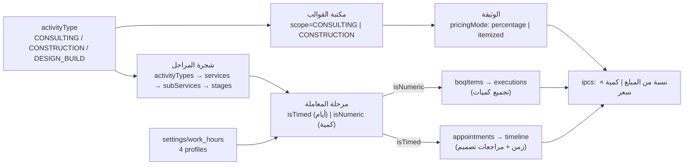
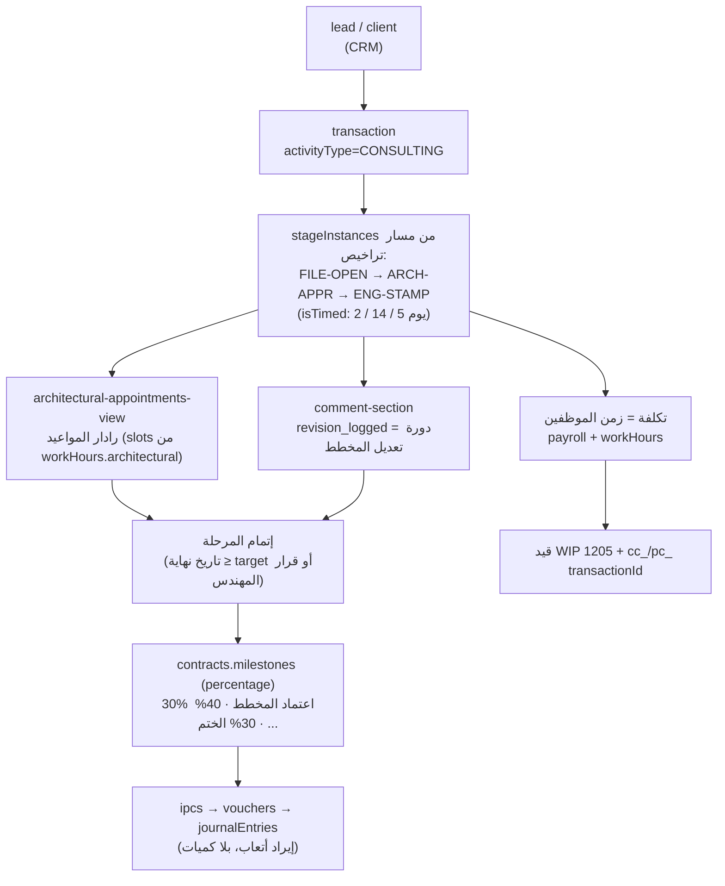
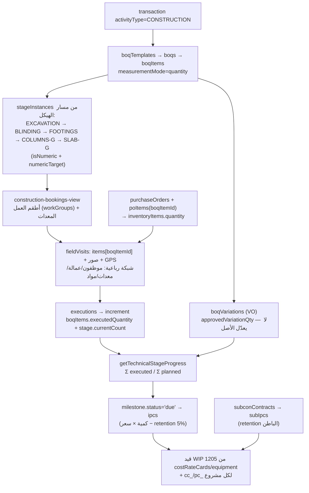
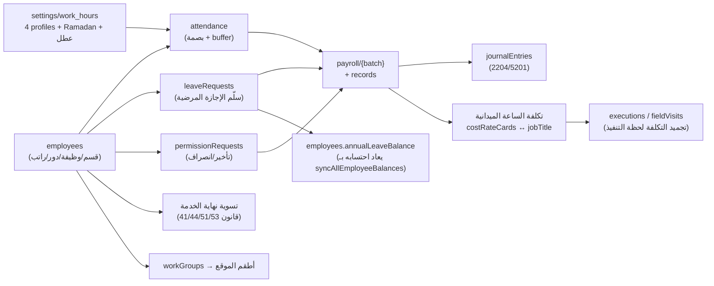

# خريطة الموديولات — شرح كامل للعلاقات داخل NovaFlow ERP 🧩

> **السؤال الذي تجيبه هذه الوثيقة**: كيف ينفصل «التصميم والاستشارات» عن «المقاولات» عن «الموارد البشرية»، وما الذي يشتركون فيه، وما هي العلاقات التي تعبر بين هذه العوالم الثلاثة؟
>
> للرجوع التفصيلي إلى كل حقل وكل رابط: [`docs/relationships.md`](relationships.md) — وللتحقق الآلي: `npm run check:relations`.

---

## ١. الحقيقة الأولى: النظام لا ينفصل بالكود، بل بالبيانات

لا يوجد في قاعدة البيانات أي حقل اسمه `vertical` أو `moduleType`. الفصل يُشتق لحظة القراءة من **خمسة مفاتيح بيانات**:

| # | المفتاح | أين يسكن | القيم | ماذا يقرّر |
| :-- | :--- | :--- | :--- | :--- |
| 1 | `activityTypeId` + كود النوع | `transactions` / القوالب | `CONSULTING` · `CONSTRUCTION` · `DESIGN_BUILD` (من `src/lib/seed-data.ts`) | أي شجرة مراحل وأي قوالب وأي رحلة عمل |
| 2 | `pricingMode` | `quotations` / `contracts` | `percentage` · `fixed` · `itemized` | نسبة مئوية على مبلغ كلي (استشارات) مقابل بنود مبلغة (مقاولات) |
| 3 | `measurementMode` | `boqs` / `boqTemplates` | `lumpsum` · `quantity` · `hybrid` | هل يوجد جدول كميات أصلاً |
| 4 | `isTimed` / `isNumeric` + `allowedDepartmentIds` | `technicalStages` / `transactionStages` | زمن بالأيام مقابل مستهدف كمّي | كيف يُقاس إنجاز المرحلة ومتى تُغلق |
| 5 | `general` / `architectural` / `fieldWork` / `meetingRooms` | `settings/work_hours` | 4 جداول زمنية في مستند واحد | أي «ساعة عمل» تُطبّق على أي موظف |



**خلاصة عملية**: الموديولات الثلاثة ليست تطبيقات منفصلة، بل **ثلاث ركوب مختلفة على نفس المحركات** — المحرك نفسه (`transactions` + `stageInstances` + `contracts.milestones` + `journalEntries`) يتصرّف كـ«أتعاب استشارية» أو «مقايسة تنفيذ» حسب المفاتيح الخمسة.

---

## ٢. خريطة التوزيع (76 مجموعة × 5 موديولات)

| الموديول | id | مجموعات تخصه | منها حصري له |
| :--- | :--- | ---: | ---: |
| الاستشارات الهندسية والتصميم | `consulting` | 26 | 0 |
| المقاولات والإنشاءات | `construction` | 48 | 8 |
| تصميم وإنشاء (Design & Build) | `hybrid` | 27 | 0 |
| الموارد البشرية والامتثال | `hr` | 14 | 7 |
| اللب المشترك (Shared Core) | `core` | 43 | 16 |

### ٢.١ مصفوفة العضوية (✓ = تُستخدم داخل الموديول، ● = حصرية له)

| المجموعة | استشارات | مقاولات | D&B | HR | اللب المشترك | الغرض المختصر |
| :--- | :---: | :---: | :---: | :---: | :---: | :--- |
| `company` |  |  |  |  | ● | جذر المستأجر: كل مجموعة داخل companies/{companyId} مملوكة له · `companies/{companyId}` |
| `company_requests` |  |  |  |  | ● | طابور طلبات التأسيس خارج نطاق المستأجر؛ يفعّله المطور فينشئ companies + roles + departments + jobs + employees + global_users · `company_requests/{requestId}` |
| `counters` |  |  |  |  | ● | مولّد الأرقام التسلسلية الآمن (JV-/RV-/PV-/PO-/BOQ-/IPC-/C-...) · `companies/{companyId}/counters/{counterKey}` |
| `globalUser` |  |  |  |  | ● | الهوية العالمية الوحيدة لكل مستخدم: uid → companyId + roleId + employeeId + departmentId + roleCode · `global_users/{uid}` |
| `invitations` |  |  |  |  | ● | دعوة للانضمام داخل المنشأة؛ تُقبل عبر /join/{companyId}/{inviteId} وتكتب global_users + companies/{c}/users · `companies/{companyId}/invitations` |
| `users` |  |  |  |  | ● | مرآة العضوية المحلية داخل المنشأة؛ تُكتب مع global_users في batch واحد — غير معلنة في multi-tenant.ts · `companies/{companyId}/users/{uid}` |
| `areas` |  |  |  |  | ● | مناطق داخل المحافظة: governorateId + مسار Firestore فرعي · `companies/{companyId}/governorates/{govId}/areas` |
| `costTypeCategories` |  |  |  |  | ● | معرّفة في paths فقط — لا استخدام لها حالياً · `companies/{companyId}/costTypeCategories` |
| `customReferenceItems` |  |  |  |  | ● | عناصر القوائم المخصصة؛ تُحلّ نفس نوع القوائم القياسية في ReferenceListService · `companies/{companyId}/customReferenceLists/{code}/items/{itemId}` |
| `customReferenceLists` |  |  |  |  | ● | تعريفات القوائم المرجعية المخصصة (نظام مفتوح للتوسّع) · `companies/{companyId}/customReferenceLists/{code}` |
| `departments` |  |  |  | ✓ | ✓ | أقسام المنشأة؛ مصدر scope='dept' في محرك الصلاحيات · `companies/{companyId}/departments` |
| `governorates` |  |  |  |  | ● | محافظات الكويت المرجعية (جذر شجرة الموقع) · `companies/{companyId}/governorates` |
| `itemCategories` |  | ✓ |  |  | ✓ | معرّفة في paths فقط — تُستخدم كمرجع allowedItemCategoryIds في بنود BOQ · `companies/{companyId}/itemCategories` |
| `jobs` |  |  |  | ✓ | ✓ | المسميات الوظيفية داخل القسم، تحمل roleId + hourlyCost (مرجع التكلفة) · `companies/{companyId}/departments/{deptId}/jobs` |
| `meetingRooms` | ✓ |  |  |  | ✓ | قاعات/صالة المكتب — تُستخدم كـ hallId في المواعيد وكمصدر جدول مواعيد العمل meetingRooms · `companies/{companyId}/meetingRooms` |
| `milestoneTimingTypes` |  |  |  |  | ● | معرّفة في paths فقط — التوقيت فعلياً enum MilestoneTiming في types/templates.ts · `companies/{companyId}/milestoneTimingTypes` |
| `paymentConditionTypes` | ✓ |  |  |  | ✓ | معرّفة في paths فقط — لا يوجد لها استخدام بعد (انظر gaps) · `companies/{companyId}/paymentConditionTypes` |
| `paymentMethods` |  |  |  |  | ● | قائمة طرق الدفع المرجعية؛ يُشار إليها بالكود لا بالمعرّف · `companies/{companyId}/paymentMethods` |
| `roles` |  |  |  |  | ● | مصفوفة الصلاحيات matrix[{resourceId,action,scope}] — تحكم الوصول داخل المنشأة؛ roleCode يُطابق القواعد الأمنية · `companies/{companyId}/roles` |
| `serviceTypes` |  |  |  |  | ● | تصنيف الخدمات العام (moduleScope) — مستقل عن شجرة activityTypes · `companies/{companyId}/serviceTypes` |
| `settings` | ✓ | ✓ |  | ✓ | ✓ | مستند إعدادات ساعات العمل/رمضان/العطل · `companies/{companyId}/settings/work_hours` |
| `unitTypes` |  | ✓ |  |  | ✓ | وحدات القياس (m²، يوم، عدد) referenced by BOQ nodes · `companies/{companyId}/unitTypes` |
| `activityTypes` | ✓ | ✓ | ✓ |  | ✓ | جذر الشجرة الوظيفية: نوع النشاط (عزل، مقاولات، تصميم...) · `companies/{companyId}/activityTypes` |
| `services` | ✓ | ✓ | ✓ |  | ✓ | خدمة داخل نوع النشاط — مجموعة فرعية Firestore تحت activityTypes/{actId}/services · `companies/{companyId}/activityTypes/{actId}/services` |
| `subServices` | ✓ | ✓ | ✓ |  | ✓ | خدمة فرعية: المستوى الذي تُربط به القوالب والمراحل · `companies/{companyId}/activityTypes/{actId}/services/{srvId}/subServices` |
| `technicalStages` | ✓ | ✓ | ✓ |  | ✓ | قالب المرحلة الفنية: isNumeric/numericTarget، isTimed/timeTargetDays، nextStageIds (DAG)، billableTrigger + milestoneKey للفوترة · `companies/{companyId}/activityTypes/{actId}/services/{srvId}/subServices/{subId}/stages` |
| `clientHistory` | ✓ | ✓ |  |  | ✓ | سجل تدقيق لكل عميل (تغيير حالة/ملاحظة/إسناد مهندس/إنشاء معاملة) كمجموعة فرعية تحت العميل · `companies/{companyId}/clients/{clientId}/history` |
| `clients` | ✓ | ✓ | ✓ |  | ✓ | ملف العميل الموحد برقم سيادي C-0001/YYYY عبر counters؛ يحمل المهندس المسؤول + الموقع + القسم · `companies/{companyId}/clients` |
| `leads` |  |  |  |  | ● | فرص المبيعات قبل التحويل إلى عميل (لا يوجد كيان TypeScript بعد) · `companies/{companyId}/leads` |
| `executions` |  | ✓ | ✓ |  |  | سطر تنفيذ مسطّح (وليس subgroup): الكميات + العمالة + المعدات + التكلفة المجمّدة، ويُرجّح به بند المقايسة · `companies/{companyId}/executions` |
| `transactionComments` | ✓ | ✓ |  |  | ✓ | نقاش المعاملة (تعليقات وردود parentCommentId، تثبيت، أرشفة) مرتبط أحياناً بموعد أو مرحلة · `companies/{companyId}/transactions/{tId}/comments` |
| `transactionStages` | ✓ | ✓ | ✓ |  | ✓ | نسخة مراحل المعاملة من القالب الفني؛ تتقدم بالمواعيد والزيارات وتُغلق المراحل لإطلاق الفوترة · `companies/{companyId}/transactions/{tId}/stageInstances` |
| `transactionTimeline` | ✓ | ✓ | ✓ |  | ✓ | شريط الأحداث الموحد لكل معاملة — تكتبه 6 خدمات مختلفة (أتمتة مالية، إنجاز، VO، مراجعات تصميم) · `companies/{companyId}/transactions/{tId}/timeline` |
| `transactions` | ✓ | ✓ | ✓ |  | ✓ | النواة التشغيلية: معاملة العميل (عملياً هي 'المشروع') · `companies/{companyId}/transactions` |
| `contracts` | ✓ | ✓ | ✓ |  | ✓ | العقد الرسمي: milestones مرتبطة بالمراحل الفنية + retentionRate + دفعة مقدمة؛ بوّابة الفوترة والذمم · `companies/{companyId}/contracts` |
| `quotations` | ✓ | ✓ | ✓ |  | ✓ | عرض سعر مُنشأ من قالب؛ يتحول إلى عقد بنفس البنية (items → milestones) · `companies/{companyId}/quotations` |
| `subconContracts` |  | ● |  |  |  | عقد مقاول باطن: نفس منطق الـ milestones لكن بحسابات مستحقات ومحتجزات خاصة بالباطن · `companies/{companyId}/subconContracts` |
| `boqReferenceNodes` | ✓ | ✓ | ✓ |  |  | القاموس الهندسي الموحد (شجرة بنود العمل): المصدر الوحيد لأكواد وأوصاف وأسرار البنود في كل النظام · `companies/{companyId}/boqReferenceNodes` |
| `boqTemplateItems` |  | ✓ | ✓ |  |  | بنود القالب مع shجرة ancestorIds وروابط boqReferenceNodeId/technicalStageId/unitTypeId · `companies/{companyId}/boqTemplates/{templateId}/items` |
| `boqTemplates` | ✓ | ✓ | ✓ |  |  | قالب جدول كميات قابل لإعادة الاستخدام؛ يُستنسخ إلى boqs/{id}/items عند التفعيل · `companies/{companyId}/boqTemplates` |
| `contractTemplates` | ✓ | ✓ |  |  | ✓ | قالب عقد: بنود قانونية + defaultMilestones + retentionRate + boqTemplateId · `companies/{companyId}/contractTemplates` |
| `quotationTemplates` | ✓ | ✓ |  |  | ✓ | قالب عرض سعر مربوط بنشاط/خدمة/خدمة فرعية + boqTemplateId اختياري · `companies/{companyId}/quotationTemplates` |
| `subconContractTemplates` |  | ● |  |  |  | قالب عقد باطن محدد بالتخصص (trade) · `companies/{companyId}/subconContractTemplates` |
| `boqItems` |  | ✓ | ✓ |  |  | بند مقايسة: 6 عدادات كمية (contract/planned/approvedVariation/executed/verified/billed) + رابط مرحلة + رابط باطن · `companies/{companyId}/boqs/{boqId}/items` |
| `boqVariationItems` |  | ✓ | ✓ |  |  | بنود الأمر التغييروي؛ عند الاعتماد تُضاف إلى approvedVariationQty للبند الأصلي · `companies/{companyId}/boqs/{boqId}/variations/{voId}/items` |
| `boqVariations` |  | ✓ | ✓ |  |  | الأمر التغييروي (VO) على المقايسة: draft → approved/rejected، لا يعدّل الأصل بل يضيف · `companies/{companyId}/boqs/{boqId}/variations` |
| `boqs` |  | ✓ | ✓ |  |  | مقايسة المعاملة الفعلية (boqNumber آلي BOQ-YYYY-0001) — حلقة الوصل بين العقد والتنفيذ والفوترة · `companies/{companyId}/boqs` |
| `appointments` | ✓ | ✓ | ✓ |  |  | موعد (عميل/موقع/قاعة/حظر) مربوط بعميل + معاملة + مرحلة + قاعة + مهندس(ين) — يحرّك إتمام المراحل · `companies/{companyId}/appointments` |
| `fieldVisits` |  | ✓ | ✓ |  |  | زيارة ميدانية بشبكة رباعية (موظفون/عمالة/معدات/مواد) + صور + GPS؛ اعتمادها يولّد قيد WIP · `companies/{companyId}/fieldVisits` |
| `workGroups` |  | ✓ | ✓ | ✓ |  | طاقم عمل ميداني: مشرف + أعضاء (employees) + قسم — وحدة الإسناد في الزيارات · `companies/{companyId}/workGroups` |
| `applications` |  |  |  | ● |  | طلبات التوظيف (recruitment pipeline) — لا يوجد لها TypeScript type بعد · `companies/{companyId}/applications` |
| `attendance` |  |  |  | ● |  | سجل بصمة يومي (checkIn/out ×2) محسوب مقابل إعدادات ساعات العمل والراحة والإجازات · `companies/{companyId}/attendance` |
| `employeeAuditLogs` |  |  |  | ● |  | تتبع حقل-بحقل لتغييرات ملف الموظف · `companies/{companyId}/employees/{employeeId}/auditLogs` |
| `employees` |  |  |  | ✓ | ✓ | السجل الموحد للقوى العاملة (داخلي/خارجي): قسم + وظيفة + دور + راتب + رصيد إجازات · `companies/{companyId}/employees` |
| `leaveRequests` |  |  |  | ● |  | طلب إجازة بمراحل (pending→approved→commenced→returned) + سلّم sickness tiers القانوني · `companies/{companyId}/leaveRequests` |
| `payroll` |  |  |  | ● |  | مسير راتب شهري؛ سجلات الموظفين في مجموعة فرعية records تحت نفس المستند · `companies/{companyId}/payroll` |
| `payrollRecords` |  |  |  | ● |  | سجلات راتب الموظف داخل المسير — يولّدها payroll-service بنسخة مجمّدة من بيانات الموظف · `companies/{companyId}/payroll/{batchId}/records/{recordId}` |
| `permissionRequests` |  |  |  | ● |  | طلب إذن تأخير/انصراف مبكر — يُحتسب في تسوية الرواتب · `companies/{companyId}/permissionRequests` |
| `assetAssignments` |  | ✓ |  | ✓ |  | العهدة الفعلية (صرف/استرجاع) للموظف — تعدّل رصيد الصنف في المخزون · `companies/{companyId}/assetAssignments` |
| `equipment` |  | ✓ | ✓ |  |  | سجل الآليات: ملكية/تمويل/تأمين/فحص + أساس الاستهلاك hourlyDepreciationRate المُغذّي لتكلفة الاستخدام · `companies/{companyId}/equipment` |
| `equipmentAssignments` |  | ● |  |  |  | مجموعة معرّفة في paths وغير مستخدمة؛ التوزيع الفعلي يسجَّل في assetAssignments (انظر gaps) · `companies/{companyId}/equipmentAssignments` |
| `inventoryItems` |  | ● |  |  |  | أصناف المخزون برصيد quantity يُزاد/يُنقص آلياً من PO والعهدة · `companies/{companyId}/inventoryItems` |
| `inventoryTransactions` |  | ● |  |  |  | مجموعة حركة مخزون معرّفة في paths ولا تُكتب منها أي موضع — الحركات حالياً ضمن assetAssignments فقط (انظر gaps) · `companies/{companyId}/inventoryTransactions` |
| `warehouses` |  | ● |  |  |  | المستودعات — حاويات منطقية للأصناف · `companies/{companyId}/warehouses` |
| `poItems` |  | ✓ | ✓ |  |  | بنود أمر الشراء: تربط الصنف ببند مقايسة ومرحلة فنية (جوهر مقارنة المشتري بالمنفذ) · `companies/{companyId}/purchaseOrders/{poId}/items` |
| `purchaseOrders` |  | ✓ | ✓ |  |  | أمر شراء PO-YYYY-0001 بحالة تدفق (draft→approved→ordered→received) — أساس الاستلام في المخزن · `companies/{companyId}/purchaseOrders` |
| `subcontractors` |  | ✓ | ✓ |  |  | مقاولو الباطن بالتخصص والتقييم — يظهرون في البنود والمراحل والتنفيذ والـ SIPs · `companies/{companyId}/subcontractors` |
| `suppliers` |  | ● |  |  |  | سجل الموردين المعتمدين (يظهر أيضاً كموردي معدات في equipment.supplierId) · `companies/{companyId}/suppliers` |
| `accounts` | ✓ | ✓ |  |  | ✓ | دليل الحسابات الشجري لكل منشأة؛ حسابات العملاء/WIP تُنشأ آلياً تحت 1202 و1205 · `companies/{companyId}/accounts` |
| `costCenters` | ✓ | ✓ |  |  | ✓ | بُعد تحليلي للتكلفة؛ للمعاملات مراكز حتمية cc_{transactionId} · `companies/{companyId}/costCenters` |
| `costRateCards` |  | ✓ | ✓ | ✓ |  | جدول تعرفة العمالة الساري؛ يغذّي تكلفة الساعة في التنفيذ والزيارات · `companies/{companyId}/costRateCards` |
| `ipcs` | ✓ | ✓ | ✓ |  |  | مستخلص المالك: gross − retention(5%) = netPayable؛ مولّد آلياً من إتمام المراحل · `companies/{companyId}/ipcs` |
| `journalEntries` | ✓ | ✓ |  |  | ✓ | قيد مزدوج متوازن وجوباً؛ مصدر sourceType+sourceId يوثّق أي عملية تشغيلية ولدته · `companies/{companyId}/journalEntries` |
| `profitCenters` | ✓ | ✓ |  |  | ✓ | بُعد تحليلي للربحية؛ pc_{transactionId} لكل معاملة/مشروع · `companies/{companyId}/profitCenters` |
| `subIpcs` |  | ● |  |  |  | مستخلص الباطن بنفس المنطق مع نسبة محتجزات عقد الباطن · `companies/{companyId}/subIpcs` |
| `vouchers` | ✓ | ✓ |  |  | ✓ | سند قبض/صرف مرتبط تلقائياً بقيد محاسبي في نفس الـ batch · `companies/{companyId}/vouchers` |

---

## ٣. موديول الاستشارات الهندسية `consulting`

### ٣.١ رحلة العمل كما ينفذها الكود



### ٣.٢ الكيانات التي يعيش فيها الموديول

| المجموعة | الدور داخل موديول الاستشارات |
| :--- | :--- |
| `transactions` | الحاضنة: معاملة «أتعاب تصميم/إشراف/ترخيص». هي نفسها جدول المشاريع لكن بمسار زمني. |
| `transactionStages` | المراحل الزمنية (FILE-OPEN · ARCH-APPR · ENG-STAMP) — الإغلاق بالأقدمية والقرار، لا بالكمية. |
| `technicalStages` | قالب المسار: `isTimed=true` + `timeTargetDays` + `allowedDepartmentIds` (القسم المعماري). |
| `appointments` | رادار المواعيد المعماري: توليد slots من `workHours.architectural` + منع تعارض نفس المهندس. |
| `meetingRooms` | قاعات الاجتماعات مع العميل (`hallId`) — تُستثنى من الرادار بنوع `hall_meeting`. |
| `transactionTimeline` | سجل `revision_logged` = دورة مراجعة المخطط (V1→V2→V2) — عملة التسليم المكتبية. |
| `transactionComments` | نقاش فني مثبّت على المرحلة، ومفلتر بـ `technicalStageId`. |
| `quotations / contracts` | `pricingMode='percentage'` — الدفعات نسب من الأتعاب الإجمالية، وشرطها اعتماد مرحلة فنية. |
| `quotationTemplates / contractTemplates` | قوالب `?scope=CONSULTING` (نصوص قانونية + جدول أتعاب، لا بنود كميات). |
| `boqTemplates / boqReferenceNodes` | اختياري: مقايسة `lumpsum` لخدمات المكتب (بنود مقطوعية لا مقاس). |
| `clients / clientHistory` | حالة العميل + سجل إسناد المهندس المسؤول (`assignedEngineerId`). |
| `ipcs` | مطالبات أتعاب: بدون retention عملياً، وبلا lineItems كمّية. |
| `journalEntries / accounts` | إيراد الاستشارات تحت 4101 + ذمم العميل 1202 (يُنشأ آلياً عند اعتماد العقد). |
| `employees` | المهندس المعماري: وقته هو المورد الإنتاجي؛ `jobTitle` يحمل «معماري» فيُصنَّف للرادار. |
| `settings (work_hours)` | profile `architectural` + `meetingRooms` (slot 30 دقيقة / راحة 5) — يختلف عن العام. |
| `attendance / leaveRequests` | تؤثر على توفر المهندس في الرادار (منع حجز موعد لمهندس في إجازة). |

### ٣.٣ ما الذي لا يفعله موديول الاستشارات
- **لا** `executions` ولا `boqItems.executedQuantity` — لا يوجد «منفَّذ كمّي»، فالقياس زمني.
- **لا** `purchaseOrders` / `inventoryItems` / `subcontractors` — المكتب لا يشتري مواد ولا يوظّف باطناً (إلا في D&B).
- **لا** `fieldVisits` ولا `workGroups` ولا `equipment` — لا شبكة موارد ميدانية.
- النتيجة: التكلفة تُحسب من الرواتب، والربحية = أتعاب − زمن (تقريبية حالياً، انظر §7).

---

## ٤. موديول المقاولات والإنشاءات `construction`

### ٤.١ رحلة العمل كما ينفذها الكود



### ٤.٢ الكيانات التي يعيش فيها الموديول

| المجموعة | الدور في المقاولات | مفتاح الربط الحاسم |
| :--- | :--- | :--- |
| `boqs / boqItems` | جدول الكميات الحي: 6 عدّادات لكل بند (contract / planned / executed / verified / approvedVariation / billed). | `boqItems.transactionId` → المعاملة |
| `boqVariations / boqVariationItems` | الأوامر التغييرويّة: تضيف `approvedVariationQty` وتحقن مراحل جديدة (`originType=temporary_vo`). | `sourceBoqItemId` |
| `executions` | سطر تنفيذ واحد = كمية + عمالة + معدات بتكلفة مجمّدة لحظة التنفيذ. | `boqItemId` + `stageInstanceId` |
| `fieldVisits` | الإثبات الميداني: صور + GPS + شبكة رباعية، واعتمادها المالي يولّد قيد WIP. | `transactionId` + `items[].boqItemId` |
| `transactionStages` | مراحل كمّية: `currentCount` يُرجَّح بـ increment وتُغلق عند بلوغ `numericTarget`. | `technicalStageId` |
| `workGroups` | طاقم العمل: مشرف + أعضاء + قسم — وحدة الإسناد في الزيارة. | `memberIds[]` → employees |
| `costRateCards` | جدول تعرفة العمالة (jobTitle → hourlyCost): المصدر الوحيد لسعر الساعة. | `laborRates[].jobTitle` |
| `equipment / assetAssignments` | سجل الآليات والعهدة: `hourlyDepreciationRate` أو `hourlyRentalRate` يصبح تكلفة استخدام. | `equipmentUsed[].equipmentId` |
| `purchaseOrders / poItems` | أمر الشراء مربوط ببند المقايسة والمرحلة = أساس تحليل انحراف المواد. | `poItems[].boqItemId` |
| `suppliers / subcontractors / subconContracts / subIpcs` | سلسلة الباطن: عقد ← تنفيذ ← مستخلص بمحتجزات خاصة. | `subcontractorId` |
| `warehouses / inventoryItems / inventoryTransactions` | المخزون ورصيده (المجموعة الأخيرة معلَّنة بلا استخدام — G3). | `itemId` |
| `ipcs` | مستخلص المالك: كمية معتمدة × سعر البند − retention (5%) − استرداد دفعة مقدمة. | `contractId` + `lineItems[].boqItemId` |
| `journalEntries / costCenters` | تكلفة مباشرة: WIP مدين / مستحقات دائن، وتحليل على `cc_{transactionId}`. | `referenceId = transactionId` |
| `attendance / payroll` | أجور الموقع اليومية تدخل المسير، والمسير يولّد قيد 2204. | `payrollRecords.employeeId` |

### ٤.٣ الفرق البنيوي عن الاستشارات (وليس مجرد مسميات)
| البند | الاستشارات | المقاولات |
| :--- | :--- | :--- |
| وحدة القياس | يوم/قطعي (`LS`) | m² · m³ · طن · م.طولي (`unitTypes` من seed) |
| عدّاد الإنجاز | تاريخ + قرار (`isTimed`) | `currentCount ≥ numericTarget` |
| الإيراد | نسبة من أتعاب | كمية × سعر بند |
| التكلفة | رواتب مكتبية | عمالة + معدات + مواد |
| الرقابة | دورات مراجعة المخططات | انحراف مُشترى/منفّذ + محتجزات |
| الوثيقة | `pricingMode=percentage` | `pricingMode=itemized` + `measurementMode=quantity` |
| المخاطر | تأخر اعتمادات بلدية | تجاوز كميات، أوامر تغييروي، هدر مواد |

---

## ٥. موديول التصميم والتنفيذ `hybrid` (D&B) — الجسر

أخطر الموديولات لأنه يجمع المحركين على **معاملة واحدة**: `DB-VILLA-01` يمرّ بمراحل زمنية (`DB-CONCEPT`, `DB-DESIGN`, `DB-PERMIT`) ثم بمراحل كمّية/ميدانية (`DB-STRUCTURE`).

علاقاته الخاصة التي يجب فهمها:
- **مرحلة واحدة بنفس المحرك لكن بنمطين**: `isTimed` للتصميم، `isNumeric` للتنفيذ — لذا لا يمكن افتراض «المرحلة = كمية» في أي كود مشترك.
- **قالب واحد للعقد** مع `milestones[]` مختلطة: دفعة عند اعتماد المخطط (نسبة) + دفعات عند صبّ السقف (كميات).
- **الربط الذي يمنع الضياع**: `boqs.transactionId` و`contracts.transactionId` و`executions.transactionId` كلها نفس المعاملة — لذا تكلفة المكتب وتكلفة الموقع تلتقيان في نفس `cc_{transactionId}` / `pc_{transactionId}`، وتظهر الربحية موحّدة في `analytics-service`.
- **أول ما ينكسر هنا**: `ProjectService` (فلترة `'مقاولات'`) **لا يرى** معاملات D&B لأن اسم نشاطها «تصميم وإنشاء» — انظر G2 وG11: معاملة D&B محجوبة عن شاشة المشاريع والتحليلات.

---

## ٦. موديول الموارد البشرية `hr` — عمود خدمي، لا جزيرة



| العلاقة | نوعها | لماذا هي مهمة بين الموديولات |
| :--- | :--- | :--- |
| `Employee.jobTitle` ⇄ `CostRateCard.laborRates[].jobTitle` | مطابقة نصية (لا معرّف!) | تحوّل الموظف إلى **سعر ساعة** يدخل تكلفة المشروع — وأي تغيير مسمى يكسر التكلفة بصمت |
| `Employee.departmentId` → `scope='dept'` | صلاحية | يحدّد مَن يرى بيانات مَن داخل كل موديول |
| `attendance` + `leaveRequests` → `PayrollRecord.deductions` | تجميع ∑ | الرقابة القانونية على الخصم (ساعة سماحية، سلّم المرضية) |
| `payroll.accountingJournalId` → `journalEntries` | مُطلِق ⚡ | الرواتب تُغلَق في الدفاتر آلياً |
| `global_users.employeeId` → `employees` | هوية | يجعل «المستخدم» هو «الموظف»: أساس `scope='own'` والمرجعيات `engineerId` |
| `workGroups.memberIds[]` → `employees` | مجموعة | تحديد من يُسمح له بتسجيل تنفيذ ميداني |
| `settings/work_hours.holidays/ramadan` | قالب | يغيّر حساب `workingDays` في الإجازات وفيslots المواعيد معاً |

**نقطة تصميم مهمة**: HR لا يعرف المشاريع، لكن المشاريع تعرف HR. لهذا لا يوجد أي حقل `transactionId` في `payroll` — التكلفة تُنسَّب لاحقاً في `executions` (مَن عمل ومتى)، لا في المسير.

---

## ٧. اللب المشترك `core` — ما لا يملكه أي موديول

| الطبقة | المجموعات | القاعدة السيادية |
| :--- | :--- | :--- |
| الهوية والتأجير | `company` · `globalUser` · `users` · `invitations` · `company_requests` · `counters` | كل مستند يحمل `companyId`؛ مرآة `users` تُكتب مع `global_users` في batch واحد |
| الصلاحيات | `roles` (matrix: resourceId/action/scope) | `resourceId` من `SYSTEM_RESOURCES` فقط — 12 مورداً، **لا مورد واحد لكل موديول رأسي** (انظر §8) |
| الجغرافيا والقوائم | `governorates` · `areas` · `unitTypes` · `paymentMethods` · `customReferenceLists` · `serviceTypes` | `ReferenceListService` يحلّ النوع ديناميكياً: `paths` أو `customReferenceLists/{code}/items` |
| الكتالوج الهندسي | `activityTypes` → `services` → `subServices` → `stages` | الشجرة واحدة لكل الموديولات؛ الفرق في **الخصائص** لا في الفروع |
| العملاء | `clients` · `clientHistory` · `leads` | `clients.status=contracted` يُكتب من `document-service` لا من شاشة العميل |
| المعاملة | `transactions` · `transactionStages` · `transactionTimeline` · `transactionComments` | المجرى الموحد لكل الأحداث: أي موديول يترك أثراً هنا |
| الوثائق | `quotations` · `contracts` · 4 أنواع قوالب | `templateId` بوليمورفي؛ التحويل من عرض إلى عقد ينسخ البنود إلى milestones |
| المال | `accounts` · `journalEntries` · `vouchers` · `ipcs` · `costCenters` · `profitCenters` | حارس التوازن في `AccountingService` فقط؛ القيد يُنسب لمصادره بـ `sourceType`+`sourceId` |

---

## ٨. التقاطعات: العلاقات التي تعبر بين الموديولات

| # | من ← إلى | الآلية | الملفات الحاسمة | المخاطرة عند التعطّل |
| :-- | :--- | :--- | :--- | :--- |
| 1 | تنفيذ ميداني ← محاسبة | `fieldVisits` معتمدة ⇒ حساب WIP تحت 1205 + قيد | `field-visit-service.ts:100-135` | تكلفة المشروع تُقرأ ناقصة |
| 2 | مراحل ← فوترة | `milestoneKey` / `linkedStageInstanceId` ⇒ `status='due'` ⇒ `ipcs` | `billing-service.ts` · `billing-trigger-service.ts` (ميت) | مستخلصات لا تصدر بصمت (G8) |
| 3 | مقايسة ← مشتريات | `poItems.boqItemId` ⇒ مقارنة مُشترى/منفّذ | `boq-inventory-link-service.ts` | معطّل فعلياً الآن (G1) |
| 4 | مقايسة ← أوامر تغييروي | VO ⇒ `approvedVariationQty` + حقن مراحل | `variation-service.ts:194-240` | إيراد مضاف بلا مقابل تنفيذي |
| 5 | عقد ← ذمم العملاء | `createAutomaticSubAccount('1202', clientId)` | `document-service.ts:57-70` | كشف عملاء بلا رصيد |
| 6 | HR ← تكلفة المشروع | `jobTitle` ⇄ `laborRates` ⇒ `hourlyCostRef` | `payroll-service.ts` · `boq-execution-service.ts` | تكلفة خاطئة لكل المشاريع القديمة |
| 7 | HR ← محاسبة | `payroll` ⇒ `journalEntries` (2204/5201) | `payroll-service.ts:20` | المسير لا يظهر في القوائم |
| 8 | عقد باطن ← باطن/تنفيذ | `StageInstance.subcontractorId` + `boqItems.subcontractorId` ⇒ `subIpcs` | `billing-service.generateSubcontractorIPC` | مستحقات باطن بلا مصدر كمّي |
| 9 | مواعيد ← مراحل | `Appointment.stageId` + `startedByApptId`/`completedByApptId` | `appointment-service.ts` · `comment-section.tsx` | مراحل تُغلق بلا أثر زمني |
| 10 | صلاحيات ← كل شيء | `roles.matrix[].resourceId` + `scope` ⇒ فلترة الواجهة | `permissions/catalog.ts` · `engine.ts` | تسرّب بيانات بين الأقسام |

---

## ٩. التقسيم المقترح (تنفيذ على 3 مراحل، بلا كسر للتوافق)

### المرحلة 1 — وسم البيانات (قراءة فقط، لا سلوك)
1. أضف `vertical: 'consulting' | 'construction' | 'hybrid'` إلى **`activityTypes`** (جذر الشجرة) — حقل واحد هناك يرثه كل شيء عبر `transactions.activityTypeId`.
2. أضف `vertical` إلى `departments` و`jobs` (لتصنيف الطاقم بدل مطابقة النصوص).
3. املأهما من `settings/checklists/technical-paths` و`settings/checklists/departments` (نفس الشاشات، حقل اختيار واحد).

### المرحلة 2 — مرجع واحد للفصل
`src/lib/verticals.ts` يقترح أن يكون المرجع الوحيد:

```ts
export type Vertical = 'consulting' | 'construction' | 'hybrid';
// يقرأ activityType.vertical أولاً، ويسقط للتوافق على المطابقة النصية القديمة
export function resolveTransactionVertical(t: { activityTypeId?: string; activityTypeName?: string }, types: ActivityType[]): Vertical;
export function resolveStaffVertical(e: { departmentId?: string; jobTitle?: string }, departments: Department[], jobs: Job[]): Vertical;
export const isConstructionPortfolio = (v: Vertical) => v === 'construction' || v === 'hybrid';
```

ثم تُستبدل المطابقات الخمس به (هذه هي المواضع الفعلية اليوم):

| الموضع | الكود الحالي | البديل |
| :--- | :--- | :--- |
| `src/services/project-service.ts:39` | `activityTypeName?.includes('مقاولات') \|\| ... 'Construction'` | `resolveTransactionVertical(...)` |
| `src/app/dashboard/projects/page.tsx:49` | نفس المطابقة نصياً | نفس الدالة |
| `src/services/analytics-service.ts:279` | `activityTypeName?.includes('مقاولات')` | نفس الدالة |
| `src/components/appointments/architectural-appointments-view.tsx:231` | `departmentName?.includes('معماري') \|\| 'Arch'` | `resolveStaffVertical(...) === 'consulting'` |
| `src/components/construction/construction-bookings-view.tsx:157` | `jobTitle?.includes('موقع'\|'تنفيذ')` | `resolveStaffVertical(...) === 'construction'` |

### المرحلة 3 — فصل الوصول (اختياري، أقوى الأثر)
- أضف موردين جديدين إلى `SYSTEM_RESOURCES`: `consulting` و`construction`، واجعل `projects` مورداً أباً يُرث منهما.
- اجعل `menuItems` في `src/components/layout/dashboard-sidebar.tsx` تُبنى من المورد: حالياً مجموعة «construction» تستخدم `resource: 'projects'` — أي أن من يملك صلاحية المشاريع يملك الميداني تلقائياً. بعد الفصل يمكن لمكتب الاستشارات إخفاء رادار الموقع والمعدات.
- **تحذير**: لا يُغيَّر أي سلوك قبل إضافة `firestore.rules` طبقة تحقق بالـ vertical وإلا صار الفصل تجميلياً فقط.

---

## ١٠. قرار معماري مفتوح: هل «المشروع» كيان مستقل؟

| الخيار | المزايا | التكاليف |
| :--- | :--- | :--- |
| **A. إبقاء المشروع = معاملة** (الوضع الحالي) | صفر هجرة؛ كل الربط الحالي على `transactionId` يعمل فوراً | تسمية مضلّلة: `projectId` يعني `transactionId` (8 مواضع)، ولا يمكن لمعاملة أن تنتمي لأكثر من نشاط/مجموعة |
| **B. مشروع كيان حقيقي يجمع عدة معاملات** | يعالج D&B فعلياً (تصميم + تنفيذ لمشروع واحد)، وميزانية إجمالية، وربحيتها موحّدة | هجرة `projectId` في 7 مجموعات، وتغيير فلاتر `cc_`/`pc_` وحسابات WIP التي تعتمد `cc_{transactionId}` |

**التوصية**: (A) + إضافة `activityType.vertical` اليوم، والتفكير في (B) فقط عند ظهور «مجمع سكني = 20 معاملة تحت مشروع واحد». السبب: العلاقات المالية (WIP/cc_/pc_) كلها مبنية على `transactionId`، وتحويلها لمسار project يعني إعادة كتابة `accounting-service` و`field-visit-service` و`cost-center` identifiers.

---

## ١١. ماذا يجب أن تتذكر عندما تعدّل

1. **قبل أن تضيف «موديولاً جديداً» اسأل: أي المفتاحين الخمسة يفعّله؟** معظم ما تظنه موديولاً جديداً هو مسار `activityType` جديد + قالب بـ `pricingMode` مختلف.
2. **المراحل هي نقطة الانفصال**: `isTimed` ⇒ زمن، `isNumeric` ⇒ كمية. أي كود يفترض أحدهما يكسر الموديول الآخر.
3. **`transactionStages` ملك المعاملة، `technicalStages` ملك المصنع**: لا تعدّل القالب لإصلاح مشروع — حقن المراحل (VO) هو المسار المشروع.
4. **الموارد تُجمَّد لا تُشار إليها**: لا تقرأ `costRateCards` لاحقاً لحساب تكلفة قديمة — خذ القيمة من `executions.laborDetails[].actualCost`.
5. **الفصل الحالي نصي وهش (G11)**: أي إعادة تسمية لقسم أو نشاط تعني بيانات مخفية عن رادارات وشاشات وتقارير، بلا خطأ ظاهر.
